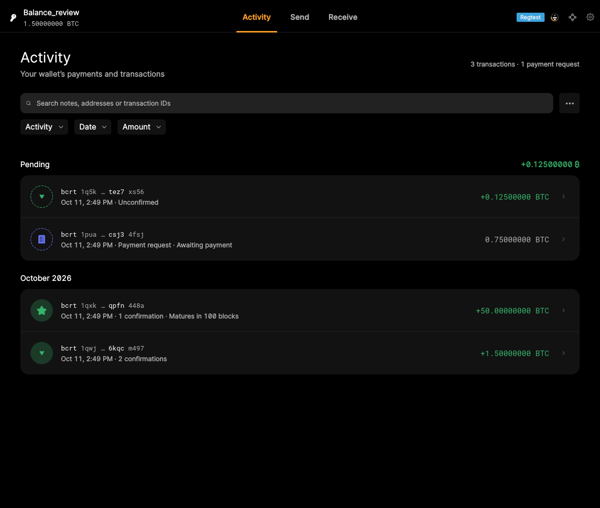
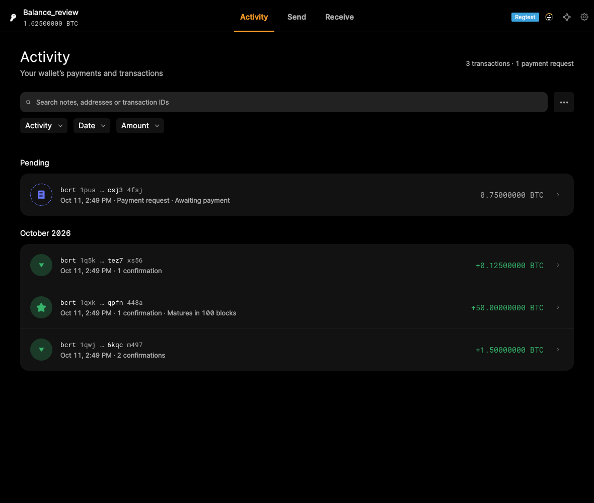
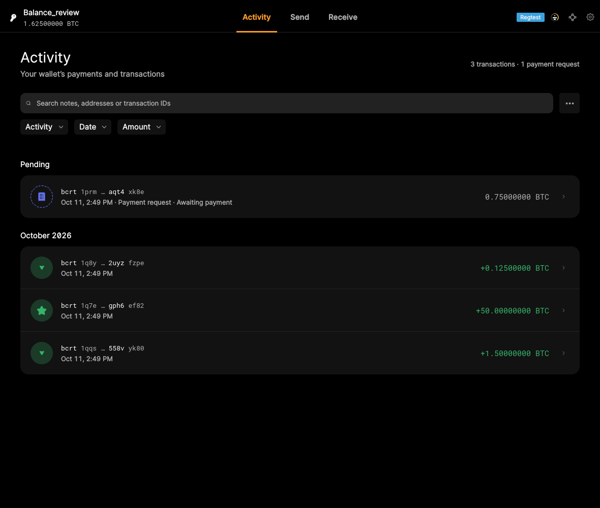

# Pending payments — October 11 verification

**Pending payments are verified.** The unchanged GUI-QML application visibly shows a real incoming wallet transaction under **Pending**, with a **+0.125 BTC** subtotal. The standalone pending-payment test passes all 13 checks.

The combined F07.S01 balance criterion remains partial for a separate, reproduced mining-maturity refresh failure. Its pending-payment behavior no longer needs proof. No application code was changed.

## Verified pending payment

The selected regtest wallet starts with 1.5 BTC available, 0.125 BTC unconfirmed, and a 50 BTC immature mining reward. RPC confirms that the 0.125 BTC transaction is in the mempool. The screenshot shows its **Unconfirmed** explanation and the **Pending** amount, alongside the available wallet balance and the mining reward's maturity explanation.



The unpaid 0.75 BTC payment request appears in the same section but does not increase the Pending subtotal. That subtotal follows activity filters; filtering activity leaves the wallet balance unchanged. Pending covers the selected wallet's unconfirmed activity, not every transaction in the node mempool. This scenario verifies a payment that is actually in the mempool; the section's confirmation-based grouping does not itself guarantee mempool membership.

## Verified confirmation

After mining a block, the transaction leaves the mempool and the Pending section. Its row says **1 confirmation**, the Pending amount disappears, and the available wallet balance increases to **1.625 BTC**. The unpaid request remains visible.



- [Passing functional test](scripts/qml_evidence_pending_balance.py) · [passing log](logs/qml_evidence_pending_balance.log)
- [13 passing assertions](logs/pending-balance-checks.json) · [RPC wallet and mempool state](logs/pending-wallet-state.json) · [GUI bridge trace](logs/qml_evidence_pending_balance.bridge.jsonl)
- [Original screenshot hashes and timestamps](media/qml/qml_evidence_pending_balance/captures.json)

## Separate failure: mining reward maturity

Extending the test by mining the remaining 99 blocks makes the 50 BTC reward spendable. RPC then reports **51.625 BTC available, zero pending and zero immature**. The activity row drops its maturity warning, but the wallet header still shows **1.625 BTC** after a 20-second wait. This was reproduced in two fresh fixtures.



This is an observed display failure, separate from the passing pending-payment checks. The broader balance criterion is therefore partial rather than automatically Accepted. The individual activity explanations also differ from the Widgets four-line balance summary; that layout difference alone is not the reason for the partial assessment.

- [Failing regression script](scripts/qml_evidence_maturity_refresh.py) · [failure log](logs/qml_evidence_maturity_refresh.log)
- [Maturity assertions](logs/maturity-refresh-checks.json) · [RPC balances](logs/maturity-wallet-state.json) · [GUI trace](logs/qml_evidence_maturity_refresh.bridge.jsonl)
- [First reproduction log](logs/initial-maturity-refresh.log) · [first reproduction wallet state](logs/initial-maturity-wallet-state.json)

**Remaining work:** make the displayed wallet balance update when mining rewards mature, then rerun the regression. Do not recollect pending-payment proof unless its behavior changes.

## Modules and automated proof

All source links are pinned to the same GUI-QML revision as the original catalog:

- [ActivityListPage.qml](https://github.com/bitcoin-core/gui-qml/blob/a91f4b4774f25de061fe1a7c132a91ddde117fca/qml/pages/wallet/ActivityListPage.qml#L348): displays the Pending heading and nonzero subtotal.
- [ActivityFilterProxyModel](https://github.com/bitcoin-core/gui-qml/blob/a91f4b4774f25de061fe1a7c132a91ddde117fca/qml/models/activityfilterproxymodel.cpp#L371): sums filtered pending transaction amounts and excludes unpaid requests.
- [TransactionActivityModel](https://github.com/bitcoin-core/gui-qml/blob/a91f4b4774f25de061fe1a7c132a91ddde117fca/qml/models/transactionactivitymodel.cpp#L522): classifies unconfirmed wallet transactions and unpaid requests.
- [ActivityRow.qml](https://github.com/bitcoin-core/gui-qml/blob/a91f4b4774f25de061fe1a7c132a91ddde117fca/qml/pages/wallet/ActivityRow.qml): displays confirmation and maturity explanations.
- [WalletQmlModel](https://github.com/bitcoin-core/gui-qml/blob/a91f4b4774f25de061fe1a7c132a91ddde117fca/qml/models/walletqmlmodel.cpp#L691) and [WalletBadge.qml](https://github.com/bitcoin-core/gui-qml/blob/a91f4b4774f25de061fe1a7c132a91ddde117fca/qml/pages/wallet/WalletBadge.qml): supply and display the wallet balance.
- [All 28 recorded assertions](logs/checks.json): 27 pass; the maturity refresh assertion fails. The maturity scenario repeats the 13 pending checks before exercising maturity; these are not 27 different user features.
- [Existing overview modules and historical automated tests](../../features/07-view-wallet-overview.md#modules) remain available with the unchanged Qt Widgets reference evidence.

## Provenance and reproduction

Application revision: `a91f4b4774f25de061fe1a7c132a91ddde117fca`. Core submodule: `dc282ff31d1cc97507530a541d9cec8a8f6a6ef4`.

Application SHA-256: `a8215c7e45242fdf0e740339733696ec832e362f8306bfbe3bac95dd6bb4fb4c`. Fixture bitcoind SHA-256: `0c2667db4e83a12f89e222aa906bbf28b4d45616f7599e83138253ee52046352`. Both match the original evidence binary hashes.

Linux X11/Xvfb/Openbox, Qt 6.8.3, software rendering, an 1180 × 1000 application window, and fresh isolated regtest data. These are original application screenshots without image editing. The capture wrapper logs bridge commands and saves frames; RPC creates only regtest fixtures. Both GUI processes exit 0; the maturity test exits 1 because its assertion fails. Stderr retains the existing Fontconfig and Qt settings warnings.

```bash
mkdir -p /tmp/pending-evidence/logs
EVIDENCE_OUTPUT=/tmp/pending-evidence CAPTURE_NAMED_ONLY=1 \
PYTHONPATH=/path/to/pinned/gui-qml/test/functional \
BITCOIN_TEST_FRAMEWORK=/path/to/pinned/gui-qml/bitcoin/test/functional \
BITCOIN_CORE_APP=/path/to/bitcoin-core-app BITCOIND=/path/to/bitcoind \
QML_TEST_QPA_PLATFORM=xcb DISPLAY=:96 QT_QUICK_BACKEND=software \
python3 scripts/qml_capture_test.py scripts/qml_evidence_pending_balance.py
```

Run `qml_evidence_maturity_refresh.py` with the same environment to reproduce the separate failure. Both scripts use the pinned repository's wallet test harness; [capture wrapper](scripts/qml_capture_test.py) and [assertion helper](scripts/evidence_helpers.py) are included. Initial fixture development corrected an asynchronous wallet-notification wait, an ambiguous repeated heading lookup, and the expected Bitcoin unit symbol; those were harness corrections, not application failures.

[Validation and exits](validation.json) · [application stderr: pending](logs/qml_evidence_pending_balance.app.stderr), [maturity](logs/qml_evidence_maturity_refresh.app.stderr) · [result and file hashes](result.json).

No native application rebuild or full upstream test-suite rerun is claimed. The retained binary has IPC disabled and no sanitizer instrumentation. The standalone website checkout lacks the native lint, clang-tidy and ASan entry scripts; [attempted commands](native-ci.json) record that blocker.
