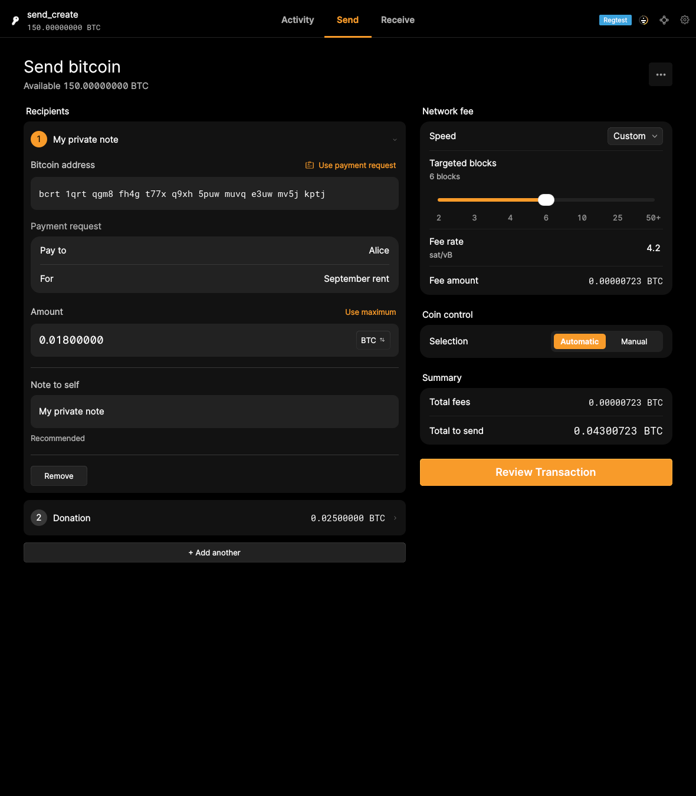
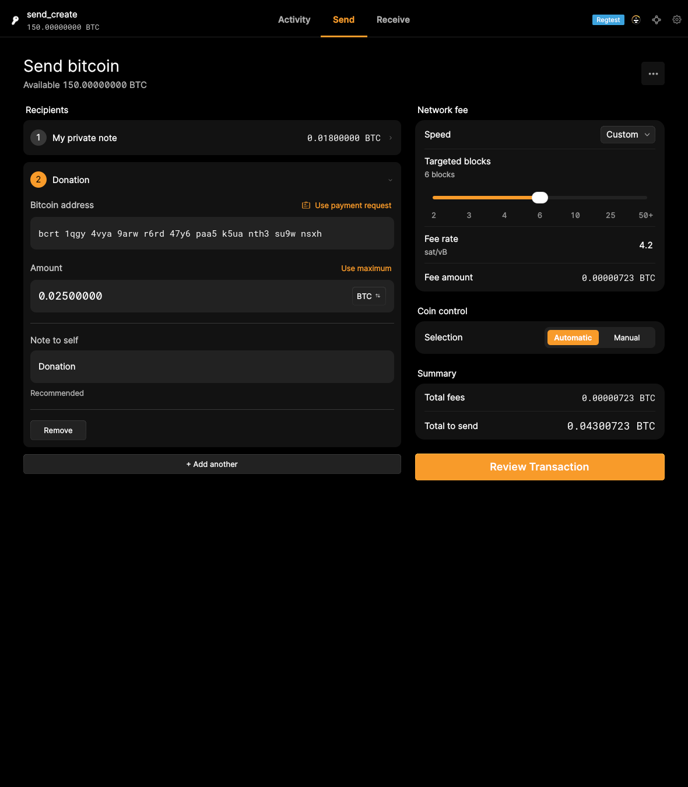

# Send-create functional rerun — October 10, 2026

**Passed in three complete runs after a test-only correction.** The original `qml_test_send_create` failure reproduced on the recorded application. Its note-preservation assertion passed when both note-entry steps used focused keyboard input. Every original assertion remains. No application code or binary changed.

The current combined record is **34 passing functional scripts, zero unresolved failures**: 33 results retained from October 8 and this script rerun on October 10. The entire suite was not rerun. The original snapshot remains archived and personal review decisions remain unchanged.

## Diagnosis and correction

On the recorded Qt 6.8.3 build, the note's `TextArea` saves changes only while focused. The test's `set_text` assigned the text property without focus, so the note appeared in the field but never reached the recipient model. Reopening the recipient reloaded the empty model value. Changing both note entries to `type_text` exercises focused keyboard input and saves the model value.

The same input correction exists in later local GUI-QML history, commit `5b7b05f5842aae73d365c3ec40340947dd09b560`. This rerun applies only the two note-input changes to the pinned source. The later commit's unrelated coin-lock waits are not needed for this binary.

- [Original failure reproduced](logs/original.log) · [original bridge trace](logs/original.bridge.jsonl)
- [Corrected script](qml_test_send_create.py) · [exact patch](test-fix.patch)
- [Passing capture run](logs/qml_test_send_create.log) · [bridge trace](logs/qml_test_send_create.bridge.jsonl)
- [Plain run 2](logs/repeat-2.log) · [plain run 3](logs/repeat-3.log) · [repeat exit codes and durations](logs/repeats.json)
- [Application stderr](logs/qml_test_send_create.app.stderr) · [stdout](logs/qml_test_send_create.app.stdout)
- [Result, revisions and hashes](result.json) · [capture wrapper](qml_capture_test.py)

## Acceptance evidence

**F09.S03 — Associate recipient addresses with recognizable labels:** the first recipient's private note remains after applying a payment request, adding another recipient and reopening the first. The original exact note assertion passed. Both recipient labels are visible in the real application captures. This supports parity for the stated labeling outcome; a reviewer still decides acceptance. Persistence across wallet restarts was not asserted.





The completed script also checks payment-request details, fee estimates, coin-selection cancellation and confirmation, and wallet coin locking/unlocking against RPC. It reaches its compact layout and light-theme captures. These are supporting results, not automatic acceptance of broader variants. All 31 unmodified raw screenshots are retained with [timestamps and hashes](media/qml/qml_test_send_create/captures.json); two are selected for the criterion gallery.

Implementation modules at the pinned application revision:

- [SendRecipientEditor.qml](https://github.com/bitcoin-core/gui-qml/blob/a91f4b4774f25de061fe1a7c132a91ddde117fca/qml/components/SendRecipientEditor.qml): connects the private note to its recipient.
- [LabeledTextArea.qml](https://github.com/bitcoin-core/gui-qml/blob/a91f4b4774f25de061fe1a7c132a91ddde117fca/qml/controls/LabeledTextArea.qml): focus-dependent editing and model restoration before Qt 6.9.
- [SendCreate.qml](https://github.com/bitcoin-core/gui-qml/blob/a91f4b4774f25de061fe1a7c132a91ddde117fca/qml/pages/wallet/SendCreate.qml): recipient accordion and editor lifecycle.
- [TestBridge](https://github.com/bitcoin-core/gui-qml/blob/a91f4b4774f25de061fe1a7c132a91ddde117fca/qml/test/testbridge.cpp): direct property assignment versus focused key events.

## Provenance and reproduction

- Application source: `a91f4b4774f25de061fe1a7c132a91ddde117fca`; Core submodule: `dc282ff31d1cc97507530a541d9cec8a8f6a6ef4`.
- Cached application was built at `4527986d46e1a34710cb77e8d5ffac0a349745f9`, with the identical source tree `7d290492acfd2c25ca2b1d4dd6ed450cc7837405` as the pinned revision. See the [original binary provenance](../../logs/qml-cached-build-provenance.json).
- Application SHA-256: `a8215c7e45242fdf0e740339733696ec832e362f8306bfbe3bac95dd6bb4fb4c`.
- Fixture `bitcoind` SHA-256: `0c2667db4e83a12f89e222aa906bbf28b4d45616f7599e83138253ee52046352`.
- Corrected test commit, on isolated local branch `evidence/send-create-input-fix`: `19891532b849b1f72fbbc9dfaa2565e7ce50546e`. The downloadable patch reproduces it without needing that local commit.
- Retained image: `pr915-review-qt:20260923`, ID `sha256:5101ac87837bc5cca898ebef392a903680f93d6133f6d31c8bb891f413baab29`; Linux X11, Xvfb/Openbox, software rendering, static Qt 6.8.3, Release, test automation enabled, IPC disabled.
- Fresh regtest data and settings for every run. One capture run (20.81 seconds), two plain runs without the wrapper (8.18 and 8.38 seconds); all exit 0. The capture run's GUI process also exited 0 after shutdown.

From a checkout at the pinned source with a matching test-enabled binary:

```bash
git apply /path/to/test-fix.patch
BITCOIN_CORE_APP=/path/to/bitcoin-core-app \
BITCOIND=/path/to/bitcoind \
QML_TEST_QPA_PLATFORM=xcb DISPLAY=:95 QT_QUICK_BACKEND=software \
python3 test/functional/qml_test_send_create.py
```

For captured proof, use the same environment with `EVIDENCE_OUTPUT` pointing to an output directory containing `logs/`, and run `python3 /path/to/qml_capture_test.py test/functional/qml_test_send_create.py`. The wrapper records traffic and application output, redirects screenshots and waits for rendered frames; it does not change assertions. The two plain runs verify success without those capture delays.

## Validation limits

[Validation record](validation.json): Python compilation and `git diff --check` passed for the test correction. The requested `./ci/lint.py`, native clang-tidy and native ASan CI commands were attempted from the pinned GUI-QML checkout; each was unavailable because that historical top-level checkout has no `ci/` directory. Its checked-in CI uses CMake/QTest and a separate GUI functional workflow. No lint, clang-tidy, sanitizer, or IPC-enabled `interface_gui.py` pass is claimed by this rerun.

The captured GUI stderr contains Fontconfig configuration warnings and existing `Qt.labs.settings` deprecation warnings; it was inspected and retained. No application rebuild, sanitizer instrumentation, or other platform validation was performed. A stale Xvfb lock initially prevented display startup; moving to a fresh display resolved that setup error before the original assertion was reproduced.

The October 8 [original test report](../../TEST-RESULTS.md) and [original failure log](../../logs/qml_test_send_create.log) remain unchanged. This dated addendum supersedes only the current result and F09.S03 assessment. Send Bitcoin remains partial because selected-recipient fee deduction is still unsupported.
