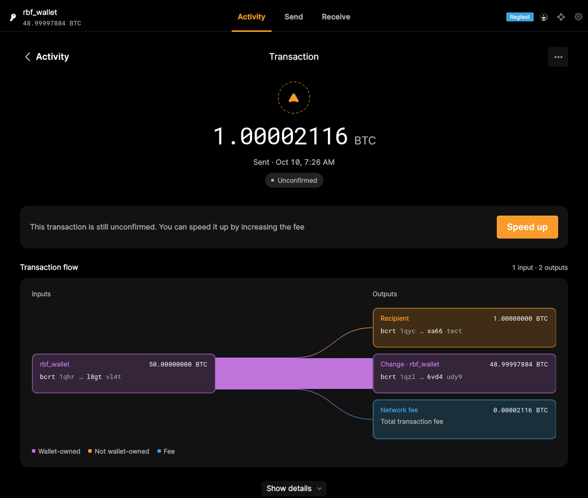
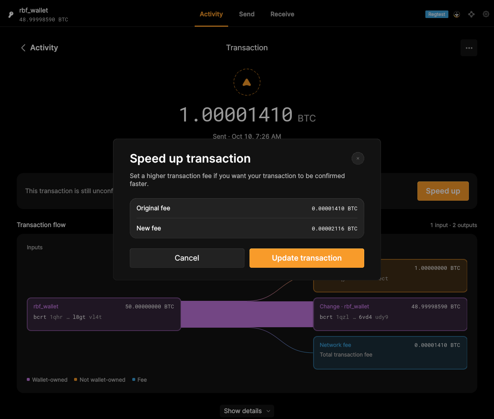
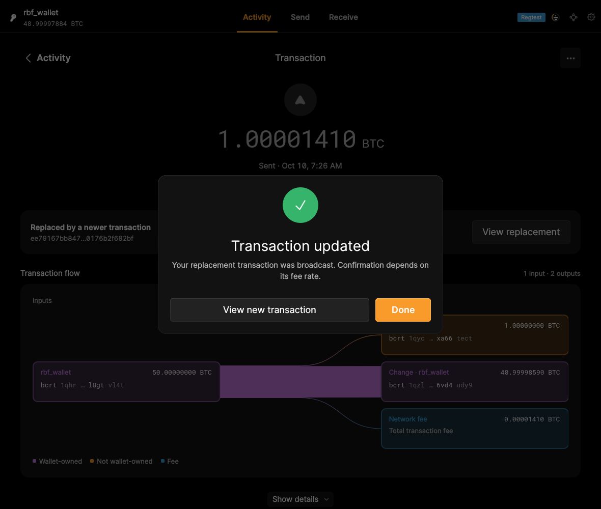

# Manage Unconfirmed Transactions — October 10 capture rerun

**Passed.** `qml_test_wallet_rbf` completed on the unchanged application with new capture checkpoints. Three selected screenshots replace the password-covered frame for F17.S01–F17.S03. These are original application frames, with no image editing. Qt Widgets reference captures and acceptance decisions are unchanged.

## Clear evidence for each criterion

- **F17.S01 — Increase an eligible transaction's fee:** the replacement entered the mempool at a higher fee and confirmed after mining a regtest block. Its details are captured with all dialogs closed.
- **F17.S02 — Review additional cost:** the test opens the password prompt, uses its ordinary Cancel button, waits until it is no longer visible, and captures the unobscured fee review before authorizing the increase. The displayed fee rises from 0.00001410 BTC to 0.00002116 BTC.
- **F17.S03 — Sign and submit a replacement:** the original wrong-password and wallet-relocking checks remain. After successful authorization the test waits for the password prompt to close, records the broadcast confirmation, and opens the new transaction's details.







## Automated proof and modules

The complete functional test passed, including replacement transaction identity, the original transaction's conflict state, wallet relocking, block confirmation, and rejection of another fee bump after confirmation. All five original Python assert statements remain. The capture variant adds UI waits, ordinary navigation, a higher-displayed-fee check, and three named screenshots.

- [Passing test log](logs/qml_test_wallet_rbf.log) · [GUI bridge trace](logs/qml_test_wallet_rbf.bridge.jsonl)
- [Fees, replacement mempool entry, dialog state and wallet lock state](logs/fee-bump-proof.json)
- [Capture script](qml_test_wallet_rbf.py) · [exact capture changes](capture-checkpoints.patch) · [capture wrapper](qml_capture_test.py)
- [All 13 raw screenshot hashes and timestamps](media/qml/qml_test_wallet_rbf/captures.json)
- [Application stderr](logs/qml_test_wallet_rbf.app.stderr) · [stdout](logs/qml_test_wallet_rbf.app.stdout) · [result and hashes](result.json) · [validation record](validation.json)
- [BumpTransactionModel](https://github.com/bitcoin-core/gui-qml/blob/a91f4b4774f25de061fe1a7c132a91ddde117fca/qml/models/bumptransactionmodel.cpp): prepares, signs and submits the replacement.
- [SpeedUpOverlay](https://github.com/bitcoin-core/gui-qml/blob/a91f4b4774f25de061fe1a7c132a91ddde117fca/qml/pages/wallet/SpeedUpOverlay.qml): fee review and authorization.
- [SpeedUpComplete](https://github.com/bitcoin-core/gui-qml/blob/a91f4b4774f25de061fe1a7c132a91ddde117fca/qml/pages/wallet/SpeedUpComplete.qml) and [TransactionDetail](https://github.com/bitcoin-core/gui-qml/blob/a91f4b4774f25de061fe1a7c132a91ddde117fca/qml/pages/wallet/TransactionDetail.qml): successful broadcast and replacement details.

## Provenance and reproduction

Application revision: `a91f4b4774f25de061fe1a7c132a91ddde117fca`; Core submodule: `dc282ff31d1cc97507530a541d9cec8a8f6a6ef4`. The cached binary's source tree matches the pinned application; [original build provenance](../../logs/qml-cached-build-provenance.json) is retained.

Application SHA-256: `a8215c7e45242fdf0e740339733696ec832e362f8306bfbe3bac95dd6bb4fb4c`. Fixture bitcoind SHA-256: `0c2667db4e83a12f89e222aa906bbf28b4d45616f7599e83138253ee52046352`. Both were checked before this rerun.

The test used fresh regtest data and settings in the retained `pr915-review-qt:20260923` container, Linux X11/Xvfb/Openbox, software rendering, static Qt 6.8.3, and an 1180 × 1000 application window. The test and GUI exited 0. Application code and the binary were not modified. Stderr retains existing Fontconfig and Qt settings deprecation warnings.

Apply `capture-checkpoints.patch` to the pinned checkout and run with a matching test-enabled binary and X11 display:

```bash
mkdir -p /tmp/rbf-evidence/logs
EVIDENCE_OUTPUT=/tmp/rbf-evidence \
BITCOIN_CORE_APP=/path/to/bitcoin-core-app BITCOIND=/path/to/bitcoind \
QML_TEST_QPA_PLATFORM=xcb DISPLAY=:96 QT_QUICK_BACKEND=software \
python3 /path/to/qml_capture_test.py test/functional/qml_test_wallet_rbf.py
```

The current functional result replaces this script's October 8 result; the other scripts were not rerun for this capture refresh. The [original result](../../logs/qml_test_wallet_rbf.log) and [superseded password-prompt frame](../../media/qml/qml_test_wallet_rbf/006-click-updatetransactionbutton.png) remain in the archive, outside the current criterion gallery.

Python compilation and retention of the original assertions passed. Native lint, clang-tidy and ASan entry scripts are absent from this historical top-level GUI-QML checkout; their attempted commands and blockers are recorded in `validation.json`. This run does not establish sanitizer or IPC-enabled lifecycle coverage. No evidence was added for fee-bump PSBT export or transaction abandonment; their existing gaps remain.
