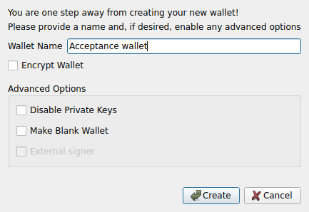
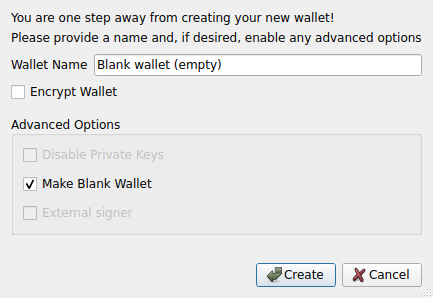
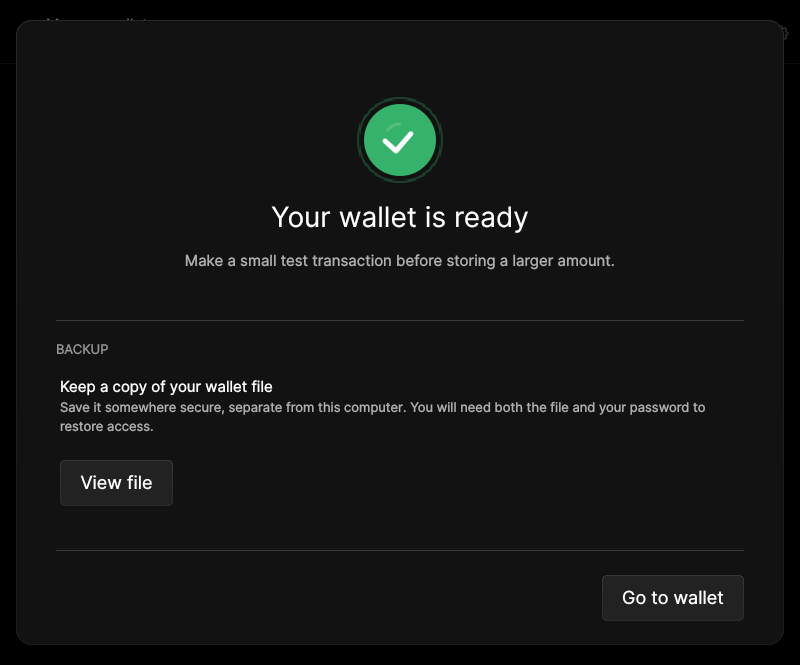
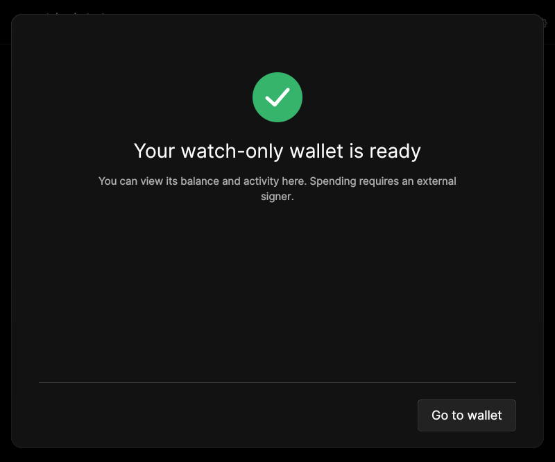

# F01 · Create Wallet

[Evidence index](../README.md) · [Test results](../TEST-RESULTS.md) · [Capture and build provenance](../PROVENANCE.md)

6 acceptance criteria from the supported-feature inventory. **Acceptance is pending review.** A screenshot demonstrates the visible state; the stated assertions describe the behavior that was actually checked. Related passing suites do not certify every variant of a criterion.

## Implementation comparison

**Partial.** Single-signature wallets, encrypted or unencrypted wallets, named wallets, watch-only wallets from an extended public key, and external-signer wallets. Watch-only creation sets up native SegWit receiving and change addresses. No standalone blank-wallet creation flow; broader watch-only or multisig configuration requires RPC.

[Wallet creation](https://github.com/bitcoin-core/gui-qml/blob/a91f4b4774f25de061fe1a7c132a91ddde117fca/qml/walletqmlcontroller.cpp#L507); [Creation choices](https://github.com/bitcoin-core/gui-qml/blob/a91f4b4774f25de061fe1a7c132a91ddde117fca/qml/pages/wallet/WalletCreationTypePage.qml).

## Application captures

| Qt Widgets (`src/qt`) | GUI-QML (`qt6`) |
| --- | --- |
|  Create wallet options   Create blank wallet |  Wallet created   Watch-only wallet created |

Baseline support notes: *Support: Configuring watched funds or multisig policies requires RPC. Encryption applies to wallets containing private keys. Blank wallets allow private keys to be added later.*

[All selected captures for this group](#capture-register) are listed below.

## Modules

- **Qt Widgets:** [primary implementation](https://github.com/bitcoin-core/gui/blob/f739c7876b81304bdc72e7eaa307702da269ac31/src/qt/createwalletdialog.cpp).
- **GUI-QML:** [Wallet creation](https://github.com/bitcoin-core/gui-qml/blob/a91f4b4774f25de061fe1a7c132a91ddde117fca/qml/walletqmlcontroller.cpp#L507); [Creation choices](https://github.com/bitcoin-core/gui-qml/blob/a91f4b4774f25de061fe1a7c132a91ddde117fca/qml/pages/wallet/WalletCreationTypePage.qml).

These are the implementation entry points for the criteria below. Links are pinned to the tested source revisions.

## Automated tests

| Application | Test/module | Recorded result |
| --- | --- | --- |
| GUI-QML | [qml_test_create_wallet_name](https://github.com/bitcoin-core/gui-qml/blob/a91f4b4774f25de061fe1a7c132a91ddde117fca/test/functional/qml_test_create_wallet_name.py) | [passed](../logs/qml_test_create_wallet_name.log) |
| GUI-QML | [qml_test_watchonly_wallet](https://github.com/bitcoin-core/gui-qml/blob/a91f4b4774f25de061fe1a7c132a91ddde117fca/test/functional/qml_test_watchonly_wallet.py) | [passed](../logs/qml_test_watchonly_wallet.log) |
| GUI-QML | [qml_test_password_wallet](https://github.com/bitcoin-core/gui-qml/blob/a91f4b4774f25de061fe1a7c132a91ddde117fca/test/functional/qml_test_password_wallet.py) | [passed](../logs/qml_test_password_wallet.log) |
| GUI-QML | [qml_test_external_signer](https://github.com/bitcoin-core/gui-qml/blob/a91f4b4774f25de061fe1a7c132a91ddde117fca/test/functional/qml_test_external_signer.py) | [passed](../logs/qml_test_external_signer.log) |
| GUI-QML C++ | [test/test_walletqmlcontroller.cpp](https://github.com/bitcoin-core/gui-qml/blob/a91f4b4774f25de061fe1a7c132a91ddde117fca/test/test_walletqmlcontroller.cpp) | [Suite passed](../logs/qml-unit-tests.log); fixture/model assertions |
| GUI-QML C++ | [test/test_walletqmlmodel.cpp](https://github.com/bitcoin-core/gui-qml/blob/a91f4b4774f25de061fe1a7c132a91ddde117fca/test/test_walletqmlmodel.cpp) | [Suite passed](../logs/qml-unit-tests.log); fixture/model assertions |
| GUI-QML components | [test/qml/tst_walletcreationflow.qml](https://github.com/bitcoin-core/gui-qml/blob/a91f4b4774f25de061fe1a7c132a91ddde117fca/test/qml/tst_walletcreationflow.qml) | [Suite passed](../logs/qml-quick-tests.log); component assertions |
| Qt Widgets | [WalletTests](https://github.com/bitcoin-core/gui/blob/f739c7876b81304bdc72e7eaa307702da269ac31/src/qt/test/wallettests.cpp) | [Suite passed](../logs/widgets-qt-tests.log); inspect assertion scope |
| Qt Widgets additional | [Live GUI/RPC scenarios](../scripts/widgets_scenarios.py) | [Recorded assertions](../logs/widgets-checks.json); outcomes listed per criterion |

## Acceptance criteria

### F01.S01 · Create a standard single-signature wallet.

| Application | Evidence status | Evidence and limits |
| --- | --- | --- |
| Qt Widgets | Assertions collected | GUI creates the named, unencrypted descriptor wallet with private keys. **passed**. [Create wallet options](../media/widgets/create-wallet-options.png) [Modules](#modules) · [Related tests](#automated-tests) |
| GUI-QML | Automated evidence collected | Regular wallet creation reaches a loaded wallet. [Wallet created](../media/qml/qml_test_create_wallet_name/015-wait-for-page-walletcreationreadypage.png) [Modules](#modules) · [Related tests](#automated-tests) |

- [ ] Acceptance decision recorded by reviewer.

### F01.S02 · Create an encrypted or unencrypted wallet containing spending keys.

| Application | Evidence status | Evidence and limits |
| --- | --- | --- |
| Qt Widgets | Assertions collected | GUI creates the named, unencrypted descriptor wallet with private keys. **passed**. **Limit:** The live creation scenario creates an unencrypted wallet; encryption of an existing wallet is verified separately. Encrypted creation itself remains unexercised. [Create wallet options](../media/widgets/create-wallet-options.png) [Encrypt wallet passphrase](../media/widgets/encrypt-wallet-passphrase.png) [Modules](#modules) · [Related tests](#automated-tests) |
| GUI-QML | Automated evidence collected | Encrypted and unencrypted creation; spending-key state checked through RPC. [Wallet created](../media/qml/qml_test_create_wallet_name/015-wait-for-page-walletcreationreadypage.png) [Modules](#modules) · [Related tests](#automated-tests) |

- [ ] Acceptance decision recorded by reviewer.

### F01.S03 · Create a watch-only wallet to monitor funds without holding spending keys.

| Application | Evidence status | Evidence and limits |
| --- | --- | --- |
| Qt Widgets | Assertions collected | Watch-only wallet has private keys disabled. **passed**. [Create wallet options](../media/widgets/create-wallet-options.png) [Create watch only wallet](../media/widgets/create-watch-only-wallet.png) [Modules](#modules) · [Related tests](#automated-tests) |
| GUI-QML | Automated evidence collected | Watch-only xpub creation and invalid-key rejection. [Watch-only wallet created](../media/qml/qml_test_watchonly_wallet/006-wait-for-page-walletcreationreadypage.png) [Modules](#modules) · [Related tests](#automated-tests) |

- [ ] Acceptance decision recorded by reviewer.

### F01.S04 · Create a blank wallet for later setup.

| Application | Evidence status | Evidence and limits |
| --- | --- | --- |
| Qt Widgets | Assertions collected | Blank wallet has no generated keys. **passed**. [Create wallet options](../media/widgets/create-wallet-options.png) [Create blank wallet](../media/widgets/create-blank-wallet.png) [Modules](#modules) · [Related tests](#automated-tests) |
| GUI-QML | Implementation gap | No blank-wallet creation workflow. No screenshot: this GUI workflow is absent. [Modules](#modules) · [Related tests](#automated-tests) |

- [ ] Acceptance decision recorded by reviewer.

### F01.S05 · Create a wallet that uses an external signer, such as a hardware wallet.

| Application | Evidence status | Evidence and limits |
| --- | --- | --- |
| Qt Widgets | Visual evidence only | No targeted runtime assertion collected for this exact criterion. **Limit:** Only configuration and the disabled external-signer choice are pictured. No Widgets signer fixture or physical device was exercised. [Create wallet options](../media/widgets/create-wallet-options.png) [Modules](#modules) · [Related tests](#automated-tests) |
| GUI-QML | Automated evidence collected | Mock external-signer wallet creation. [External signer wallet](../media/qml/qml_test_external_signer/014-14-external-signer-wallet-hides-password-settings.png) [Modules](#modules) · [Related tests](#automated-tests) |

- [ ] Acceptance decision recorded by reviewer.

### F01.S06 · Name the wallet.

| Application | Evidence status | Evidence and limits |
| --- | --- | --- |
| Qt Widgets | Assertions collected | GUI creates the named, unencrypted descriptor wallet with private keys. **passed**. [Create wallet options](../media/widgets/create-wallet-options.png) [Modules](#modules) · [Related tests](#automated-tests) |
| GUI-QML | Automated evidence collected | Empty, duplicate and valid wallet-name handling. [Wallet created](../media/qml/qml_test_create_wallet_name/015-wait-for-page-walletcreationreadypage.png) [Modules](#modules) · [Related tests](#automated-tests) |

- [ ] Acceptance decision recorded by reviewer.

## Capture register

The original PNGs are unmodified application captures. Timestamps, dimensions and SHA-256 hashes are in the [capture manifest](../selected-captures.json). Some early/raw frames are not selected for review.

| Application | Capture | Criteria |
| --- | --- | --- |
| widgets | [Create wallet options](../media/widgets/create-wallet-options.png) | F01.S01, F01.S02, F01.S03, F01.S04, F01.S05, F01.S06 |
| widgets | [Create blank wallet](../media/widgets/create-blank-wallet.png) | F01.S04 |
| widgets | [Create watch only wallet](../media/widgets/create-watch-only-wallet.png) | F01.S03 |
| widgets | [Encrypt wallet passphrase](../media/widgets/encrypt-wallet-passphrase.png) | F01.S02 |
| qml | [Wallet created](../media/qml/qml_test_create_wallet_name/015-wait-for-page-walletcreationreadypage.png) | F01.S01, F01.S02, F01.S06 |
| qml | [Watch-only wallet created](../media/qml/qml_test_watchonly_wallet/006-wait-for-page-walletcreationreadypage.png) | F01.S03 |
| qml | [External signer wallet](../media/qml/qml_test_external_signer/014-14-external-signer-wallet-hides-password-settings.png) | F01.S05 |
