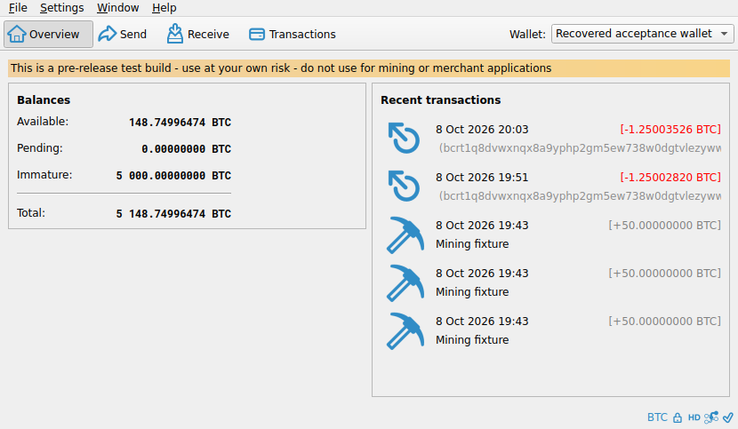
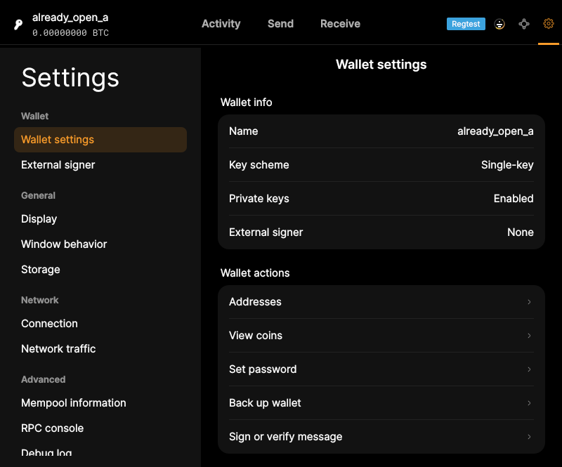

# F02 · Open, Switch, and Close Wallets

[Evidence index](../README.md) · [Test results](../TEST-RESULTS.md) · [Capture and build provenance](../PROVENANCE.md)

4 acceptance criteria from the supported-feature inventory. **Acceptance is pending review.** A screenshot demonstrates the visible state; the stated assertions describe the behavior that was actually checked. Related passing suites do not certify every variant of a criterion.

## Implementation comparison

**Partial.** Open existing wallets, keep several loaded, switch the active wallet, and close an individual wallet. No close-all-wallets action.

[Wallet management](https://github.com/bitcoin-core/gui-qml/blob/a91f4b4774f25de061fe1a7c132a91ddde117fca/qml/walletqmlcontroller.cpp#L93); [Wallet selection](https://github.com/bitcoin-core/gui-qml/blob/a91f4b4774f25de061fe1a7c132a91ddde117fca/qml/pages/wallet/WalletSelect.qml).

## Application captures

| Qt Widgets (`src/qt`) | GUI-QML (`qt6`) |
| --- | --- |
|  Restored wallet overview |  Multiple wallets available   Wallet closed after confirmation |

Baseline support notes: *Support: Legacy wallets require migration before they can be opened.*

## Modules

- **Qt Widgets:** [primary implementation](https://github.com/bitcoin-core/gui/blob/f739c7876b81304bdc72e7eaa307702da269ac31/src/qt/bitcoingui.cpp).
- **GUI-QML:** [Wallet management](https://github.com/bitcoin-core/gui-qml/blob/a91f4b4774f25de061fe1a7c132a91ddde117fca/qml/walletqmlcontroller.cpp#L93); [Wallet selection](https://github.com/bitcoin-core/gui-qml/blob/a91f4b4774f25de061fe1a7c132a91ddde117fca/qml/pages/wallet/WalletSelect.qml).

These are the implementation entry points for the criteria below. Links are pinned to the tested source revisions.

## Automated tests

| Application | Test/module | Recorded result |
| --- | --- | --- |
| GUI-QML | [qml_test_wallet_selector_load](https://github.com/bitcoin-core/gui-qml/blob/a91f4b4774f25de061fe1a7c132a91ddde117fca/test/functional/qml_test_wallet_selector_load.py) | [passed](../logs/qml_test_wallet_selector_load.log) |
| GUI-QML | [qml_test_password_wallet](https://github.com/bitcoin-core/gui-qml/blob/a91f4b4774f25de061fe1a7c132a91ddde117fca/test/functional/qml_test_password_wallet.py) | [passed](../logs/qml_test_password_wallet.log) |
| GUI-QML C++ | [test/test_walletqmlcontroller.cpp](https://github.com/bitcoin-core/gui-qml/blob/a91f4b4774f25de061fe1a7c132a91ddde117fca/test/test_walletqmlcontroller.cpp) | [Suite passed](../logs/qml-unit-tests.log); fixture/model assertions |
| GUI-QML C++ | [test/test_walletlistmodel.cpp](https://github.com/bitcoin-core/gui-qml/blob/a91f4b4774f25de061fe1a7c132a91ddde117fca/test/test_walletlistmodel.cpp) | [Suite passed](../logs/qml-unit-tests.log); fixture/model assertions |
| GUI-QML components | [test/qml/tst_walletselect.qml](https://github.com/bitcoin-core/gui-qml/blob/a91f4b4774f25de061fe1a7c132a91ddde117fca/test/qml/tst_walletselect.qml) | [Suite passed](../logs/qml-quick-tests.log); component assertions |
| GUI-QML additional | [Independent live scenarios](../scripts/qml_additional.py) | [Passed](../logs/qml-additional.log), [assertions](../logs/qml-additional-checks.json) |
| Qt Widgets | [WalletTests](https://github.com/bitcoin-core/gui/blob/f739c7876b81304bdc72e7eaa307702da269ac31/src/qt/test/wallettests.cpp) | [Suite passed](../logs/widgets-qt-tests.log); inspect assertion scope |
| Qt Widgets additional | [Live GUI/RPC scenarios](../scripts/widgets_scenarios.py) | [Recorded assertions](../logs/widgets-checks.json); outcomes listed per criterion |

## Acceptance criteria

### F02.S01 · Open existing wallets.

| Application | Evidence status | Evidence and limits |
| --- | --- | --- |
| Qt Widgets | Assertions collected | Several wallets remain loaded. **passed**. No matching screenshot collected. [Modules](#modules) · [Related tests](#automated-tests) |
| GUI-QML | Automated evidence collected | Closed-wallet loading and a genuine permission-denied load failure. [Multiple wallets available](../media/qml/qml_additional/032-multiple-loaded-wallets.png) [Modules](#modules) · [Related tests](#automated-tests) |

- [ ] Acceptance decision recorded by reviewer.

### F02.S02 · Keep multiple wallets available at the same time.

| Application | Evidence status | Evidence and limits |
| --- | --- | --- |
| Qt Widgets | Assertions collected | Several wallets remain loaded. **passed**. [Restored wallet overview](../media/widgets/restored-wallet-overview.png) [Modules](#modules) · [Related tests](#automated-tests) |
| GUI-QML | Automated evidence collected | Two wallets stay loaded. [Multiple wallets available](../media/qml/qml_additional/032-multiple-loaded-wallets.png) [Modules](#modules) · [Related tests](#automated-tests) |

- [ ] Acceptance decision recorded by reviewer.

### F02.S03 · Choose which wallet to use.

| Application | Evidence status | Evidence and limits |
| --- | --- | --- |
| Qt Widgets | Assertions collected | Selecting another wallet changes the application title. **passed**. [Restored wallet overview](../media/widgets/restored-wallet-overview.png) [Modules](#modules) · [Related tests](#automated-tests) |
| GUI-QML | Automated evidence collected | Selection changes the active wallet and corresponding settings. [Multiple wallets available](../media/qml/qml_additional/032-multiple-loaded-wallets.png) [Modules](#modules) · [Related tests](#automated-tests) |

- [ ] Acceptance decision recorded by reviewer.

### F02.S04 · Close individual wallets or all wallets.

| Application | Evidence status | Evidence and limits |
| --- | --- | --- |
| Qt Widgets | Related automated suite | No targeted runtime assertion collected for this exact criterion. No matching screenshot collected. [Modules](#modules) · [Related tests](#automated-tests) |
| GUI-QML | Partial / limited evidence | Individual close is available; close-all is missing. Confirmed individual wallet unload. [Wallet closed after confirmation](../media/qml/qml_test_wallet_selector_load/013-05-selected-wallet-unloads-only-after-confirmation.png) [Modules](#modules) · [Related tests](#automated-tests) |

- [ ] Acceptance decision recorded by reviewer.

## Capture register

The original PNGs are unmodified application captures. Timestamps, dimensions and SHA-256 hashes are in the [capture manifest](../selected-captures.json). Some early/raw frames are not selected for review.

| Application | Capture | Criteria |
| --- | --- | --- |
| widgets | [Restored wallet overview](../media/widgets/restored-wallet-overview.png) | F02.S02, F02.S03 |
| qml | [Multiple wallets available](../media/qml/qml_additional/032-multiple-loaded-wallets.png) | F02.S01, F02.S02, F02.S03 |
| qml | [Wallet closed after confirmation](../media/qml/qml_test_wallet_selector_load/013-05-selected-wallet-unloads-only-after-confirmation.png) | F02.S04 |
