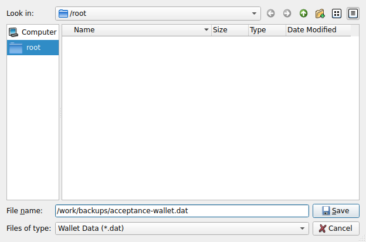
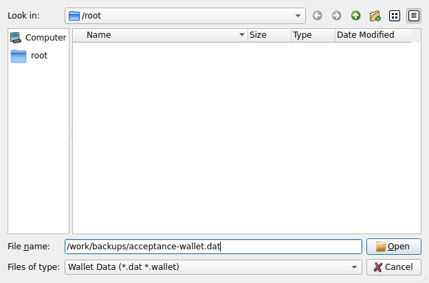
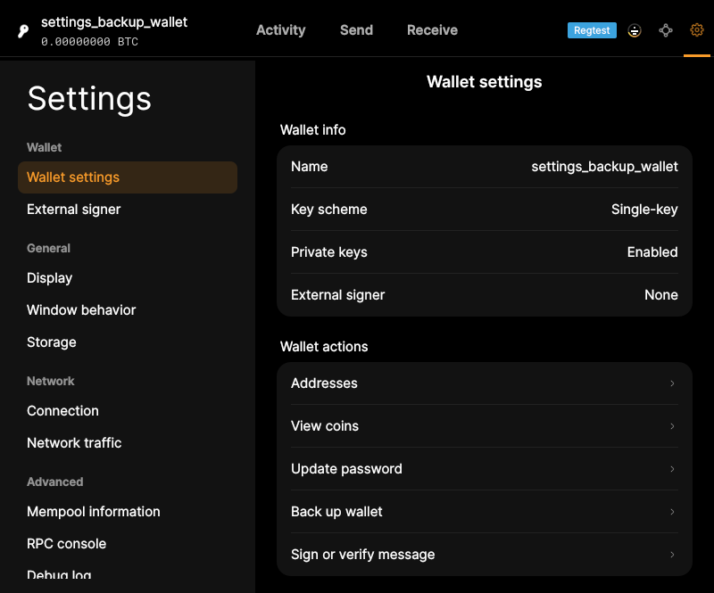
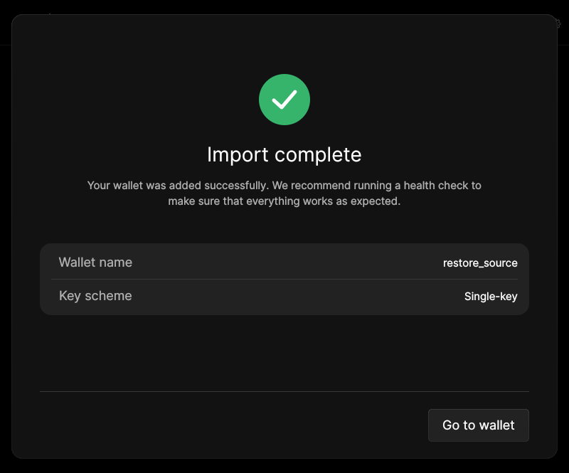

# F03 · Back Up and Restore Wallet

[Evidence index](../README.md) · [Test results](../TEST-RESULTS.md) · [Capture and build provenance](../PROVENANCE.md)

4 acceptance criteria from the supported-feature inventory. **Acceptance is pending review.** A screenshot demonstrates the visible state; the stated assertions describe the behavior that was actually checked. Related passing suites do not certify every variant of a criterion.

## Implementation comparison

**Partial.** Save wallet backups and restore supported wallet backup files. The restored wallet name is inferred from the file rather than chosen independently. Legacy backup import reports that migration is required; it does not perform a combined restore-and-migrate workflow.

[Backup](https://github.com/bitcoin-core/gui-qml/blob/a91f4b4774f25de061fe1a7c132a91ddde117fca/qml/pages/settings/WalletSectionPage.qml); [Restore](https://github.com/bitcoin-core/gui-qml/blob/a91f4b4774f25de061fe1a7c132a91ddde117fca/qml/walletqmlcontroller.cpp#L1009); [Restore test cases](https://github.com/bitcoin-core/gui-qml/blob/a91f4b4774f25de061fe1a7c132a91ddde117fca/test/functional/qml_test_wallet_restore.py).

## Application captures

| Qt Widgets (`src/qt`) | GUI-QML (`qt6`) |
| --- | --- |
|  Backup wallet file   Restore wallet file |  Wallet settings after saving a backup   Wallet backup restored |

[All selected captures for this group](#capture-register) are listed below.

## Modules

- **Qt Widgets:** [primary implementation](https://github.com/bitcoin-core/gui/blob/f739c7876b81304bdc72e7eaa307702da269ac31/src/qt/walletcontroller.cpp).
- **GUI-QML:** [Backup](https://github.com/bitcoin-core/gui-qml/blob/a91f4b4774f25de061fe1a7c132a91ddde117fca/qml/pages/settings/WalletSectionPage.qml); [Restore](https://github.com/bitcoin-core/gui-qml/blob/a91f4b4774f25de061fe1a7c132a91ddde117fca/qml/walletqmlcontroller.cpp#L1009); [Restore test cases](https://github.com/bitcoin-core/gui-qml/blob/a91f4b4774f25de061fe1a7c132a91ddde117fca/test/functional/qml_test_wallet_restore.py).

These are the implementation entry points for the criteria below. Links are pinned to the tested source revisions.

## Automated tests

| Application | Test/module | Recorded result |
| --- | --- | --- |
| GUI-QML | [qml_test_wallet_settings](https://github.com/bitcoin-core/gui-qml/blob/a91f4b4774f25de061fe1a7c132a91ddde117fca/test/functional/qml_test_wallet_settings.py) | [passed](../logs/qml_test_wallet_settings.log) |
| GUI-QML | [qml_test_wallet_restore](https://github.com/bitcoin-core/gui-qml/blob/a91f4b4774f25de061fe1a7c132a91ddde117fca/test/functional/qml_test_wallet_restore.py) | [passed](../logs/qml_test_wallet_restore.log) |
| GUI-QML | [qml_test_password_wallet](https://github.com/bitcoin-core/gui-qml/blob/a91f4b4774f25de061fe1a7c132a91ddde117fca/test/functional/qml_test_password_wallet.py) | [passed](../logs/qml_test_password_wallet.log) |
| GUI-QML C++ | [test/test_walletqmlmodel.cpp](https://github.com/bitcoin-core/gui-qml/blob/a91f4b4774f25de061fe1a7c132a91ddde117fca/test/test_walletqmlmodel.cpp) | [Suite passed](../logs/qml-unit-tests.log); fixture/model assertions |
| GUI-QML C++ | [test/test_walletqmlcontroller.cpp](https://github.com/bitcoin-core/gui-qml/blob/a91f4b4774f25de061fe1a7c132a91ddde117fca/test/test_walletqmlcontroller.cpp) | [Suite passed](../logs/qml-unit-tests.log); fixture/model assertions |
| Qt Widgets | [WalletTests](https://github.com/bitcoin-core/gui/blob/f739c7876b81304bdc72e7eaa307702da269ac31/src/qt/test/wallettests.cpp) | [Suite passed](../logs/widgets-qt-tests.log); inspect assertion scope |
| Qt Widgets additional | [Live GUI/RPC scenarios](../scripts/widgets_scenarios.py) | [Recorded assertions](../logs/widgets-checks.json); outcomes listed per criterion |

## Acceptance criteria

### F03.S01 · Save a wallet backup to a file.

| Application | Evidence status | Evidence and limits |
| --- | --- | --- |
| Qt Widgets | Assertions collected | The GUI writes a nonempty wallet backup file. **passed**. [Backup wallet file](../media/widgets/backup-wallet-file.png) [Modules](#modules) · [Related tests](#automated-tests) |
| GUI-QML | Automated evidence collected | Backup file is created and backend path forwarding is tested. [Wallet settings after saving a backup](../media/qml/qml_test_wallet_settings/010-06-wallet-backup-created.png) [Modules](#modules) · [Related tests](#automated-tests) |

- [ ] Acceptance decision recorded by reviewer.

### F03.S02 · Restore a wallet from a backup file.

| Application | Evidence status | Evidence and limits |
| --- | --- | --- |
| Qt Widgets | Assertions collected | GUI restores the selected backup under the requested name with spending keys. **passed**. [Restore wallet file](../media/widgets/restore-wallet-file.png) [Restore wallet name](../media/widgets/restore-wallet-name.png) [Restored wallet success](../media/widgets/restored-wallet-success.png) [Modules](#modules) · [Related tests](#automated-tests) |
| GUI-QML | Automated evidence collected | Valid descriptor backup imports; malformed and legacy files report errors. [Wallet backup restored](../media/qml/qml_test_wallet_restore/009-04-import-success-screen-displayed.png) [Modules](#modules) · [Related tests](#automated-tests) |

- [ ] Acceptance decision recorded by reviewer.

### F03.S03 · Name a recovered wallet.

| Application | Evidence status | Evidence and limits |
| --- | --- | --- |
| Qt Widgets | Assertions collected | GUI restores the selected backup under the requested name with spending keys. **passed**. [Restore wallet name](../media/widgets/restore-wallet-name.png) [Restored wallet success](../media/widgets/restored-wallet-success.png) [Restored wallet overview](../media/widgets/restored-wallet-overview.png) [Modules](#modules) · [Related tests](#automated-tests) |
| GUI-QML | Partial / limited evidence | The restored name comes from the filename, without a separate naming step. [Wallet backup restored](../media/qml/qml_test_wallet_restore/009-04-import-success-screen-displayed.png) [Modules](#modules) · [Related tests](#automated-tests) |

- [ ] Acceptance decision recorded by reviewer.

### F03.S04 · Recover and update a legacy wallet backup.

| Application | Evidence status | Evidence and limits |
| --- | --- | --- |
| Qt Widgets | Related automated suite | No targeted runtime assertion collected for this exact criterion. No matching screenshot collected. [Modules](#modules) · [Related tests](#automated-tests) |
| GUI-QML | Partial / limited evidence | Legacy-file import reports migration guidance; it does not restore and migrate in one flow. [Legacy backup import feedback](../media/qml/qml_test_wallet_restore/005-04-legacy-backup-submitted.png) [Modules](#modules) · [Related tests](#automated-tests) |

- [ ] Acceptance decision recorded by reviewer.

## Capture register

The original PNGs are unmodified application captures. Timestamps, dimensions and SHA-256 hashes are in the [capture manifest](../selected-captures.json). Some early/raw frames are not selected for review.

| Application | Capture | Criteria |
| --- | --- | --- |
| widgets | [Backup wallet file](../media/widgets/backup-wallet-file.png) | F03.S01 |
| widgets | [Restore wallet file](../media/widgets/restore-wallet-file.png) | F03.S02 |
| widgets | [Restore wallet name](../media/widgets/restore-wallet-name.png) | F03.S02, F03.S03 |
| widgets | [Restored wallet success](../media/widgets/restored-wallet-success.png) | F03.S02, F03.S03 |
| widgets | [Restored wallet overview](../media/widgets/restored-wallet-overview.png) | F03.S02, F03.S03 |
| qml | [Wallet settings after saving a backup](../media/qml/qml_test_wallet_settings/010-06-wallet-backup-created.png) | F03.S01 |
| qml | [Wallet backup restored](../media/qml/qml_test_wallet_restore/009-04-import-success-screen-displayed.png) | F03.S02, F03.S03 |
| qml | [Legacy backup import feedback](../media/qml/qml_test_wallet_restore/005-04-legacy-backup-submitted.png) | F03.S04 |
