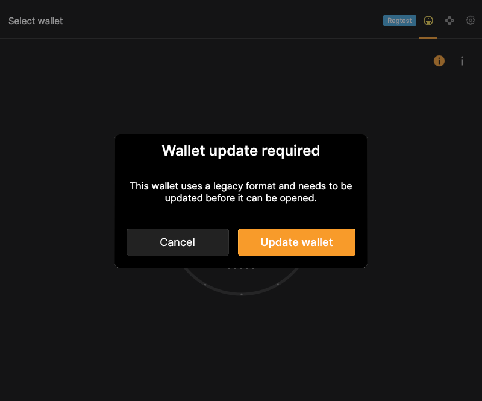
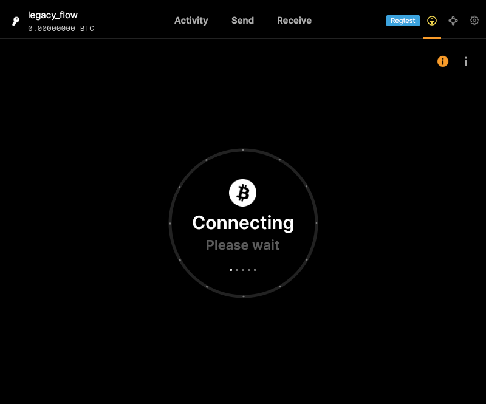

# F04 · Migrate Legacy Wallet

[Evidence index](../README.md) · [Test results](../TEST-RESULTS.md) · [Capture and build provenance](../PROVENANCE.md)

4 acceptance criteria from the supported-feature inventory. **Acceptance is pending review.** A screenshot demonstrates the visible state; the stated assertions describe the behavior that was actually checked. Related passing suites do not certify every variant of a criterion.

## Implementation comparison

**Partial.** Migrate an existing legacy wallet in managed wallet storage, including encrypted wallets, using Core migration and its backup/content preservation. The migrated wallet opens automatically; deferring that opening is not offered.

[Migration](https://github.com/bitcoin-core/gui-qml/blob/a91f4b4774f25de061fe1a7c132a91ddde117fca/qml/walletqmlcontroller.cpp#L1194); [Migration flow](https://github.com/bitcoin-core/gui-qml/blob/a91f4b4774f25de061fe1a7c132a91ddde117fca/qml/pages/wallet/DesktopWallets.qml#L440).

## Application captures

| Qt Widgets (`src/qt`) | GUI-QML (`qt6`) |
| --- | --- |
| No matching application capture collected. See the criterion-level gaps below. |  Legacy wallet migration confirmation   Encrypted legacy wallet migrated |

## Modules

- **Qt Widgets:** [primary implementation](https://github.com/bitcoin-core/gui/blob/f739c7876b81304bdc72e7eaa307702da269ac31/src/qt/walletcontroller.cpp).
- **GUI-QML:** [Migration](https://github.com/bitcoin-core/gui-qml/blob/a91f4b4774f25de061fe1a7c132a91ddde117fca/qml/walletqmlcontroller.cpp#L1194); [Migration flow](https://github.com/bitcoin-core/gui-qml/blob/a91f4b4774f25de061fe1a7c132a91ddde117fca/qml/pages/wallet/DesktopWallets.qml#L440).

These are the implementation entry points for the criteria below. Links are pinned to the tested source revisions.

## Automated tests

| Application | Test/module | Recorded result |
| --- | --- | --- |
| GUI-QML | [qml_test_wallet_migration](https://github.com/bitcoin-core/gui-qml/blob/a91f4b4774f25de061fe1a7c132a91ddde117fca/test/functional/qml_test_wallet_migration.py) | [passed](../logs/qml_test_wallet_migration.log) |
| GUI-QML | [qml_test_password_wallet](https://github.com/bitcoin-core/gui-qml/blob/a91f4b4774f25de061fe1a7c132a91ddde117fca/test/functional/qml_test_password_wallet.py) | [passed](../logs/qml_test_password_wallet.log) |
| GUI-QML C++ | [test/test_walletqmlcontroller.cpp](https://github.com/bitcoin-core/gui-qml/blob/a91f4b4774f25de061fe1a7c132a91ddde117fca/test/test_walletqmlcontroller.cpp) | [Suite passed](../logs/qml-unit-tests.log); fixture/model assertions |

## Acceptance criteria

### F04.S01 · Update legacy wallets to the current wallet format.

| Application | Evidence status | Evidence and limits |
| --- | --- | --- |
| Qt Widgets | Source only | No targeted runtime assertion collected for this exact criterion. No matching screenshot collected. [Modules](#modules) · [Related tests](#automated-tests) |
| GUI-QML | Automated evidence collected | Encrypted and unencrypted legacy files become SQLite descriptor wallets. [Legacy wallet migration confirmation](../media/qml/qml_test_wallet_migration/003-06-unencrypted-migration-prompt-displayed.png) [Encrypted legacy wallet migrated](../media/qml/qml_test_wallet_migration/004-07-unencrypted-wallet-migrated-and-loaded.png) [Modules](#modules) · [Related tests](#automated-tests) |

- [ ] Acceptance decision recorded by reviewer.

### F04.S02 · Preserve the original wallet with an automatic backup.

| Application | Evidence status | Evidence and limits |
| --- | --- | --- |
| Qt Widgets | Source only | No targeted runtime assertion collected for this exact criterion. No matching screenshot collected. [Modules](#modules) · [Related tests](#automated-tests) |
| GUI-QML | Source / related tests only | No targeted runtime assertion collected for this exact criterion. No matching screenshot collected. [Modules](#modules) · [Related tests](#automated-tests) |

- [ ] Acceptance decision recorded by reviewer.

### F04.S03 · Preserve wallet contents, including watch-only information.

| Application | Evidence status | Evidence and limits |
| --- | --- | --- |
| Qt Widgets | Source only | No targeted runtime assertion collected for this exact criterion. No matching screenshot collected. [Modules](#modules) · [Related tests](#automated-tests) |
| GUI-QML | Partial / limited evidence | Migration tests use empty legacy fixtures; preservation of funded and watch-only contents was not asserted. No matching screenshot collected. [Modules](#modules) · [Related tests](#automated-tests) |

- [ ] Acceptance decision recorded by reviewer.

### F04.S04 · Open migrated wallets immediately or later.

| Application | Evidence status | Evidence and limits |
| --- | --- | --- |
| Qt Widgets | Source only | No targeted runtime assertion collected for this exact criterion. No matching screenshot collected. [Modules](#modules) · [Related tests](#automated-tests) |
| GUI-QML | Partial / limited evidence | The migrated wallet opens automatically; deferred opening is not offered. [Legacy wallet migration confirmation](../media/qml/qml_test_wallet_migration/003-06-unencrypted-migration-prompt-displayed.png) [Encrypted legacy wallet migrated](../media/qml/qml_test_wallet_migration/004-07-unencrypted-wallet-migrated-and-loaded.png) [Modules](#modules) · [Related tests](#automated-tests) |

- [ ] Acceptance decision recorded by reviewer.

## Capture register

The original PNGs are unmodified application captures. Timestamps, dimensions and SHA-256 hashes are in the [capture manifest](../selected-captures.json). Some early/raw frames are not selected for review.

| Application | Capture | Criteria |
| --- | --- | --- |
| qml | [Legacy wallet migration confirmation](../media/qml/qml_test_wallet_migration/003-06-unencrypted-migration-prompt-displayed.png) | F04.S01, F04.S04 |
| qml | [Encrypted legacy wallet migrated](../media/qml/qml_test_wallet_migration/004-07-unencrypted-wallet-migrated-and-loaded.png) | F04.S01, F04.S04 |
