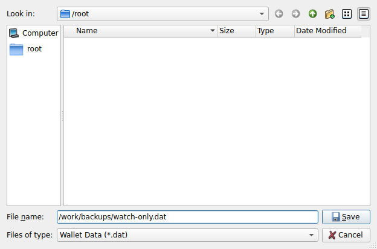
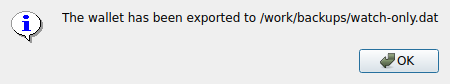

# F05 · Export Watch-Only Wallet

[Evidence index](../README.md) · [Test results](../TEST-RESULTS.md) · [Capture and build provenance](../PROVENANCE.md)

4 acceptance criteria from the supported-feature inventory. **Acceptance is pending review.** A screenshot demonstrates the visible state; the stated assertions describe the behavior that was actually checked. Related passing suites do not certify every variant of a criterion.

## Implementation comparison

**Not available in GUI.** Watch-only wallet creation is available, but exporting a spending wallet as a watch-only wallet file is not.

[Available wallet actions](https://github.com/bitcoin-core/gui-qml/blob/a91f4b4774f25de061fe1a7c132a91ddde117fca/qml/pages/settings/WalletSectionPage.qml).

## Application captures

| Qt Widgets (`src/qt`) | GUI-QML (`qt6`) |
| --- | --- |
|  Export watch only wallet   Export watch only success | No matching application capture collected. See the criterion-level gaps below. |

## Modules

- **Qt Widgets:** [primary implementation](https://github.com/bitcoin-core/gui/blob/f739c7876b81304bdc72e7eaa307702da269ac31/src/qt/bitcoingui.cpp).
- **GUI-QML:** [Available wallet actions](https://github.com/bitcoin-core/gui-qml/blob/a91f4b4774f25de061fe1a7c132a91ddde117fca/qml/pages/settings/WalletSectionPage.qml).

These are the implementation entry points for the criteria below. Links are pinned to the tested source revisions.

## Automated tests

| Application | Test/module | Recorded result |
| --- | --- | --- |
| Qt Widgets additional | [Live GUI/RPC scenarios](../scripts/widgets_scenarios.py) | [Recorded assertions](../logs/widgets-checks.json); outcomes listed per criterion |

## Acceptance criteria

### F05.S01 · Create a copy of a wallet that can monitor its funds without spending them.

| Application | Evidence status | Evidence and limits |
| --- | --- | --- |
| Qt Widgets | Assertions collected | Exported wallet restores on another node with private keys disabled and public descriptors only. **passed**. [Export watch only wallet](../media/widgets/export-watch-only-wallet.png) [Export watch only success](../media/widgets/export-watch-only-success.png) [Modules](#modules) · [Related tests](#automated-tests) |
| GUI-QML | Implementation gap | No watch-only wallet export workflow. No screenshot: this GUI workflow is absent. [Modules](#modules) · [Related tests](#automated-tests) |

- [ ] Acceptance decision recorded by reviewer.

### F05.S02 · Export the watch-only wallet to a file.

| Application | Evidence status | Evidence and limits |
| --- | --- | --- |
| Qt Widgets | Assertions collected | The GUI exports a nonempty watch-only backup. **passed**. [Export watch only wallet](../media/widgets/export-watch-only-wallet.png) [Export watch only success](../media/widgets/export-watch-only-success.png) [Modules](#modules) · [Related tests](#automated-tests) |
| GUI-QML | Implementation gap | No watch-only wallet export workflow. No screenshot: this GUI workflow is absent. [Modules](#modules) · [Related tests](#automated-tests) |

- [ ] Acceptance decision recorded by reviewer.

### F05.S03 · Transfer wallet monitoring to another node.

| Application | Evidence status | Evidence and limits |
| --- | --- | --- |
| Qt Widgets | Assertions collected | Exported wallet restores on another node with private keys disabled and public descriptors only. **passed**. No matching screenshot collected. [Modules](#modules) · [Related tests](#automated-tests) |
| GUI-QML | Implementation gap | No watch-only wallet export workflow. No screenshot: this GUI workflow is absent. [Modules](#modules) · [Related tests](#automated-tests) |

- [ ] Acceptance decision recorded by reviewer.

### F05.S04 · Keep spending keys separate from a wallet used for monitoring.

| Application | Evidence status | Evidence and limits |
| --- | --- | --- |
| Qt Widgets | Assertions collected | Exported wallet restores on another node with private keys disabled and public descriptors only. **passed**. [Export watch only wallet](../media/widgets/export-watch-only-wallet.png) [Export watch only success](../media/widgets/export-watch-only-success.png) [Modules](#modules) · [Related tests](#automated-tests) |
| GUI-QML | Implementation gap | No watch-only wallet export workflow. No screenshot: this GUI workflow is absent. [Modules](#modules) · [Related tests](#automated-tests) |

- [ ] Acceptance decision recorded by reviewer.

## Capture register

The original PNGs are unmodified application captures. Timestamps, dimensions and SHA-256 hashes are in the [capture manifest](../selected-captures.json). Some early/raw frames are not selected for review.

| Application | Capture | Criteria |
| --- | --- | --- |
| widgets | [Export watch only wallet](../media/widgets/export-watch-only-wallet.png) | F05.S01, F05.S02, F05.S04 |
| widgets | [Export watch only success](../media/widgets/export-watch-only-success.png) | F05.S01, F05.S02, F05.S04 |
