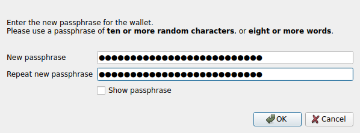
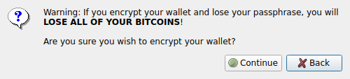
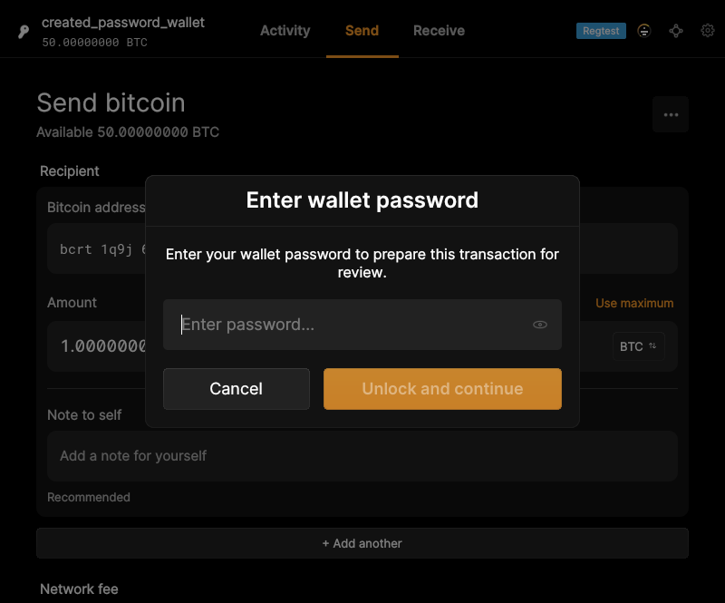
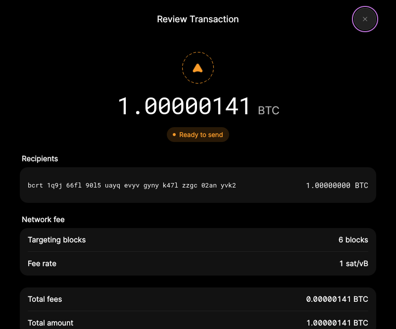

# F06 · Encrypt Wallet and Manage Passphrase

[Evidence index](../README.md) · [Test results](../TEST-RESULTS.md) · [Capture and build provenance](../PROVENANCE.md)

7 acceptance criteria from the supported-feature inventory. **Acceptance is pending review.** A screenshot demonstrates the visible state; the stated assertions describe the behavior that was actually checked. Related passing suites do not certify every variant of a criterion.

## Implementation comparison

**Partial.** Encrypt an existing wallet, change its passphrase, temporarily unlock for wallet operations, and relock automatically. Passphrase visibility and validation feedback are available. Encryption is reflected in wallet settings, but the current locked/unlocked state is not displayed.

[Passphrase management](https://github.com/bitcoin-core/gui-qml/blob/a91f4b4774f25de061fe1a7c132a91ddde117fca/qml/pages/wallet/WalletPasswordSettings.qml); [Temporary unlocking](https://github.com/bitcoin-core/gui-qml/blob/a91f4b4774f25de061fe1a7c132a91ddde117fca/qml/models/walletunlock.cpp).

## Application captures

| Qt Widgets (`src/qt`) | GUI-QML (`qt6`) |
| --- | --- |
|  Encrypt wallet passphrase   Encryption confirmation |  Unlock for transaction review   Transaction reviewed after temporary unlock |

[All selected captures for this group](#capture-register) are listed below.

## Modules

- **Qt Widgets:** [primary implementation](https://github.com/bitcoin-core/gui/blob/f739c7876b81304bdc72e7eaa307702da269ac31/src/qt/askpassphrasedialog.cpp).
  [Unlock handling](https://github.com/bitcoin-core/gui/blob/f739c7876b81304bdc72e7eaa307702da269ac31/src/qt/walletmodel.cpp).
- **GUI-QML:** [Passphrase management](https://github.com/bitcoin-core/gui-qml/blob/a91f4b4774f25de061fe1a7c132a91ddde117fca/qml/pages/wallet/WalletPasswordSettings.qml); [Temporary unlocking](https://github.com/bitcoin-core/gui-qml/blob/a91f4b4774f25de061fe1a7c132a91ddde117fca/qml/models/walletunlock.cpp).

These are the implementation entry points for the criteria below. Links are pinned to the tested source revisions.

## Automated tests

| Application | Test/module | Recorded result |
| --- | --- | --- |
| GUI-QML | [qml_test_password_wallet](https://github.com/bitcoin-core/gui-qml/blob/a91f4b4774f25de061fe1a7c132a91ddde117fca/test/functional/qml_test_password_wallet.py) | [passed](../logs/qml_test_password_wallet.log) |
| GUI-QML | [qml_test_wallet_settings](https://github.com/bitcoin-core/gui-qml/blob/a91f4b4774f25de061fe1a7c132a91ddde117fca/test/functional/qml_test_wallet_settings.py) | [passed](../logs/qml_test_wallet_settings.log) |
| GUI-QML C++ | [test/test_walletqmlmodel.cpp](https://github.com/bitcoin-core/gui-qml/blob/a91f4b4774f25de061fe1a7c132a91ddde117fca/test/test_walletqmlmodel.cpp) | [Suite passed](../logs/qml-unit-tests.log); fixture/model assertions |
| GUI-QML components | [test/qml/tst_walletpassphrasepopup.qml](https://github.com/bitcoin-core/gui-qml/blob/a91f4b4774f25de061fe1a7c132a91ddde117fca/test/qml/tst_walletpassphrasepopup.qml) | [Suite passed](../logs/qml-quick-tests.log); component assertions |
| GUI-QML components | [test/qml/tst_walletpasswordsettings.qml](https://github.com/bitcoin-core/gui-qml/blob/a91f4b4774f25de061fe1a7c132a91ddde117fca/test/qml/tst_walletpasswordsettings.qml) | [Suite passed](../logs/qml-quick-tests.log); component assertions |
| Qt Widgets additional | [Live GUI/RPC scenarios](../scripts/widgets_scenarios.py) | [Recorded assertions](../logs/widgets-checks.json); outcomes listed per criterion |

## Acceptance criteria

### F06.S01 · Protect stored spending keys with passphrase encryption.

| Application | Evidence status | Evidence and limits |
| --- | --- | --- |
| Qt Widgets | Assertions collected | After GUI encryption, the backend reports an encrypted, locked wallet. **passed**. [Encrypt wallet passphrase](../media/widgets/encrypt-wallet-passphrase.png) [Encryption confirmation](../media/widgets/encryption-confirmation.png) [Wallet encrypted result](../media/widgets/wallet-encrypted-result.png) [Modules](#modules) · [Related tests](#automated-tests) |
| GUI-QML | Automated evidence collected | Encrypted wallets start locked; model encryption state updates. No matching screenshot collected. [Modules](#modules) · [Related tests](#automated-tests) |

- [ ] Acceptance decision recorded by reviewer.

### F06.S02 · Change the wallet passphrase.

| Application | Evidence status | Evidence and limits |
| --- | --- | --- |
| Qt Widgets | Assertions collected | The new GUI-supplied passphrase unlocks the wallet through Core RPC. **passed**. [Change wallet passphrase](../media/widgets/change-wallet-passphrase.png) [Modules](#modules) · [Related tests](#automated-tests) |
| GUI-QML | Automated evidence collected | Passphrase change forwards the supplied passwords; incorrect current password rejected. [Incorrect passphrase feedback](../media/qml/qml_test_wallet_settings/032-05-wrong-current-password-rejected-and-preserved.png) [Modules](#modules) · [Related tests](#automated-tests) |

- [ ] Acceptance decision recorded by reviewer.

### F06.S03 · Temporarily unlock spending keys for operations that require them.

| Application | Evidence status | Evidence and limits |
| --- | --- | --- |
| Qt Widgets | Assertions collected | The GUI signs successfully and immediately restores the locked wallet state. **passed**. [Temporary unlock prompt](../media/widgets/temporary-unlock-prompt.png) [Encrypted message signed](../media/widgets/encrypted-message-signed.png) [Modules](#modules) · [Related tests](#automated-tests) |
| GUI-QML | Automated evidence collected | Spending/message-signing prompts unlock the selected wallet. [Unlock for transaction review](../media/qml/qml_test_password_wallet/007-07-review-passphrase-prompt-displayed.png) [Modules](#modules) · [Related tests](#automated-tests) |

- [ ] Acceptance decision recorded by reviewer.

### F06.S04 · Automatically restore the locked state after temporary access.

| Application | Evidence status | Evidence and limits |
| --- | --- | --- |
| Qt Widgets | Assertions collected | The GUI signs successfully and immediately restores the locked wallet state. **passed**. [Encrypted message signed](../media/widgets/encrypted-message-signed.png) [Modules](#modules) · [Related tests](#automated-tests) |
| GUI-QML | Automated evidence collected | RPC/model checks confirm relocking after signing and errors. [Transaction reviewed after temporary unlock](../media/qml/qml_test_password_wallet/008-08-review-built-and-wallet-relocked.png) [Modules](#modules) · [Related tests](#automated-tests) |

- [ ] Acceptance decision recorded by reviewer.

### F06.S05 · Check whether a wallet is encrypted and locked.

| Application | Evidence status | Evidence and limits |
| --- | --- | --- |
| Qt Widgets | Visual evidence only | No targeted runtime assertion collected for this exact criterion. [Encrypted wallet status](../media/widgets/encrypted-wallet-status.png) [Modules](#modules) · [Related tests](#automated-tests) |
| GUI-QML | Partial / limited evidence | Encryption is shown in settings; live locked/unlocked status is not displayed. No matching screenshot collected. [Modules](#modules) · [Related tests](#automated-tests) |

- [ ] Acceptance decision recorded by reviewer.

### F06.S06 · Show or hide entered passphrases.

| Application | Evidence status | Evidence and limits |
| --- | --- | --- |
| Qt Widgets | Visual evidence only | No targeted runtime assertion collected for this exact criterion. [Encrypt wallet passphrase](../media/widgets/encrypt-wallet-passphrase.png) [Change wallet passphrase](../media/widgets/change-wallet-passphrase.png) [Temporary unlock prompt](../media/widgets/temporary-unlock-prompt.png) [Modules](#modules) · [Related tests](#automated-tests) |
| GUI-QML | Automated evidence collected | Password controls exercise visibility toggling. [Unlock for transaction review](../media/qml/qml_test_password_wallet/007-07-review-passphrase-prompt-displayed.png) [Modules](#modules) · [Related tests](#automated-tests) |

- [ ] Acceptance decision recorded by reviewer.

### F06.S07 · Receive feedback on passphrase mismatches and common entry mistakes.

| Application | Evidence status | Evidence and limits |
| --- | --- | --- |
| Qt Widgets | Source only | No targeted runtime assertion collected for this exact criterion. No matching screenshot collected. [Modules](#modules) · [Related tests](#automated-tests) |
| GUI-QML | Automated evidence collected | Mismatch, invalid-password and confirmation feedback is tested. [Incorrect passphrase feedback](../media/qml/qml_test_wallet_settings/032-05-wrong-current-password-rejected-and-preserved.png) [Modules](#modules) · [Related tests](#automated-tests) |

- [ ] Acceptance decision recorded by reviewer.

## Capture register

The original PNGs are unmodified application captures. Timestamps, dimensions and SHA-256 hashes are in the [capture manifest](../selected-captures.json). Some early/raw frames are not selected for review.

| Application | Capture | Criteria |
| --- | --- | --- |
| widgets | [Encrypt wallet passphrase](../media/widgets/encrypt-wallet-passphrase.png) | F06.S01, F06.S06 |
| widgets | [Encryption confirmation](../media/widgets/encryption-confirmation.png) | F06.S01 |
| widgets | [Wallet encrypted result](../media/widgets/wallet-encrypted-result.png) | F06.S01 |
| widgets | [Change wallet passphrase](../media/widgets/change-wallet-passphrase.png) | F06.S02, F06.S06 |
| widgets | [Encrypted wallet status](../media/widgets/encrypted-wallet-status.png) | F06.S05 |
| widgets | [Temporary unlock prompt](../media/widgets/temporary-unlock-prompt.png) | F06.S03, F06.S06 |
| widgets | [Encrypted message signed](../media/widgets/encrypted-message-signed.png) | F06.S03, F06.S04 |
| qml | [Unlock for transaction review](../media/qml/qml_test_password_wallet/007-07-review-passphrase-prompt-displayed.png) | F06.S03, F06.S06 |
| qml | [Transaction reviewed after temporary unlock](../media/qml/qml_test_password_wallet/008-08-review-built-and-wallet-relocked.png) | F06.S04 |
| qml | [Incorrect passphrase feedback](../media/qml/qml_test_wallet_settings/032-05-wrong-current-password-rejected-and-preserved.png) | F06.S02, F06.S07 |
