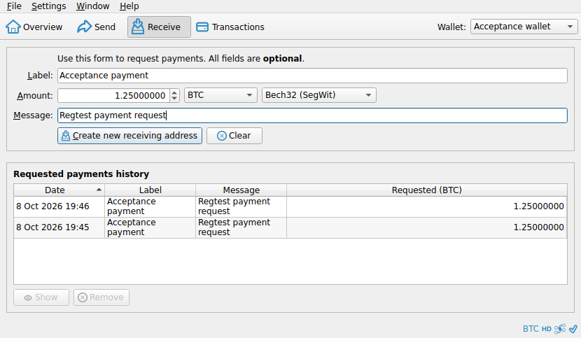
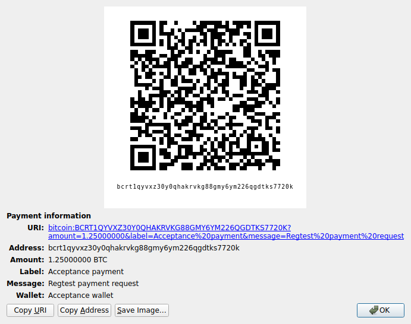
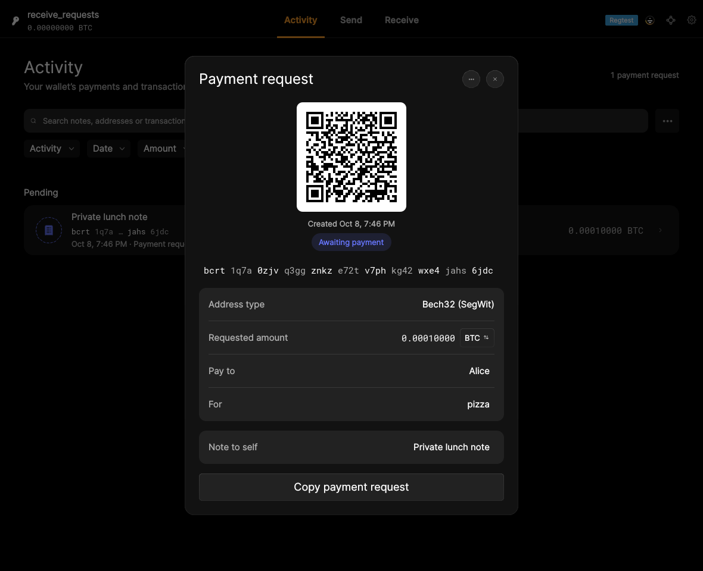

# F08 · Receive Bitcoin / Request Payment

[Evidence index](../README.md) · [Test results](../TEST-RESULTS.md) · [Capture and build provenance](../PROVENANCE.md)

9 acceptance criteria from the supported-feature inventory. **Acceptance is pending review.** A screenshot demonstrates the visible state; the stated assertions describe the behavior that was actually checked. Related passing suites do not certify every variant of a criterion.

## Implementation comparison

**Partial.** Generate receiving addresses, choose address formats, request an amount with descriptive information, and generate payment links and QR codes. Copy addresses/payment requests and QR images, save QR images, and review, reuse, edit, or remove saved requests. Configured watch-only wallets can receive. Device address verification and sharing QR images by drag and drop are missing.

[Receiving](https://github.com/bitcoin-core/gui-qml/blob/a91f4b4774f25de061fe1a7c132a91ddde117fca/qml/pages/wallet/ReceivePage.qml); [Payment requests](https://github.com/bitcoin-core/gui-qml/blob/a91f4b4774f25de061fe1a7c132a91ddde117fca/qml/components/PaymentRequestCard.qml); [Address types](https://github.com/bitcoin-core/gui-qml/blob/a91f4b4774f25de061fe1a7c132a91ddde117fca/qml/models/walletqmlmodel.cpp#L1050).

## Application captures

| Qt Widgets (`src/qt`) | GUI-QML (`qt6`) |
| --- | --- |
|  Receive request form   Receive payment QR |  Watch-only wallet created   Payment request and QR code |

Baseline support notes: *Support: QR support depends on the application build. Request labels and messages describe the request without becoming part of the on-chain transaction.*

[All selected captures for this group](#capture-register) are listed below.

## Modules

- **Qt Widgets:** [primary implementation](https://github.com/bitcoin-core/gui/blob/f739c7876b81304bdc72e7eaa307702da269ac31/src/qt/receivecoinsdialog.cpp).
  [QR support](https://github.com/bitcoin-core/gui/blob/f739c7876b81304bdc72e7eaa307702da269ac31/src/qt/qrimagewidget.cpp).
- **GUI-QML:** [Receiving](https://github.com/bitcoin-core/gui-qml/blob/a91f4b4774f25de061fe1a7c132a91ddde117fca/qml/pages/wallet/ReceivePage.qml); [Payment requests](https://github.com/bitcoin-core/gui-qml/blob/a91f4b4774f25de061fe1a7c132a91ddde117fca/qml/components/PaymentRequestCard.qml); [Address types](https://github.com/bitcoin-core/gui-qml/blob/a91f4b4774f25de061fe1a7c132a91ddde117fca/qml/models/walletqmlmodel.cpp#L1050).

These are the implementation entry points for the criteria below. Links are pinned to the tested source revisions.

## Automated tests

| Application | Test/module | Recorded result |
| --- | --- | --- |
| GUI-QML | [qml_test_receive](https://github.com/bitcoin-core/gui-qml/blob/a91f4b4774f25de061fe1a7c132a91ddde117fca/test/functional/qml_test_receive.py) | [passed](../logs/qml_test_receive.log) |
| GUI-QML | [qml_test_watchonly_wallet](https://github.com/bitcoin-core/gui-qml/blob/a91f4b4774f25de061fe1a7c132a91ddde117fca/test/functional/qml_test_watchonly_wallet.py) | [passed](../logs/qml_test_watchonly_wallet.log) |
| GUI-QML | [qml_test_address_label_sync](https://github.com/bitcoin-core/gui-qml/blob/a91f4b4774f25de061fe1a7c132a91ddde117fca/test/functional/qml_test_address_label_sync.py) | [passed](../logs/qml_test_address_label_sync.log) |
| GUI-QML C++ | [test/test_walletqmlmodel.cpp](https://github.com/bitcoin-core/gui-qml/blob/a91f4b4774f25de061fe1a7c132a91ddde117fca/test/test_walletqmlmodel.cpp) | [Suite passed](../logs/qml-unit-tests.log); fixture/model assertions |
| GUI-QML C++ | [test/test_receiverequesthistorymodel.cpp](https://github.com/bitcoin-core/gui-qml/blob/a91f4b4774f25de061fe1a7c132a91ddde117fca/test/test_receiverequesthistorymodel.cpp) | [Suite passed](../logs/qml-unit-tests.log); fixture/model assertions |
| GUI-QML C++ | [test/test_imageprovider.cpp](https://github.com/bitcoin-core/gui-qml/blob/a91f4b4774f25de061fe1a7c132a91ddde117fca/test/test_imageprovider.cpp) | [Suite passed](../logs/qml-unit-tests.log); fixture/model assertions |
| GUI-QML C++ | [test/test_bitcoinaddress.cpp](https://github.com/bitcoin-core/gui-qml/blob/a91f4b4774f25de061fe1a7c132a91ddde117fca/test/test_bitcoinaddress.cpp) | [Suite passed](../logs/qml-unit-tests.log); fixture/model assertions |
| GUI-QML components | [test/qml/tst_requestpayment.qml](https://github.com/bitcoin-core/gui-qml/blob/a91f4b4774f25de061fe1a7c132a91ddde117fca/test/qml/tst_requestpayment.qml) | [Suite passed](../logs/qml-quick-tests.log); component assertions |
| Qt Widgets | [WalletTests](https://github.com/bitcoin-core/gui/blob/f739c7876b81304bdc72e7eaa307702da269ac31/src/qt/test/wallettests.cpp) | [Suite passed](../logs/widgets-qt-tests.log); inspect assertion scope |
| Qt Widgets additional | [Live GUI/RPC scenarios](../scripts/widgets_scenarios.py) | [Recorded assertions](../logs/widgets-checks.json); outcomes listed per criterion |

## Acceptance criteria

### F08.S01 · Generate receiving addresses using legacy, wrapped SegWit, native SegWit, or Taproot formats supported by the wallet.

| Application | Evidence status | Evidence and limits |
| --- | --- | --- |
| Qt Widgets | Assertions collected | Generated receiving address belongs to the selected wallet. **passed**. **Limit:** The live capture uses native SegWit; all four formats were not individually captured. [Receive request form](../media/widgets/receive-request-form.png) [Modules](#modules) · [Related tests](#automated-tests) |
| GUI-QML | Automated evidence collected | Address-type selection is tested at the wallet-model layer. [Payment request and QR code](../media/qml/qml_test_receive/022-receive-created.png) [Modules](#modules) · [Related tests](#automated-tests) |

- [ ] Acceptance decision recorded by reviewer.

### F08.S02 · Request a payment with an optional amount, label, and message.

| Application | Evidence status | Evidence and limits |
| --- | --- | --- |
| Qt Widgets | Assertions collected | Copied BIP21 link includes address, amount, label and message. **passed**. [Receive request form](../media/widgets/receive-request-form.png) [Receive payment QR](../media/widgets/receive-payment-qr.png) [Modules](#modules) · [Related tests](#automated-tests) |
| GUI-QML | Automated evidence collected | Amount, label, message and request persistence are exercised. [Payment request and QR code](../media/qml/qml_test_receive/022-receive-created.png) [Modules](#modules) · [Related tests](#automated-tests) |

- [ ] Acceptance decision recorded by reviewer.

### F08.S03 · Generate payment links and QR codes.

| Application | Evidence status | Evidence and limits |
| --- | --- | --- |
| Qt Widgets | Assertions collected | Copied BIP21 link includes address, amount, label and message. **passed**. [Receive payment QR](../media/widgets/receive-payment-qr.png) [Modules](#modules) · [Related tests](#automated-tests) |
| GUI-QML | Automated evidence collected | Generated payment URI and QR rendering are exercised. [Payment request and QR code](../media/qml/qml_test_receive/022-receive-created.png) [Modules](#modules) · [Related tests](#automated-tests) |

- [ ] Acceptance decision recorded by reviewer.

### F08.S04 · Copy receiving addresses, payment links, and request details to the clipboard.

| Application | Evidence status | Evidence and limits |
| --- | --- | --- |
| Qt Widgets | Assertions collected | Copy address writes the generated address to the system clipboard. **passed**. Copied BIP21 link includes address, amount, label and message. **passed**. [Receive payment QR](../media/widgets/receive-payment-qr.png) [Modules](#modules) · [Related tests](#automated-tests) |
| GUI-QML | Automated evidence collected | Clipboard payment-request contents are checked. [Payment request and QR code](../media/qml/qml_test_receive/022-receive-created.png) [Payment-request sharing actions](../media/qml/qml_test_receive/024-receive-menu.png) [Modules](#modules) · [Related tests](#automated-tests) |

- [ ] Acceptance decision recorded by reviewer.

### F08.S05 · Copy payment QR codes to the clipboard or save them as images.

| Application | Evidence status | Evidence and limits |
| --- | --- | --- |
| Qt Widgets | Visual evidence only | No targeted runtime assertion collected for this exact criterion. **Limit:** The save-image control is visible; this Widgets capture run does not assert image clipboard/save output. [Receive payment QR](../media/widgets/receive-payment-qr.png) [Modules](#modules) · [Related tests](#automated-tests) |
| GUI-QML | Automated evidence collected | Image clipboard and saved QR file are checked. [Payment request and QR code](../media/qml/qml_test_receive/022-receive-created.png) [Payment-request sharing actions](../media/qml/qml_test_receive/024-receive-menu.png) [Modules](#modules) · [Related tests](#automated-tests) |

- [ ] Acceptance decision recorded by reviewer.

### F08.S06 · Share QR images with other applications using drag and drop.

| Application | Evidence status | Evidence and limits |
| --- | --- | --- |
| Qt Widgets | Related automated suite | No targeted runtime assertion collected for this exact criterion. No matching screenshot collected. [Modules](#modules) · [Related tests](#automated-tests) |
| GUI-QML | Implementation gap | No QR image drag-and-drop export. No screenshot: this GUI workflow is absent. [Modules](#modules) · [Related tests](#automated-tests) |

- [ ] Acceptance decision recorded by reviewer.

### F08.S07 · Review, reuse, and remove saved payment requests.

| Application | Evidence status | Evidence and limits |
| --- | --- | --- |
| Qt Widgets | Visual evidence only | No targeted runtime assertion collected for this exact criterion. [Receive request form](../media/widgets/receive-request-form.png) [Receive saved request](../media/widgets/receive-saved-request.png) [Modules](#modules) · [Related tests](#automated-tests) |
| GUI-QML | Automated evidence collected | Create, edit, reuse and delete request flows are exercised. [Payment-request sharing actions](../media/qml/qml_test_receive/024-receive-menu.png) [Modules](#modules) · [Related tests](#automated-tests) |

- [ ] Acceptance decision recorded by reviewer.

### F08.S08 · Verify receiving addresses on a compatible signing device.

| Application | Evidence status | Evidence and limits |
| --- | --- | --- |
| Qt Widgets | Related automated suite | No targeted runtime assertion collected for this exact criterion. **Limit:** No physical signing device was available. No matching screenshot collected. [Modules](#modules) · [Related tests](#automated-tests) |
| GUI-QML | Implementation gap | No address verification on a signing device. No screenshot: this GUI workflow is absent. [Modules](#modules) · [Related tests](#automated-tests) |

- [ ] Acceptance decision recorded by reviewer.

### F08.S09 · Generate receiving addresses for a configured watch-only wallet.

| Application | Evidence status | Evidence and limits |
| --- | --- | --- |
| Qt Widgets | Related automated suite | No targeted runtime assertion collected for this exact criterion. No matching screenshot collected. [Modules](#modules) · [Related tests](#automated-tests) |
| GUI-QML | Automated evidence collected | Configured xpub wallet creation and receiving-address derivation are exercised. [Watch-only wallet created](../media/qml/qml_test_watchonly_wallet/006-wait-for-page-walletcreationreadypage.png) [Modules](#modules) · [Related tests](#automated-tests) |

- [ ] Acceptance decision recorded by reviewer.

## Capture register

The original PNGs are unmodified application captures. Timestamps, dimensions and SHA-256 hashes are in the [capture manifest](../selected-captures.json). Some early/raw frames are not selected for review.

| Application | Capture | Criteria |
| --- | --- | --- |
| widgets | [Receive request form](../media/widgets/receive-request-form.png) | F08.S01, F08.S02, F08.S07 |
| widgets | [Receive payment QR](../media/widgets/receive-payment-qr.png) | F08.S02, F08.S03, F08.S04, F08.S05 |
| widgets | [Receive saved request](../media/widgets/receive-saved-request.png) | F08.S07 |
| qml | [Watch-only wallet created](../media/qml/qml_test_watchonly_wallet/006-wait-for-page-walletcreationreadypage.png) | F08.S09 |
| qml | [Payment request and QR code](../media/qml/qml_test_receive/022-receive-created.png) | F08.S01, F08.S02, F08.S03, F08.S04, F08.S05 |
| qml | [Payment-request sharing actions](../media/qml/qml_test_receive/024-receive-menu.png) | F08.S04, F08.S05, F08.S07 |
