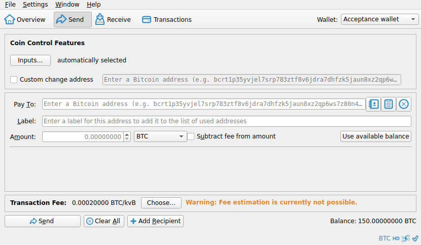

# F09 · Send Bitcoin

[Evidence index](../README.md) · [Test results](../TEST-RESULTS.md) · [Capture and build provenance](../PROVENANCE.md)

9 acceptance criteria from the supported-feature inventory. **Acceptance is pending review.** A screenshot demonstrates the visible state; the stated assertions describe the behavior that was actually checked. Related passing suites do not certify every variant of a criterion.

## Implementation comparison

**Partial.** Single or multiple recipients, pasted addresses, recipient notes/labels, sending the available balance, validation, and payment review. Local signing, external signing, and saving a watch-only payment for signing elsewhere are available. No saved-recipient picker or general control for subtracting fees from selected recipient amounts.

[Sending](https://github.com/bitcoin-core/gui-qml/blob/a91f4b4774f25de061fe1a7c132a91ddde117fca/qml/pages/wallet/SendCreate.qml); [Payment review](https://github.com/bitcoin-core/gui-qml/blob/a91f4b4774f25de061fe1a7c132a91ddde117fca/qml/pages/wallet/SendTransactionReview.qml).

## Application captures

| Qt Widgets (`src/qt`) | GUI-QML (`qt6`) |
| --- | --- |
|  Send coin control   Send fee selection |  Unlock for transaction review   Transaction reviewed after temporary unlock |

[All selected captures for this group](#capture-register) are listed below.

## Modules

- **Qt Widgets:** [primary implementation](https://github.com/bitcoin-core/gui/blob/f739c7876b81304bdc72e7eaa307702da269ac31/src/qt/sendcoinsdialog.cpp).
  [Payment validation](https://github.com/bitcoin-core/gui/blob/f739c7876b81304bdc72e7eaa307702da269ac31/src/qt/walletmodel.cpp).
- **GUI-QML:** [Sending](https://github.com/bitcoin-core/gui-qml/blob/a91f4b4774f25de061fe1a7c132a91ddde117fca/qml/pages/wallet/SendCreate.qml); [Payment review](https://github.com/bitcoin-core/gui-qml/blob/a91f4b4774f25de061fe1a7c132a91ddde117fca/qml/pages/wallet/SendTransactionReview.qml).

These are the implementation entry points for the criteria below. Links are pinned to the tested source revisions.

## Automated tests

| Application | Test/module | Recorded result |
| --- | --- | --- |
| GUI-QML | [qml_test_send_receive](https://github.com/bitcoin-core/gui-qml/blob/a91f4b4774f25de061fe1a7c132a91ddde117fca/test/functional/qml_test_send_receive.py) | [passed](../logs/qml_test_send_receive.log) |
| GUI-QML | [qml_test_send_create](https://github.com/bitcoin-core/gui-qml/blob/a91f4b4774f25de061fe1a7c132a91ddde117fca/test/functional/qml_test_send_create.py) | [failed](../logs/qml_test_send_create.log) |
| GUI-QML | [qml_test_password_wallet](https://github.com/bitcoin-core/gui-qml/blob/a91f4b4774f25de061fe1a7c132a91ddde117fca/test/functional/qml_test_password_wallet.py) | [passed](../logs/qml_test_password_wallet.log) |
| GUI-QML | [qml_test_external_signer](https://github.com/bitcoin-core/gui-qml/blob/a91f4b4774f25de061fe1a7c132a91ddde117fca/test/functional/qml_test_external_signer.py) | [passed](../logs/qml_test_external_signer.log) |
| GUI-QML C++ | [test/test_walletqmlmodel.cpp](https://github.com/bitcoin-core/gui-qml/blob/a91f4b4774f25de061fe1a7c132a91ddde117fca/test/test_walletqmlmodel.cpp) | [Suite passed](../logs/qml-unit-tests.log); fixture/model assertions |
| GUI-QML C++ | [test/test_sendrecipientslistmodel.cpp](https://github.com/bitcoin-core/gui-qml/blob/a91f4b4774f25de061fe1a7c132a91ddde117fca/test/test_sendrecipientslistmodel.cpp) | [Suite passed](../logs/qml-unit-tests.log); fixture/model assertions |
| GUI-QML C++ | [test/test_walletqmlmodeltransaction.cpp](https://github.com/bitcoin-core/gui-qml/blob/a91f4b4774f25de061fe1a7c132a91ddde117fca/test/test_walletqmlmodeltransaction.cpp) | [Suite passed](../logs/qml-unit-tests.log); fixture/model assertions |
| GUI-QML components | [test/qml/tst_sendcreate.qml](https://github.com/bitcoin-core/gui-qml/blob/a91f4b4774f25de061fe1a7c132a91ddde117fca/test/qml/tst_sendcreate.qml) | [Suite passed](../logs/qml-quick-tests.log); component assertions |
| GUI-QML components | [test/qml/tst_sendoptionspopup.qml](https://github.com/bitcoin-core/gui-qml/blob/a91f4b4774f25de061fe1a7c132a91ddde117fca/test/qml/tst_sendoptionspopup.qml) | [Suite passed](../logs/qml-quick-tests.log); component assertions |
| GUI-QML components | [test/qml/tst_transactionflow.qml](https://github.com/bitcoin-core/gui-qml/blob/a91f4b4774f25de061fe1a7c132a91ddde117fca/test/qml/tst_transactionflow.qml) | [Suite passed](../logs/qml-quick-tests.log); component assertions |
| GUI-QML additional | [Independent live scenarios](../scripts/qml_additional.py) | [Passed](../logs/qml-additional.log), [assertions](../logs/qml-additional-checks.json) |
| Qt Widgets | [WalletTests](https://github.com/bitcoin-core/gui/blob/f739c7876b81304bdc72e7eaa307702da269ac31/src/qt/test/wallettests.cpp) | [Suite passed](../logs/widgets-qt-tests.log); inspect assertion scope |
| Qt Widgets additional | [Live GUI/RPC scenarios](../scripts/widgets_scenarios.py) | [Recorded assertions](../logs/widgets-checks.json); outcomes listed per criterion |

## Acceptance criteria

### F09.S01 · Pay one recipient or multiple recipients in a single transaction.

| Application | Evidence status | Evidence and limits |
| --- | --- | --- |
| Qt Widgets | Visual evidence only | No targeted runtime assertion collected for this exact criterion. **Limit:** The live transaction has one recipient. Multiple-recipient behavior is only covered by related existing tests/source. [Send coin control](../media/widgets/send-coin-control.png) [Send fee selection](../media/widgets/send-fee-selection.png) [Modules](#modules) · [Related tests](#automated-tests) |
| GUI-QML | Automated evidence collected | One/multiple recipients proceed through review; an independent multi-recipient scenario also passes. Two recipients with a custom fee can proceed to review. **passed**. [Payment review](../media/qml/qml_test_send_receive/012-14-review-page-with-fixed-amount.png) [Maximum amount with another recipient](../media/qml/qml_test_send_receive/007-09-maximum-preserves-the-fixed-amount-of-another-recipient.png) [Multiple recipients and custom fee](../media/qml/qml_additional/006-send-multiple-custom-fee.png) [Modules](#modules) · [Related tests](#automated-tests) |

- [ ] Acceptance decision recorded by reviewer.

### F09.S02 · Enter or paste a recipient address, or use a saved address.

| Application | Evidence status | Evidence and limits |
| --- | --- | --- |
| Qt Widgets | Visual evidence only | No targeted runtime assertion collected for this exact criterion. [Send coin control](../media/widgets/send-coin-control.png) [Send fee selection](../media/widgets/send-fee-selection.png) [Modules](#modules) · [Related tests](#automated-tests) |
| GUI-QML | Partial / limited evidence | Entry and paste work; no saved-recipient picker. No matching screenshot collected. [Modules](#modules) · [Related tests](#automated-tests) |

- [ ] Acceptance decision recorded by reviewer.

### F09.S03 · Associate recipient addresses with recognizable labels.

| Application | Evidence status | Evidence and limits |
| --- | --- | --- |
| Qt Widgets | Visual evidence only | No targeted runtime assertion collected for this exact criterion. [Send fee selection](../media/widgets/send-fee-selection.png) [Modules](#modules) · [Related tests](#automated-tests) |
| GUI-QML | Partial / limited evidence | Recipient-note restoration fails in qml_test_send_create after editing the first recipient again. No matching screenshot collected. [Modules](#modules) · [Related tests](#automated-tests) |

- [ ] Acceptance decision recorded by reviewer.

### F09.S04 · Send the available balance.

| Application | Evidence status | Evidence and limits |
| --- | --- | --- |
| Qt Widgets | Visual evidence only | No targeted runtime assertion collected for this exact criterion. [Send coin control](../media/widgets/send-coin-control.png) [Modules](#modules) · [Related tests](#automated-tests) |
| GUI-QML | Automated evidence collected | Maximum spending is compared with sendall RPC and locked-coin exclusions. [Maximum amount with another recipient](../media/qml/qml_test_send_receive/007-09-maximum-preserves-the-fixed-amount-of-another-recipient.png) [Maximum spending excludes locked coins](../media/qml/qml_test_send_receive/008-10-automatic-maximum-excludes-locked-coins-and-shows-both-warnings.png) [Modules](#modules) · [Related tests](#automated-tests) |

- [ ] Acceptance decision recorded by reviewer.

### F09.S05 · Deduct fees from selected recipient amounts.

| Application | Evidence status | Evidence and limits |
| --- | --- | --- |
| Qt Widgets | Visual evidence only | No targeted runtime assertion collected for this exact criterion. [Send coin control](../media/widgets/send-coin-control.png) [Send fee selection](../media/widgets/send-fee-selection.png) [Modules](#modules) · [Related tests](#automated-tests) |
| GUI-QML | Implementation gap | No general recipient fee-subtraction control. No screenshot: this GUI workflow is absent. [Modules](#modules) · [Related tests](#automated-tests) |

- [ ] Acceptance decision recorded by reviewer.

### F09.S06 · Review payment details and total costs before authorizing a transaction.

| Application | Evidence status | Evidence and limits |
| --- | --- | --- |
| Qt Widgets | Visual evidence only | No targeted runtime assertion collected for this exact criterion. [Send review](../media/widgets/send-review.png) [Modules](#modules) · [Related tests](#automated-tests) |
| GUI-QML | Automated evidence collected | Prepared amounts and fee remain stable through review. [Unlock for transaction review](../media/qml/qml_test_password_wallet/007-07-review-passphrase-prompt-displayed.png) [Transaction reviewed after temporary unlock](../media/qml/qml_test_password_wallet/008-08-review-built-and-wallet-relocked.png) [Payment review](../media/qml/qml_test_send_receive/012-14-review-page-with-fixed-amount.png) [Modules](#modules) · [Related tests](#automated-tests) |

- [ ] Acceptance decision recorded by reviewer.

### F09.S07 · Sign payments with local spending keys or a compatible external signer.

| Application | Evidence status | Evidence and limits |
| --- | --- | --- |
| Qt Widgets | Assertions collected | GUI broadcast reaches the node mempool. **passed**. **Limit:** The live round trip signs with local keys; no Widgets external signer is exercised. No matching screenshot collected. [Modules](#modules) · [Related tests](#automated-tests) |
| GUI-QML | Partial / limited evidence | Local signing and a mock external signer are exercised; physical hardware is not. Local and mock-signer transactions reach broadcast. [Transaction reviewed after temporary unlock](../media/qml/qml_test_password_wallet/008-08-review-built-and-wallet-relocked.png) [Payment review](../media/qml/qml_test_send_receive/012-14-review-page-with-fixed-amount.png) [Modules](#modules) · [Related tests](#automated-tests) |

- [ ] Acceptance decision recorded by reviewer.

### F09.S08 · Prepare a payment from a watch-only wallet for signing elsewhere.

| Application | Evidence status | Evidence and limits |
| --- | --- | --- |
| Qt Widgets | Related automated suite | No targeted runtime assertion collected for this exact criterion. No matching screenshot collected. [Modules](#modules) · [Related tests](#automated-tests) |
| GUI-QML | Automated evidence collected | Watch-only/imported PSBT review paths are tested; exhaustive watch-only creation is not. No matching screenshot collected. [Modules](#modules) · [Related tests](#automated-tests) |

- [ ] Acceptance decision recorded by reviewer.

### F09.S09 · Check payment details and available funds before sending.

| Application | Evidence status | Evidence and limits |
| --- | --- | --- |
| Qt Widgets | Visual evidence only | No targeted runtime assertion collected for this exact criterion. [Send review](../media/widgets/send-review.png) [Modules](#modules) · [Related tests](#automated-tests) |
| GUI-QML | Automated evidence collected | Dust, duplicates, invalid amounts, missing fees and balance limits have assertions. [Payment review](../media/qml/qml_test_send_receive/012-14-review-page-with-fixed-amount.png) [Modules](#modules) · [Related tests](#automated-tests) |

- [ ] Acceptance decision recorded by reviewer.

## Capture register

The original PNGs are unmodified application captures. Timestamps, dimensions and SHA-256 hashes are in the [capture manifest](../selected-captures.json). Some early/raw frames are not selected for review.

| Application | Capture | Criteria |
| --- | --- | --- |
| widgets | [Send coin control](../media/widgets/send-coin-control.png) | F09.S01, F09.S02, F09.S04, F09.S05 |
| widgets | [Send fee selection](../media/widgets/send-fee-selection.png) | F09.S01, F09.S02, F09.S03, F09.S05 |
| widgets | [Send review](../media/widgets/send-review.png) | F09.S06, F09.S09 |
| qml | [Unlock for transaction review](../media/qml/qml_test_password_wallet/007-07-review-passphrase-prompt-displayed.png) | F09.S06 |
| qml | [Transaction reviewed after temporary unlock](../media/qml/qml_test_password_wallet/008-08-review-built-and-wallet-relocked.png) | F09.S06, F09.S07 |
| qml | [Payment review](../media/qml/qml_test_send_receive/012-14-review-page-with-fixed-amount.png) | F09.S01, F09.S06, F09.S07, F09.S09 |
| qml | [Maximum amount with another recipient](../media/qml/qml_test_send_receive/007-09-maximum-preserves-the-fixed-amount-of-another-recipient.png) | F09.S01, F09.S04 |
| qml | [Maximum spending excludes locked coins](../media/qml/qml_test_send_receive/008-10-automatic-maximum-excludes-locked-coins-and-shows-both-warnings.png) | F09.S04 |
| qml | [Multiple recipients and custom fee](../media/qml/qml_additional/006-send-multiple-custom-fee.png) | F09.S01 |
