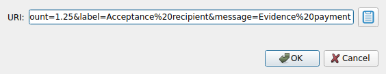
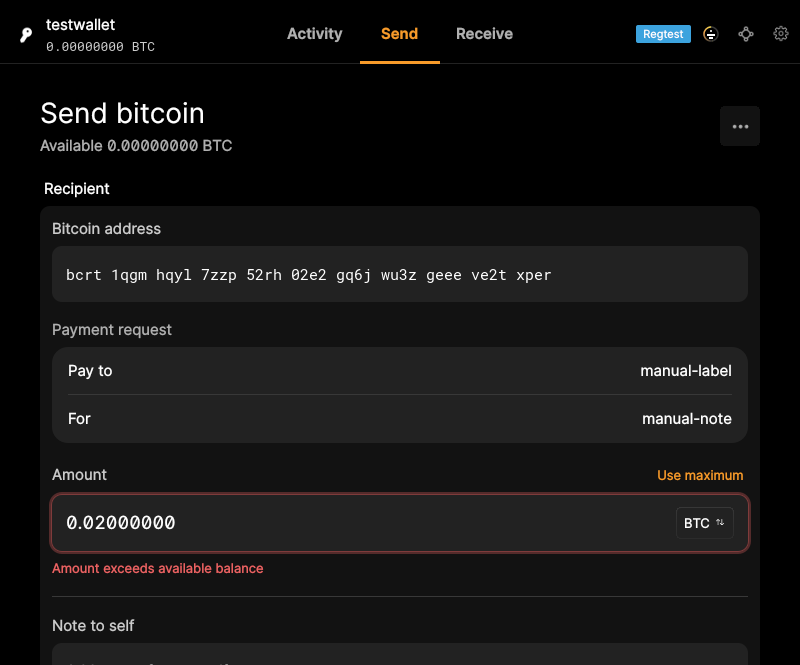

# F10 · Open Payment URI

[Evidence index](../README.md) · [Test results](../TEST-RESULTS.md) · [Capture and build provenance](../PROVENANCE.md)

3 acceptance criteria from the supported-feature inventory. **Acceptance is pending review.** A screenshot demonstrates the visible state; the stated assertions describe the behavior that was actually checked. Related passing suites do not certify every variant of a criterion.

## Implementation comparison

**Partial.** Import BIP21 requests by entering or pasting a link, selecting a file, or dragging and dropping; review and apply the recipient, amount, label, and message. Desktop/operating-system delivery and forwarding requests to an already-running application are missing.

[Payment-request import](https://github.com/bitcoin-core/gui-qml/blob/a91f4b4774f25de061fe1a7c132a91ddde117fca/qml/pages/wallet/SendCreate.qml); [URI handling](https://github.com/bitcoin-core/gui-qml/blob/a91f4b4774f25de061fe1a7c132a91ddde117fca/qml/models/bitcoinurimodel.cpp).

## Application captures

| Qt Widgets (`src/qt`) | GUI-QML (`qt6`) |
| --- | --- |
|  Open payment URI |  Imported payment request |

Baseline support notes: *Support: Supports BIP21 payment links; BIP70 payment requests are unsupported.*

## Modules

- **Qt Widgets:** [primary implementation](https://github.com/bitcoin-core/gui/blob/f739c7876b81304bdc72e7eaa307702da269ac31/src/qt/paymentserver.cpp).
- **GUI-QML:** [Payment-request import](https://github.com/bitcoin-core/gui-qml/blob/a91f4b4774f25de061fe1a7c132a91ddde117fca/qml/pages/wallet/SendCreate.qml); [URI handling](https://github.com/bitcoin-core/gui-qml/blob/a91f4b4774f25de061fe1a7c132a91ddde117fca/qml/models/bitcoinurimodel.cpp).

These are the implementation entry points for the criteria below. Links are pinned to the tested source revisions.

## Automated tests

| Application | Test/module | Recorded result |
| --- | --- | --- |
| GUI-QML | [qml_test_uri_import](https://github.com/bitcoin-core/gui-qml/blob/a91f4b4774f25de061fe1a7c132a91ddde117fca/test/functional/qml_test_uri_import.py) | [passed](../logs/qml_test_uri_import.log) |
| GUI-QML | [qml_test_uri_argument_injection](https://github.com/bitcoin-core/gui-qml/blob/a91f4b4774f25de061fe1a7c132a91ddde117fca/test/functional/qml_test_uri_argument_injection.py) | [passed](../logs/qml_test_uri_argument_injection.log) |
| GUI-QML C++ | [test/test_bitcoinuri.cpp](https://github.com/bitcoin-core/gui-qml/blob/a91f4b4774f25de061fe1a7c132a91ddde117fca/test/test_bitcoinuri.cpp) | [Suite passed](../logs/qml-unit-tests.log); fixture/model assertions |
| GUI-QML components | [test/qml/tst_sendcreate.qml](https://github.com/bitcoin-core/gui-qml/blob/a91f4b4774f25de061fe1a7c132a91ddde117fca/test/qml/tst_sendcreate.qml) | [Suite passed](../logs/qml-quick-tests.log); component assertions |
| Qt Widgets | [URITests](https://github.com/bitcoin-core/gui/blob/f739c7876b81304bdc72e7eaa307702da269ac31/src/qt/test/uritests.cpp) | [Suite passed](../logs/widgets-qt-tests.log); inspect assertion scope |
| Qt Widgets additional | [Live GUI/RPC scenarios](../scripts/widgets_scenarios.py) | [Recorded assertions](../logs/widgets-checks.json); outcomes listed per criterion |

## Acceptance criteria

### F10.S01 · Open or paste Bitcoin payment links.

| Application | Evidence status | Evidence and limits |
| --- | --- | --- |
| Qt Widgets | Assertions collected | Opening a payment URI populates recipient and amount. **passed**. [Open payment URI](../media/widgets/open-payment-uri.png) [Modules](#modules) · [Related tests](#automated-tests) |
| GUI-QML | Automated evidence collected | Entered/pasted/file payment links parse through the live UI. [Imported payment request](../media/qml/qml_test_uri_import/006-click-senduriimportapplybutton.png) [Modules](#modules) · [Related tests](#automated-tests) |

- [ ] Acceptance decision recorded by reviewer.

### F10.S02 · Prepare a payment using the requested recipient, amount, and descriptive information.

| Application | Evidence status | Evidence and limits |
| --- | --- | --- |
| Qt Widgets | Assertions collected | Opening a payment URI populates recipient and amount. **passed**. [Open payment URI](../media/widgets/open-payment-uri.png) [Modules](#modules) · [Related tests](#automated-tests) |
| GUI-QML | Automated evidence collected | Recipient, amount, label and message populate the payment form. [Imported payment request](../media/qml/qml_test_uri_import/006-click-senduriimportapplybutton.png) [Modules](#modules) · [Related tests](#automated-tests) |

- [ ] Acceptance decision recorded by reviewer.

### F10.S03 · Handle payment requests from other applications, including while Bitcoin Core is already running.

| Application | Evidence status | Evidence and limits |
| --- | --- | --- |
| Qt Widgets | Related automated suite | No targeted runtime assertion collected for this exact criterion. No matching screenshot collected. [Modules](#modules) · [Related tests](#automated-tests) |
| GUI-QML | Implementation gap | No operating-system URI delivery or forwarding workflow. No screenshot: this GUI workflow is absent. [Modules](#modules) · [Related tests](#automated-tests) |

- [ ] Acceptance decision recorded by reviewer.

## Capture register

The original PNGs are unmodified application captures. Timestamps, dimensions and SHA-256 hashes are in the [capture manifest](../selected-captures.json). Some early/raw frames are not selected for review.

| Application | Capture | Criteria |
| --- | --- | --- |
| widgets | [Open payment URI](../media/widgets/open-payment-uri.png) | F10.S01, F10.S02 |
| qml | [Imported payment request](../media/qml/qml_test_uri_import/006-click-senduriimportapplybutton.png) | F10.S01, F10.S02 |
