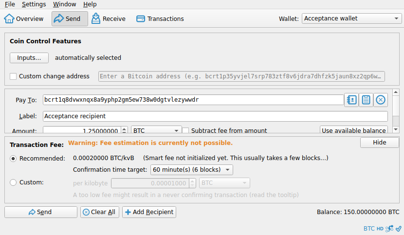
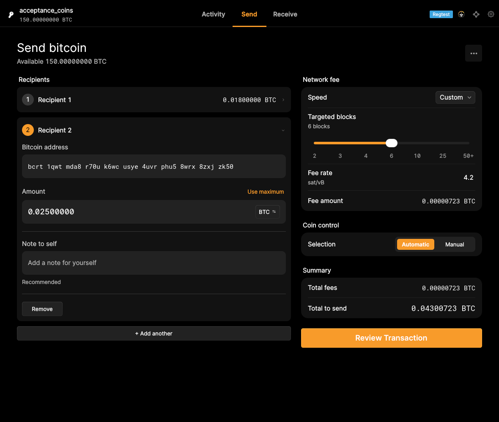

# F11 · Choose Transaction Fee

[Evidence index](../README.md) · [Test results](../TEST-RESULTS.md) · [Capture and build provenance](../PROVENANCE.md)

4 acceptance criteria from the supported-feature inventory. **Acceptance is pending review.** A screenshot demonstrates the visible state; the stated assertions describe the behavior that was actually checked. Related passing suites do not certify every variant of a criterion.

## Implementation comparison

**Implemented.** Choose estimated fees by confirmation target, set a custom fee rate, review the target and fee amount, and see when estimates are unavailable.

[Fee selection](https://github.com/bitcoin-core/gui-qml/blob/a91f4b4774f25de061fe1a7c132a91ddde117fca/qml/components/SendFeeSelection.qml); [Estimate feedback](https://github.com/bitcoin-core/gui-qml/blob/a91f4b4774f25de061fe1a7c132a91ddde117fca/qml/pages/wallet/SendCreate.qml#L969).

## Application captures

| Qt Widgets (`src/qt`) | GUI-QML (`qt6`) |
| --- | --- |
|  Send fee selection |  Payment review   Multiple recipients and custom fee |

## Modules

- **Qt Widgets:** [primary implementation](https://github.com/bitcoin-core/gui/blob/f739c7876b81304bdc72e7eaa307702da269ac31/src/qt/sendcoinsdialog.cpp).
- **GUI-QML:** [Fee selection](https://github.com/bitcoin-core/gui-qml/blob/a91f4b4774f25de061fe1a7c132a91ddde117fca/qml/components/SendFeeSelection.qml); [Estimate feedback](https://github.com/bitcoin-core/gui-qml/blob/a91f4b4774f25de061fe1a7c132a91ddde117fca/qml/pages/wallet/SendCreate.qml#L969).

These are the implementation entry points for the criteria below. Links are pinned to the tested source revisions.

## Automated tests

| Application | Test/module | Recorded result |
| --- | --- | --- |
| GUI-QML | [qml_test_send_receive](https://github.com/bitcoin-core/gui-qml/blob/a91f4b4774f25de061fe1a7c132a91ddde117fca/test/functional/qml_test_send_receive.py) | [passed](../logs/qml_test_send_receive.log) |
| GUI-QML | [qml_test_send_create](https://github.com/bitcoin-core/gui-qml/blob/a91f4b4774f25de061fe1a7c132a91ddde117fca/test/functional/qml_test_send_create.py) | [failed](../logs/qml_test_send_create.log) |
| GUI-QML C++ | [test/test_walletqmlmodel.cpp](https://github.com/bitcoin-core/gui-qml/blob/a91f4b4774f25de061fe1a7c132a91ddde117fca/test/test_walletqmlmodel.cpp) | [Suite passed](../logs/qml-unit-tests.log); fixture/model assertions |
| GUI-QML components | [test/qml/tst_feeselection.qml](https://github.com/bitcoin-core/gui-qml/blob/a91f4b4774f25de061fe1a7c132a91ddde117fca/test/qml/tst_feeselection.qml) | [Suite passed](../logs/qml-quick-tests.log); component assertions |
| GUI-QML components | [test/qml/tst_sendfeeselection.qml](https://github.com/bitcoin-core/gui-qml/blob/a91f4b4774f25de061fe1a7c132a91ddde117fca/test/qml/tst_sendfeeselection.qml) | [Suite passed](../logs/qml-quick-tests.log); component assertions |
| GUI-QML additional | [Independent live scenarios](../scripts/qml_additional.py) | [Passed](../logs/qml-additional.log), [assertions](../logs/qml-additional-checks.json) |
| Qt Widgets | [WalletTests](https://github.com/bitcoin-core/gui/blob/f739c7876b81304bdc72e7eaa307702da269ac31/src/qt/test/wallettests.cpp) | [Suite passed](../logs/widgets-qt-tests.log); inspect assertion scope |

## Acceptance criteria

### F11.S01 · Choose an estimated fee based on the desired confirmation speed.

| Application | Evidence status | Evidence and limits |
| --- | --- | --- |
| Qt Widgets | Visual evidence only | No targeted runtime assertion collected for this exact criterion. [Send fee selection](../media/widgets/send-fee-selection.png) [Modules](#modules) · [Related tests](#automated-tests) |
| GUI-QML | Automated evidence collected | Fee target choices and fallback behavior have model/UI assertions. [Payment review](../media/qml/qml_test_send_receive/012-14-review-page-with-fixed-amount.png) [Modules](#modules) · [Related tests](#automated-tests) |

- [ ] Acceptance decision recorded by reviewer.

### F11.S02 · Set a custom fee rate.

| Application | Evidence status | Evidence and limits |
| --- | --- | --- |
| Qt Widgets | Visual evidence only | No targeted runtime assertion collected for this exact criterion. [Send fee selection](../media/widgets/send-fee-selection.png) [Modules](#modules) · [Related tests](#automated-tests) |
| GUI-QML | Automated evidence collected | Custom rate is accepted in the independent live scenario. Two recipients with a custom fee can proceed to review. **passed**. [Payment review](../media/qml/qml_test_send_receive/012-14-review-page-with-fixed-amount.png) [Multiple recipients and custom fee](../media/qml/qml_additional/006-send-multiple-custom-fee.png) [Modules](#modules) · [Related tests](#automated-tests) |

- [ ] Acceptance decision recorded by reviewer.

### F11.S03 · Assess expected confirmation timing.

| Application | Evidence status | Evidence and limits |
| --- | --- | --- |
| Qt Widgets | Visual evidence only | No targeted runtime assertion collected for this exact criterion. [Send fee selection](../media/widgets/send-fee-selection.png) [Modules](#modules) · [Related tests](#automated-tests) |
| GUI-QML | Automated evidence collected | Target/fee review is checked; real-world confirmation latency is not predicted by this evidence. [Payment review](../media/qml/qml_test_send_receive/012-14-review-page-with-fixed-amount.png) [Modules](#modules) · [Related tests](#automated-tests) |

- [ ] Acceptance decision recorded by reviewer.

### F11.S04 · Know when a fee estimate is unavailable.

| Application | Evidence status | Evidence and limits |
| --- | --- | --- |
| Qt Widgets | Visual evidence only | No targeted runtime assertion collected for this exact criterion. [Send fee selection](../media/widgets/send-fee-selection.png) [Modules](#modules) · [Related tests](#automated-tests) |
| GUI-QML | Automated evidence collected | Unavailable estimates and missing-recipient feedback are asserted. No matching screenshot collected. [Modules](#modules) · [Related tests](#automated-tests) |

- [ ] Acceptance decision recorded by reviewer.

## Capture register

The original PNGs are unmodified application captures. Timestamps, dimensions and SHA-256 hashes are in the [capture manifest](../selected-captures.json). Some early/raw frames are not selected for review.

| Application | Capture | Criteria |
| --- | --- | --- |
| widgets | [Send fee selection](../media/widgets/send-fee-selection.png) | F11.S01, F11.S02, F11.S03, F11.S04 |
| qml | [Payment review](../media/qml/qml_test_send_receive/012-14-review-page-with-fixed-amount.png) | F11.S01, F11.S02, F11.S03 |
| qml | [Multiple recipients and custom fee](../media/qml/qml_additional/006-send-multiple-custom-fee.png) | F11.S02 |
