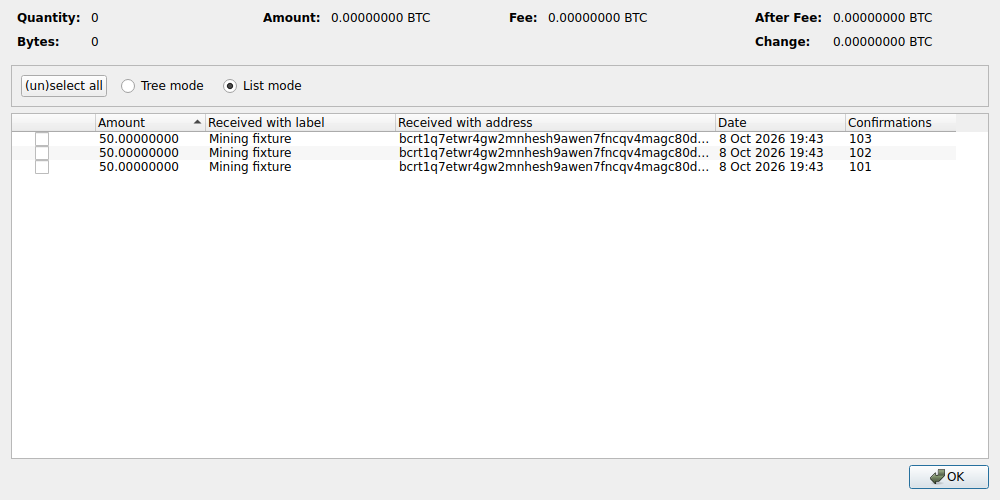
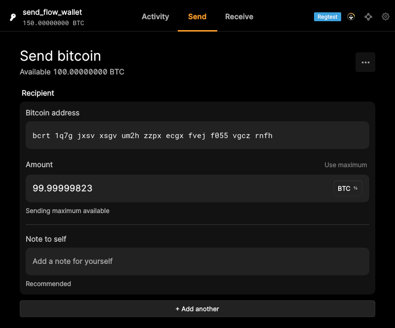
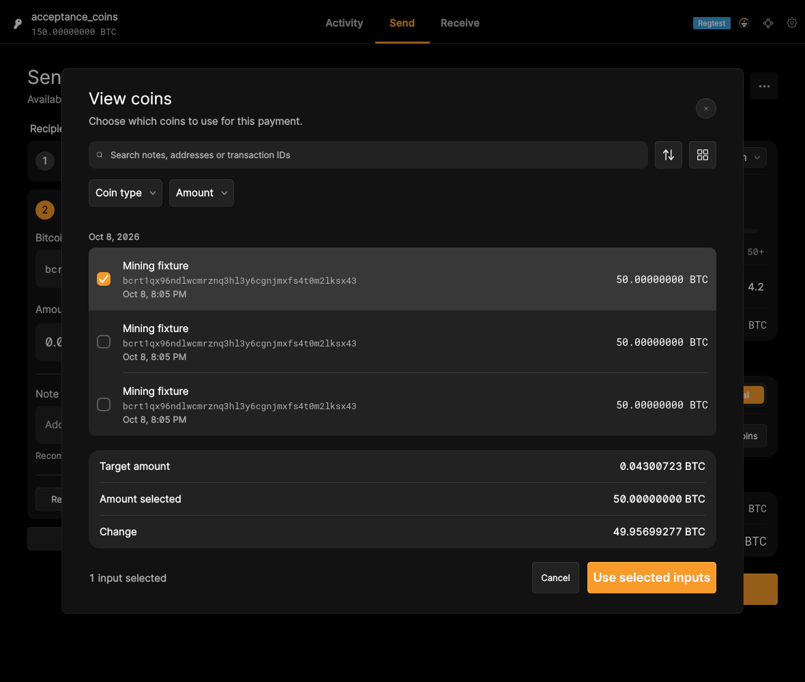

# F12 · Select Coins / Coin Control

[Evidence index](../README.md) · [Test results](../TEST-RESULTS.md) · [Capture and build provenance](../PROVENANCE.md)

9 acceptance criteria from the supported-feature inventory. **Acceptance is pending review.** A screenshot demonstrates the visible state; the stated assertions describe the behavior that was actually checked. Related passing suites do not certify every variant of a criterion.

## Implementation comparison

**Partial.** Select individual or multiple inputs; browse, search, sort, and group coins; lock/unlock coins; review selected funds, fees, and change estimates. Coin confirmation counts, coin-detail clipboard actions, and custom change destinations are missing.

[Coin controls](https://github.com/bitcoin-core/gui-qml/blob/a91f4b4774f25de061fe1a7c132a91ddde117fca/qml/components/CoinsList.qml); [Coin data](https://github.com/bitcoin-core/gui-qml/blob/a91f4b4774f25de061fe1a7c132a91ddde117fca/qml/models/coinslistmodel.h).

## Application captures

| Qt Widgets (`src/qt`) | GUI-QML (`qt6`) |
| --- | --- |
|  Send coin control   Coin control inputs |  Maximum spending excludes locked coins   Selected transaction input |

[All selected captures for this group](#capture-register) are listed below.

## Modules

- **Qt Widgets:** [primary implementation](https://github.com/bitcoin-core/gui/blob/f739c7876b81304bdc72e7eaa307702da269ac31/src/qt/coincontroldialog.cpp).
- **GUI-QML:** [Coin controls](https://github.com/bitcoin-core/gui-qml/blob/a91f4b4774f25de061fe1a7c132a91ddde117fca/qml/components/CoinsList.qml); [Coin data](https://github.com/bitcoin-core/gui-qml/blob/a91f4b4774f25de061fe1a7c132a91ddde117fca/qml/models/coinslistmodel.h).

These are the implementation entry points for the criteria below. Links are pinned to the tested source revisions.

## Automated tests

| Application | Test/module | Recorded result |
| --- | --- | --- |
| GUI-QML | [qml_test_send_receive](https://github.com/bitcoin-core/gui-qml/blob/a91f4b4774f25de061fe1a7c132a91ddde117fca/test/functional/qml_test_send_receive.py) | [passed](../logs/qml_test_send_receive.log) |
| GUI-QML | [qml_test_send_create](https://github.com/bitcoin-core/gui-qml/blob/a91f4b4774f25de061fe1a7c132a91ddde117fca/test/functional/qml_test_send_create.py) | [failed](../logs/qml_test_send_create.log) |
| GUI-QML C++ | [test/test_coinslistmodel.cpp](https://github.com/bitcoin-core/gui-qml/blob/a91f4b4774f25de061fe1a7c132a91ddde117fca/test/test_coinslistmodel.cpp) | [Suite passed](../logs/qml-unit-tests.log); fixture/model assertions |
| GUI-QML C++ | [test/test_walletqmlmodel.cpp](https://github.com/bitcoin-core/gui-qml/blob/a91f4b4774f25de061fe1a7c132a91ddde117fca/test/test_walletqmlmodel.cpp) | [Suite passed](../logs/qml-unit-tests.log); fixture/model assertions |
| GUI-QML components | [test/qml/tst_sendcreate.qml](https://github.com/bitcoin-core/gui-qml/blob/a91f4b4774f25de061fe1a7c132a91ddde117fca/test/qml/tst_sendcreate.qml) | [Suite passed](../logs/qml-quick-tests.log); component assertions |
| GUI-QML additional | [Independent live scenarios](../scripts/qml_additional.py) | [Passed](../logs/qml-additional.log), [assertions](../logs/qml-additional-checks.json) |
| Qt Widgets | [WalletTests](https://github.com/bitcoin-core/gui/blob/f739c7876b81304bdc72e7eaa307702da269ac31/src/qt/test/wallettests.cpp) | [Suite passed](../logs/widgets-qt-tests.log); inspect assertion scope |

## Acceptance criteria

### F12.S01 · Choose which coins fund a transaction.

| Application | Evidence status | Evidence and limits |
| --- | --- | --- |
| Qt Widgets | Visual evidence only | No targeted runtime assertion collected for this exact criterion. [Coin control inputs](../media/widgets/coin-control-inputs.png) [Modules](#modules) · [Related tests](#automated-tests) |
| GUI-QML | Automated evidence collected | A chosen input persists into the send form and constrains preparation. The send form retains the selected input. **passed**. [Selected transaction input](../media/qml/qml_additional/009-coin-selection-selected.png) [Modules](#modules) · [Related tests](#automated-tests) |

- [ ] Acceptance decision recorded by reviewer.

### F12.S02 · Select individual coins or groups of coins.

| Application | Evidence status | Evidence and limits |
| --- | --- | --- |
| Qt Widgets | Visual evidence only | No targeted runtime assertion collected for this exact criterion. [Coin control inputs](../media/widgets/coin-control-inputs.png) [Modules](#modules) · [Related tests](#automated-tests) |
| GUI-QML | Automated evidence collected | Individual and multi-selection models are exercised. The send form retains the selected input. **passed**. [Selected transaction input](../media/qml/qml_additional/009-coin-selection-selected.png) [Modules](#modules) · [Related tests](#automated-tests) |

- [ ] Acceptance decision recorded by reviewer.

### F12.S03 · Inspect coins individually or grouped by address.

| Application | Evidence status | Evidence and limits |
| --- | --- | --- |
| Qt Widgets | Visual evidence only | No targeted runtime assertion collected for this exact criterion. [Coin control inputs](../media/widgets/coin-control-inputs.png) [Modules](#modules) · [Related tests](#automated-tests) |
| GUI-QML | Automated evidence collected | Coin model grouping/sorting and live coin browser are covered. [Selected transaction input](../media/qml/qml_additional/009-coin-selection-selected.png) [Modules](#modules) · [Related tests](#automated-tests) |

- [ ] Acceptance decision recorded by reviewer.

### F12.S04 · Compare coins by amount, address, label, age, and confirmations.

| Application | Evidence status | Evidence and limits |
| --- | --- | --- |
| Qt Widgets | Visual evidence only | No targeted runtime assertion collected for this exact criterion. [Coin control inputs](../media/widgets/coin-control-inputs.png) [Modules](#modules) · [Related tests](#automated-tests) |
| GUI-QML | Partial / limited evidence | Amounts, addresses, labels, age, sorting and grouping are supported; confirmation counts are missing. [Selected transaction input](../media/qml/qml_additional/009-coin-selection-selected.png) [Modules](#modules) · [Related tests](#automated-tests) |

- [ ] Acceptance decision recorded by reviewer.

### F12.S05 · Control spending eligibility by locking or unlocking coins.

| Application | Evidence status | Evidence and limits |
| --- | --- | --- |
| Qt Widgets | Visual evidence only | No targeted runtime assertion collected for this exact criterion. [Coin control inputs](../media/widgets/coin-control-inputs.png) [Modules](#modules) · [Related tests](#automated-tests) |
| GUI-QML | Automated evidence collected | UI lock/unlock is checked using listlockunspent RPC. Locking a coin through QML changes Core listlockunspent. **passed**. Unlocking the coin clears Core listlockunspent. **passed**. [Maximum spending excludes locked coins](../media/qml/qml_test_send_receive/008-10-automatic-maximum-excludes-locked-coins-and-shows-both-warnings.png) [Locked coin in the wallet](../media/qml/qml_additional/019-wallet-coin-locked.png) [Modules](#modules) · [Related tests](#automated-tests) |

- [ ] Acceptance decision recorded by reviewer.

### F12.S06 · Copy coin addresses, labels, amounts, identifiers, and transaction estimates to the clipboard.

| Application | Evidence status | Evidence and limits |
| --- | --- | --- |
| Qt Widgets | Visual evidence only | No targeted runtime assertion collected for this exact criterion. [Coin control inputs](../media/widgets/coin-control-inputs.png) [Modules](#modules) · [Related tests](#automated-tests) |
| GUI-QML | Implementation gap | No coin-detail clipboard actions. No screenshot: this GUI workflow is absent. [Modules](#modules) · [Related tests](#automated-tests) |

- [ ] Acceptance decision recorded by reviewer.

### F12.S07 · Review the selected funds, expected fees, and change.

| Application | Evidence status | Evidence and limits |
| --- | --- | --- |
| Qt Widgets | Visual evidence only | No targeted runtime assertion collected for this exact criterion. [Coin control inputs](../media/widgets/coin-control-inputs.png) [Modules](#modules) · [Related tests](#automated-tests) |
| GUI-QML | Automated evidence collected | Selected funds and fee preparation have model assertions and live captures. The send form retains the selected input. **passed**. [Maximum spending excludes locked coins](../media/qml/qml_test_send_receive/008-10-automatic-maximum-excludes-locked-coins-and-shows-both-warnings.png) [Selected transaction input](../media/qml/qml_additional/009-coin-selection-selected.png) [Modules](#modules) · [Related tests](#automated-tests) |

- [ ] Acceptance decision recorded by reviewer.

### F12.S08 · Choose where transaction change is returned.

| Application | Evidence status | Evidence and limits |
| --- | --- | --- |
| Qt Widgets | Visual evidence only | No targeted runtime assertion collected for this exact criterion. [Send coin control](../media/widgets/send-coin-control.png) [Modules](#modules) · [Related tests](#automated-tests) |
| GUI-QML | Implementation gap | No custom change destination. No screenshot: this GUI workflow is absent. [Modules](#modules) · [Related tests](#automated-tests) |

- [ ] Acceptance decision recorded by reviewer.

### F12.S09 · Receive a warning when a change destination is not recognized as spendable by the wallet.

| Application | Evidence status | Evidence and limits |
| --- | --- | --- |
| Qt Widgets | Related automated suite | No targeted runtime assertion collected for this exact criterion. No matching screenshot collected. [Modules](#modules) · [Related tests](#automated-tests) |
| GUI-QML | Implementation gap | No custom change destination and corresponding warning. No screenshot: this GUI workflow is absent. [Modules](#modules) · [Related tests](#automated-tests) |

- [ ] Acceptance decision recorded by reviewer.

## Capture register

The original PNGs are unmodified application captures. Timestamps, dimensions and SHA-256 hashes are in the [capture manifest](../selected-captures.json). Some early/raw frames are not selected for review.

| Application | Capture | Criteria |
| --- | --- | --- |
| widgets | [Send coin control](../media/widgets/send-coin-control.png) | F12.S08 |
| widgets | [Coin control inputs](../media/widgets/coin-control-inputs.png) | F12.S01, F12.S02, F12.S03, F12.S04, F12.S05, F12.S06, F12.S07 |
| qml | [Maximum spending excludes locked coins](../media/qml/qml_test_send_receive/008-10-automatic-maximum-excludes-locked-coins-and-shows-both-warnings.png) | F12.S05, F12.S07 |
| qml | [Selected transaction input](../media/qml/qml_additional/009-coin-selection-selected.png) | F12.S01, F12.S02, F12.S03, F12.S04, F12.S07 |
| qml | [Locked coin in the wallet](../media/qml/qml_additional/019-wallet-coin-locked.png) | F12.S05 |
