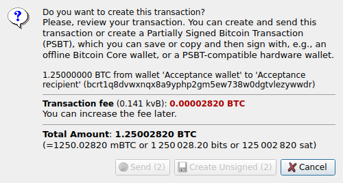
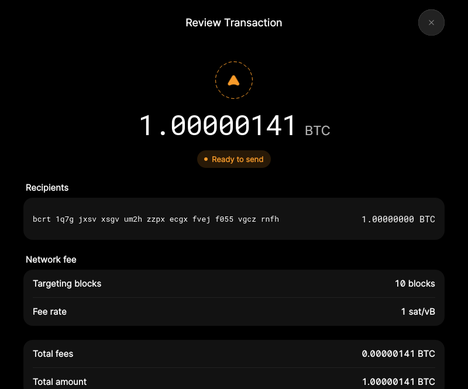
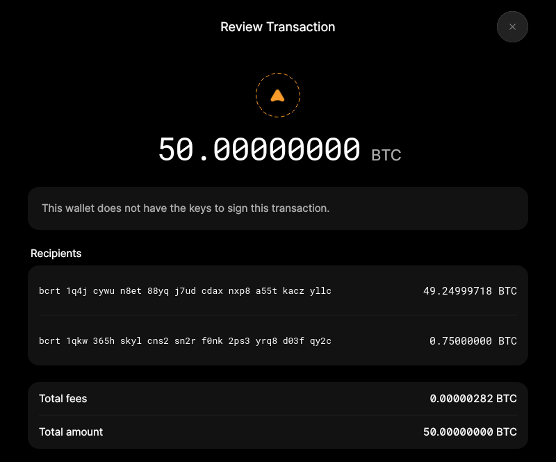

# F13 · Create and Export PSBT

[Evidence index](../README.md) · [Test results](../TEST-RESULTS.md) · [Capture and build provenance](../PROVENANCE.md)

5 acceptance criteria from the supported-feature inventory. **Acceptance is pending review.** A screenshot demonstrates the visible state; the stated assertions describe the behavior that was actually checked. Related passing suites do not certify every variant of a criterion.

## Implementation comparison

**Partial.** Prepare payments with selected recipients, fees, and inputs, then save unsigned PSBT files, including from watch-only wallets. Configured watch-only multisig wallets can prepare unsigned payments; wallets holding only some required private keys cannot use that unsigned-payment workflow. Clipboard export is not exposed.

[Transaction preparation](https://github.com/bitcoin-core/gui-qml/blob/a91f4b4774f25de061fe1a7c132a91ddde117fca/qml/models/walletqmlmodel.cpp#L2251); [PSBT export](https://github.com/bitcoin-core/gui-qml/blob/a91f4b4774f25de061fe1a7c132a91ddde117fca/qml/models/walletqmlmodel.cpp#L2676); [Export flow](https://github.com/bitcoin-core/gui-qml/blob/a91f4b4774f25de061fe1a7c132a91ddde117fca/qml/pages/wallet/SendTransactionReview.qml).

## Application captures

| Qt Widgets (`src/qt`) | GUI-QML (`qt6`) |
| --- | --- |
|  Send review |  Payment review   PSBT that requires another signer |

## Modules

- **Qt Widgets:** [primary implementation](https://github.com/bitcoin-core/gui/blob/f739c7876b81304bdc72e7eaa307702da269ac31/src/qt/sendcoinsdialog.cpp).
  [Multisig support](https://github.com/bitcoin-core/gui/blob/f739c7876b81304bdc72e7eaa307702da269ac31/doc/descriptors.md#basic-multisig-example).
- **GUI-QML:** [Transaction preparation](https://github.com/bitcoin-core/gui-qml/blob/a91f4b4774f25de061fe1a7c132a91ddde117fca/qml/models/walletqmlmodel.cpp#L2251); [PSBT export](https://github.com/bitcoin-core/gui-qml/blob/a91f4b4774f25de061fe1a7c132a91ddde117fca/qml/models/walletqmlmodel.cpp#L2676); [Export flow](https://github.com/bitcoin-core/gui-qml/blob/a91f4b4774f25de061fe1a7c132a91ddde117fca/qml/pages/wallet/SendTransactionReview.qml).

These are the implementation entry points for the criteria below. Links are pinned to the tested source revisions.

## Automated tests

| Application | Test/module | Recorded result |
| --- | --- | --- |
| GUI-QML | [qml_test_send_receive](https://github.com/bitcoin-core/gui-qml/blob/a91f4b4774f25de061fe1a7c132a91ddde117fca/test/functional/qml_test_send_receive.py) | [passed](../logs/qml_test_send_receive.log) |
| GUI-QML | [qml_test_external_signer](https://github.com/bitcoin-core/gui-qml/blob/a91f4b4774f25de061fe1a7c132a91ddde117fca/test/functional/qml_test_external_signer.py) | [passed](../logs/qml_test_external_signer.log) |
| GUI-QML C++ | [test/test_walletqmlmodel.cpp](https://github.com/bitcoin-core/gui-qml/blob/a91f4b4774f25de061fe1a7c132a91ddde117fca/test/test_walletqmlmodel.cpp) | [Suite passed](../logs/qml-unit-tests.log); fixture/model assertions |
| Qt Widgets | [WalletTests](https://github.com/bitcoin-core/gui/blob/f739c7876b81304bdc72e7eaa307702da269ac31/src/qt/test/wallettests.cpp) | [Suite passed](../logs/widgets-qt-tests.log); inspect assertion scope |
| Qt Widgets additional | [Live GUI/RPC scenarios](../scripts/widgets_scenarios.py) | [Recorded assertions](../logs/widgets-checks.json); outcomes listed per criterion |

## Acceptance criteria

### F13.S01 · Prepare a transaction for later signing.

| Application | Evidence status | Evidence and limits |
| --- | --- | --- |
| Qt Widgets | Assertions collected | GUI creates a decodable unsigned single-signature PSBT in the system clipboard. **passed**. [Send review](../media/widgets/send-review.png) [Modules](#modules) · [Related tests](#automated-tests) |
| GUI-QML | Automated evidence collected | Unsigned prepared transaction can be serialized without committing it. [PSBT that requires another signer](../media/qml/qml_test_psbt/012-14-review-only-transaction-modal-displayed.png) [Modules](#modules) · [Related tests](#automated-tests) |

- [ ] Acceptance decision recorded by reviewer.

### F13.S02 · Create transactions from watch-only wallets or wallets containing spending keys.

| Application | Evidence status | Evidence and limits |
| --- | --- | --- |
| Qt Widgets | Assertions collected | GUI creates a decodable unsigned single-signature PSBT in the system clipboard. **passed**. **Limit:** The custom live assertion uses a spending wallet; the existing WalletTests suite also exercises a watch-only PSBT path. No matching screenshot collected. [Modules](#modules) · [Related tests](#automated-tests) |
| GUI-QML | Partial / limited evidence | Single-signature and configured watch-only paths exist; this run does not exercise every wallet type. No matching screenshot collected. [Modules](#modules) · [Related tests](#automated-tests) |

- [ ] Acceptance decision recorded by reviewer.

### F13.S03 · Use single-signature or previously configured multisig wallets.

| Application | Evidence status | Evidence and limits |
| --- | --- | --- |
| Qt Widgets | Assertions collected | GUI creates a decodable unsigned single-signature PSBT in the system clipboard. **passed**. **Limit:** The live proof is single-signature. Multisig creation is not exercised. No matching screenshot collected. [Modules](#modules) · [Related tests](#automated-tests) |
| GUI-QML | Partial / limited evidence | Previously configured watch-only multisig can be prepared; incomplete local multisig signing is limited. No matching screenshot collected. [Modules](#modules) · [Related tests](#automated-tests) |

- [ ] Acceptance decision recorded by reviewer.

### F13.S04 · Choose recipients, fees, and coins for the proposed transaction.

| Application | Evidence status | Evidence and limits |
| --- | --- | --- |
| Qt Widgets | Assertions collected | GUI creates a decodable unsigned single-signature PSBT in the system clipboard. **passed**. [Send review](../media/widgets/send-review.png) [Modules](#modules) · [Related tests](#automated-tests) |
| GUI-QML | Automated evidence collected | Prepared recipients, selected coins and fee choices have model assertions. [Payment review](../media/qml/qml_test_send_receive/012-14-review-page-with-fixed-amount.png) [Modules](#modules) · [Related tests](#automated-tests) |

- [ ] Acceptance decision recorded by reviewer.

### F13.S05 · Copy an unsigned PSBT to the clipboard or save it to a file for signing elsewhere.

| Application | Evidence status | Evidence and limits |
| --- | --- | --- |
| Qt Widgets | Assertions collected | GUI creates a decodable unsigned single-signature PSBT in the system clipboard. **passed**. **Limit:** Clipboard serialization is checked; GUI file export was not asserted in this Widgets scenario. No matching screenshot collected. [Modules](#modules) · [Related tests](#automated-tests) |
| GUI-QML | Partial / limited evidence | File export is available; PSBT clipboard export is missing. No matching screenshot collected. [Modules](#modules) · [Related tests](#automated-tests) |

- [ ] Acceptance decision recorded by reviewer.

## Capture register

The original PNGs are unmodified application captures. Timestamps, dimensions and SHA-256 hashes are in the [capture manifest](../selected-captures.json). Some early/raw frames are not selected for review.

| Application | Capture | Criteria |
| --- | --- | --- |
| widgets | [Send review](../media/widgets/send-review.png) | F13.S01, F13.S04 |
| qml | [Payment review](../media/qml/qml_test_send_receive/012-14-review-page-with-fixed-amount.png) | F13.S04 |
| qml | [PSBT that requires another signer](../media/qml/qml_test_psbt/012-14-review-only-transaction-modal-displayed.png) | F13.S01 |
