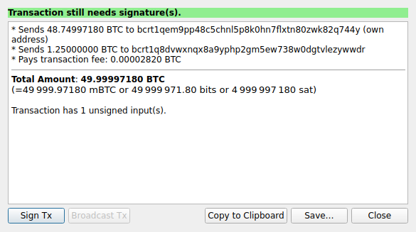
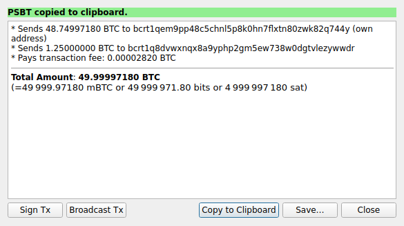
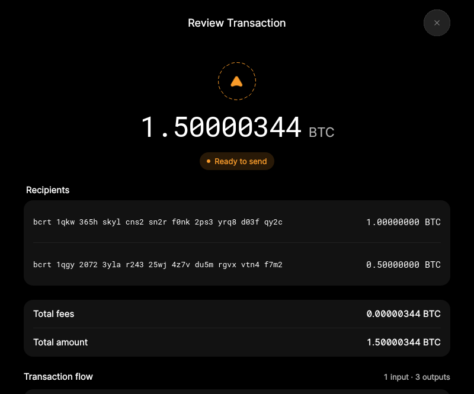

# F14 · Import, Sign, and Broadcast PSBT

[Evidence index](../README.md) · [Test results](../TEST-RESULTS.md) · [Capture and build provenance](../PROVENANCE.md)

8 acceptance criteria from the supported-feature inventory. **Acceptance is pending review.** A screenshot demonstrates the visible state; the stated assertions describe the behavior that was actually checked. Related passing suites do not certify every variant of a criterion.

## Implementation comparison

**Partial.** Import PSBT files, review recipients/amounts/fees, save the imported PSBT, sign eligible transactions the selected wallet can fully sign, and broadcast fully signed transactions. Incomplete multisig transactions can be reviewed, but collecting partial local signatures is not supported by the reachable flow. Clipboard import/export and operation without a loaded wallet are missing. Import also has recipient and output-script compatibility limits.

[PSBT import and signing](https://github.com/bitcoin-core/gui-qml/blob/a91f4b4774f25de061fe1a7c132a91ddde117fca/qml/models/walletqmlmodel.cpp#L2508); [Import interface](https://github.com/bitcoin-core/gui-qml/blob/a91f4b4774f25de061fe1a7c132a91ddde117fca/qml/pages/wallet/SendCreate.qml#L224); [Review actions](https://github.com/bitcoin-core/gui-qml/blob/a91f4b4774f25de061fe1a7c132a91ddde117fca/qml/pages/wallet/SendTransactionReview.qml).

## Application captures

| Qt Widgets (`src/qt`) | GUI-QML (`qt6`) |
| --- | --- |
|  Import unsigned PSBT   PSBT signed ready |  Imported PSBT recipients   PSBT that requires another signer |

Baseline support notes: *Support: Signing imported PSBTs requires local private keys. External signing is supported for payments created by the application. Combining independently signed copies requires RPC. Wallet functionality must be enabled even when no wallet is open. [Multisig workflow](https://github.com/bitcoin-core/gui/blob/f739c7876b81304bdc72e7eaa307702da269ac31/doc/descriptors.md#basic-multisig-example).*

[All selected captures for this group](#capture-register) are listed below.

## Modules

- **Qt Widgets:** [primary implementation](https://github.com/bitcoin-core/gui/blob/f739c7876b81304bdc72e7eaa307702da269ac31/src/qt/psbtoperationsdialog.cpp).
- **GUI-QML:** [PSBT import and signing](https://github.com/bitcoin-core/gui-qml/blob/a91f4b4774f25de061fe1a7c132a91ddde117fca/qml/models/walletqmlmodel.cpp#L2508); [Import interface](https://github.com/bitcoin-core/gui-qml/blob/a91f4b4774f25de061fe1a7c132a91ddde117fca/qml/pages/wallet/SendCreate.qml#L224); [Review actions](https://github.com/bitcoin-core/gui-qml/blob/a91f4b4774f25de061fe1a7c132a91ddde117fca/qml/pages/wallet/SendTransactionReview.qml).

These are the implementation entry points for the criteria below. Links are pinned to the tested source revisions.

## Automated tests

| Application | Test/module | Recorded result |
| --- | --- | --- |
| GUI-QML | [qml_test_psbt](https://github.com/bitcoin-core/gui-qml/blob/a91f4b4774f25de061fe1a7c132a91ddde117fca/test/functional/qml_test_psbt.py) | [passed](../logs/qml_test_psbt.log) |
| GUI-QML | [qml_test_password_wallet](https://github.com/bitcoin-core/gui-qml/blob/a91f4b4774f25de061fe1a7c132a91ddde117fca/test/functional/qml_test_password_wallet.py) | [passed](../logs/qml_test_password_wallet.log) |
| GUI-QML | [qml_test_external_signer](https://github.com/bitcoin-core/gui-qml/blob/a91f4b4774f25de061fe1a7c132a91ddde117fca/test/functional/qml_test_external_signer.py) | [passed](../logs/qml_test_external_signer.log) |
| GUI-QML C++ | [test/test_psbtqmlmodel.cpp](https://github.com/bitcoin-core/gui-qml/blob/a91f4b4774f25de061fe1a7c132a91ddde117fca/test/test_psbtqmlmodel.cpp) | [Suite passed](../logs/qml-unit-tests.log); fixture/model assertions |
| GUI-QML C++ | [test/test_walletqmlmodel.cpp](https://github.com/bitcoin-core/gui-qml/blob/a91f4b4774f25de061fe1a7c132a91ddde117fca/test/test_walletqmlmodel.cpp) | [Suite passed](../logs/qml-unit-tests.log); fixture/model assertions |
| GUI-QML components | [test/qml/tst_transactionflow.qml](https://github.com/bitcoin-core/gui-qml/blob/a91f4b4774f25de061fe1a7c132a91ddde117fca/test/qml/tst_transactionflow.qml) | [Suite passed](../logs/qml-quick-tests.log); component assertions |
| GUI-QML components | [test/qml/tst_externalsignerreviewactions.qml](https://github.com/bitcoin-core/gui-qml/blob/a91f4b4774f25de061fe1a7c132a91ddde117fca/test/qml/tst_externalsignerreviewactions.qml) | [Suite passed](../logs/qml-quick-tests.log); component assertions |
| Qt Widgets additional | [Live GUI/RPC scenarios](../scripts/widgets_scenarios.py) | [Recorded assertions](../logs/widgets-checks.json); outcomes listed per criterion |

## Acceptance criteria

### F14.S01 · Import a PSBT from a file or the clipboard.

| Application | Evidence status | Evidence and limits |
| --- | --- | --- |
| Qt Widgets | Assertions collected | GUI signs an imported PSBT and copies a complete finalizable PSBT. **passed**. **Limit:** The live round trip imports from the clipboard; file import was not separately exercised. [Import unsigned PSBT](../media/widgets/import-unsigned-psbt.png) [Modules](#modules) · [Related tests](#automated-tests) |
| GUI-QML | Partial / limited evidence | File import is available; clipboard import is missing. [Imported PSBT recipients](../media/qml/qml_test_psbt/009-11-multiple-recipient-review-displayed.png) [Modules](#modules) · [Related tests](#automated-tests) |

- [ ] Acceptance decision recorded by reviewer.

### F14.S02 · Review recipients, amounts, available fee information, and signing progress.

| Application | Evidence status | Evidence and limits |
| --- | --- | --- |
| Qt Widgets | Visual evidence only | No targeted runtime assertion collected for this exact criterion. [Import unsigned PSBT](../media/widgets/import-unsigned-psbt.png) [PSBT signed ready](../media/widgets/psbt-signed-ready.png) [Modules](#modules) · [Related tests](#automated-tests) |
| GUI-QML | Automated evidence collected | Recipient review, review-only state and ready-to-broadcast state are captured. [Imported PSBT recipients](../media/qml/qml_test_psbt/009-11-multiple-recipient-review-displayed.png) [PSBT that requires another signer](../media/qml/qml_test_psbt/012-14-review-only-transaction-modal-displayed.png) [Modules](#modules) · [Related tests](#automated-tests) |

- [ ] Acceptance decision recorded by reviewer.

### F14.S03 · Process single-signature and multisig transactions when the required keys and transaction information are available.

| Application | Evidence status | Evidence and limits |
| --- | --- | --- |
| Qt Widgets | Assertions collected | GUI signs an imported PSBT and copies a complete finalizable PSBT. **passed**. **Limit:** The live imported PSBT is single-signature; multisig remains unexercised. No matching screenshot collected. [Modules](#modules) · [Related tests](#automated-tests) |
| GUI-QML | Partial / limited evidence | Completed foreign multisig can broadcast; incomplete local multisig is review-only. [Imported PSBT recipients](../media/qml/qml_test_psbt/009-11-multiple-recipient-review-displayed.png) [PSBT that requires another signer](../media/qml/qml_test_psbt/012-14-review-only-transaction-modal-displayed.png) [Modules](#modules) · [Related tests](#automated-tests) |

- [ ] Acceptance decision recorded by reviewer.

### F14.S04 · Sign with local wallets, including encrypted wallets after unlocking.

| Application | Evidence status | Evidence and limits |
| --- | --- | --- |
| Qt Widgets | Assertions collected | GUI signs an imported PSBT and copies a complete finalizable PSBT. **passed**. **Limit:** The live imported PSBT uses an unencrypted wallet. Encrypted message signing is separately tested but is not encrypted-PSBT proof. [Import unsigned PSBT](../media/widgets/import-unsigned-psbt.png) [PSBT signed ready](../media/widgets/psbt-signed-ready.png) [Modules](#modules) · [Related tests](#automated-tests) |
| GUI-QML | Partial / limited evidence | Eligible local single-signature wallets sign; incomplete local multisig is limited. Local signed import relocks the wallet; model assertions cover encrypted import. No matching screenshot collected. [Modules](#modules) · [Related tests](#automated-tests) |

- [ ] Acceptance decision recorded by reviewer.

### F14.S05 · Collect additional signatures by passing a transaction between signers.

| Application | Evidence status | Evidence and limits |
| --- | --- | --- |
| Qt Widgets | Source only | No targeted runtime assertion collected for this exact criterion. No matching screenshot collected. [Modules](#modules) · [Related tests](#automated-tests) |
| GUI-QML | Implementation gap | No local partial-signature collection workflow. No screenshot: this GUI workflow is absent. [Modules](#modules) · [Related tests](#automated-tests) |

- [ ] Acceptance decision recorded by reviewer.

### F14.S06 · Copy a partially signed PSBT to the clipboard or save it to a file for further signing.

| Application | Evidence status | Evidence and limits |
| --- | --- | --- |
| Qt Widgets | Assertions collected | GUI signs an imported PSBT and copies a complete finalizable PSBT. **passed**. **Limit:** The checked clipboard result is fully signed. Partially signed exchange and file save remain unexercised. No matching screenshot collected. [Modules](#modules) · [Related tests](#automated-tests) |
| GUI-QML | Partial / limited evidence | File saving is available, including incomplete external-signer results; clipboard export is missing. [PSBT that requires another signer](../media/qml/qml_test_psbt/012-14-review-only-transaction-modal-displayed.png) [Modules](#modules) · [Related tests](#automated-tests) |

- [ ] Acceptance decision recorded by reviewer.

### F14.S07 · Finalize and broadcast a transaction once sufficient signatures are present.

| Application | Evidence status | Evidence and limits |
| --- | --- | --- |
| Qt Widgets | Assertions collected | GUI broadcast reaches the node mempool. **passed**. [PSBT signed ready](../media/widgets/psbt-signed-ready.png) [PSBT broadcast](../media/widgets/psbt-broadcast.png) [Modules](#modules) · [Related tests](#automated-tests) |
| GUI-QML | Automated evidence collected | A fully signed foreign PSBT reaches broadcast. [Signed PSBT ready to broadcast](../media/qml/qml_test_psbt/015-17-signed-foreign-psbt-ready-to-broadcast.png) [Send form after PSBT broadcast (RPC checked)](../media/qml/qml_test_psbt/016-18-signed-foreign-psbt-broadcast-confirmed.png) [Modules](#modules) · [Related tests](#automated-tests) |

- [ ] Acceptance decision recorded by reviewer.

### F14.S08 · Inspect transactions and broadcast fully signed transactions without opening a wallet.

| Application | Evidence status | Evidence and limits |
| --- | --- | --- |
| Qt Widgets | Source only | No targeted runtime assertion collected for this exact criterion. No matching screenshot collected. [Modules](#modules) · [Related tests](#automated-tests) |
| GUI-QML | Implementation gap | PSBT workflow requires an open wallet. No screenshot: this GUI workflow is absent. [Modules](#modules) · [Related tests](#automated-tests) |

- [ ] Acceptance decision recorded by reviewer.

## Capture register

The original PNGs are unmodified application captures. Timestamps, dimensions and SHA-256 hashes are in the [capture manifest](../selected-captures.json). Some early/raw frames are not selected for review.

| Application | Capture | Criteria |
| --- | --- | --- |
| widgets | [Import unsigned PSBT](../media/widgets/import-unsigned-psbt.png) | F14.S01, F14.S02, F14.S04 |
| widgets | [PSBT signed ready](../media/widgets/psbt-signed-ready.png) | F14.S02, F14.S04, F14.S07 |
| widgets | [PSBT broadcast](../media/widgets/psbt-broadcast.png) | F14.S07 |
| qml | [Imported PSBT recipients](../media/qml/qml_test_psbt/009-11-multiple-recipient-review-displayed.png) | F14.S01, F14.S02, F14.S03 |
| qml | [PSBT that requires another signer](../media/qml/qml_test_psbt/012-14-review-only-transaction-modal-displayed.png) | F14.S02, F14.S03, F14.S06 |
| qml | [Signed PSBT ready to broadcast](../media/qml/qml_test_psbt/015-17-signed-foreign-psbt-ready-to-broadcast.png) | F14.S07 |
| qml | [Send form after PSBT broadcast (RPC checked)](../media/qml/qml_test_psbt/016-18-signed-foreign-psbt-broadcast-confirmed.png) | F14.S07 |
