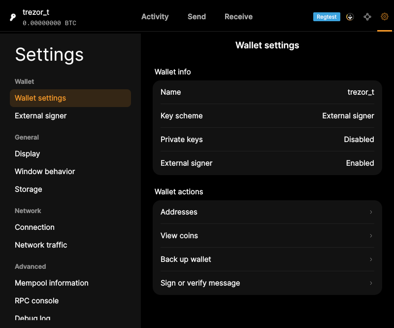
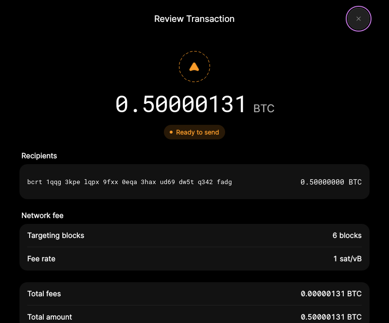

# F15 · Use Hardware Wallet / External Signer

[Evidence index](../README.md) · [Test results](../TEST-RESULTS.md) · [Capture and build provenance](../PROVENANCE.md)

5 acceptance criteria from the supported-feature inventory. **Acceptance is pending review.** A screenshot demonstrates the visible state; the stated assertions describe the behavior that was actually checked. Related passing suites do not certify every variant of a criterion.

## Implementation comparison

**Partial.** Configure compatible signer software, discover a device, create an external-signer wallet, and approve payments on the device. A partially signed device result can be saved as a PSBT for further signing. Receiving-address verification on the device is missing. Requires signer support in the build and one connected signer.

[Signer setup](https://github.com/bitcoin-core/gui-qml/blob/a91f4b4774f25de061fe1a7c132a91ddde117fca/qml/pages/settings/ExternalSignerSettingsPage.qml); [Device approval](https://github.com/bitcoin-core/gui-qml/blob/a91f4b4774f25de061fe1a7c132a91ddde117fca/qml/models/walletqmlmodel.cpp#L2373).

## Application captures

| Qt Widgets (`src/qt`) | GUI-QML (`qt6`) |
| --- | --- |
|  Preferences wallet |  External signer wallet   External-signer payment review |

Baseline support notes: *Support: Requires compatible signer software, device support, and an application build with external signing enabled. The integration expects one connected signer at a time.*

## Modules

- **Qt Widgets:** [primary implementation](https://github.com/bitcoin-core/gui/blob/f739c7876b81304bdc72e7eaa307702da269ac31/doc/external-signer.md).
  [Signing workflow](https://github.com/bitcoin-core/gui/blob/f739c7876b81304bdc72e7eaa307702da269ac31/src/qt/sendcoinsdialog.cpp).
- **GUI-QML:** [Signer setup](https://github.com/bitcoin-core/gui-qml/blob/a91f4b4774f25de061fe1a7c132a91ddde117fca/qml/pages/settings/ExternalSignerSettingsPage.qml); [Device approval](https://github.com/bitcoin-core/gui-qml/blob/a91f4b4774f25de061fe1a7c132a91ddde117fca/qml/models/walletqmlmodel.cpp#L2373).

These are the implementation entry points for the criteria below. Links are pinned to the tested source revisions.

## Automated tests

| Application | Test/module | Recorded result |
| --- | --- | --- |
| GUI-QML | [qml_test_external_signer](https://github.com/bitcoin-core/gui-qml/blob/a91f4b4774f25de061fe1a7c132a91ddde117fca/test/functional/qml_test_external_signer.py) | [passed](../logs/qml_test_external_signer.log) |
| GUI-QML C++ | [test/test_walletqmlcontroller.cpp](https://github.com/bitcoin-core/gui-qml/blob/a91f4b4774f25de061fe1a7c132a91ddde117fca/test/test_walletqmlcontroller.cpp) | [Suite passed](../logs/qml-unit-tests.log); fixture/model assertions |
| GUI-QML C++ | [test/test_walletqmlmodel.cpp](https://github.com/bitcoin-core/gui-qml/blob/a91f4b4774f25de061fe1a7c132a91ddde117fca/test/test_walletqmlmodel.cpp) | [Suite passed](../logs/qml-unit-tests.log); fixture/model assertions |
| GUI-QML components | [test/qml/tst_externalsignerreviewactions.qml](https://github.com/bitcoin-core/gui-qml/blob/a91f4b4774f25de061fe1a7c132a91ddde117fca/test/qml/tst_externalsignerreviewactions.qml) | [Suite passed](../logs/qml-quick-tests.log); component assertions |

## Acceptance criteria

### F15.S01 · Connect a wallet to a compatible external signer.

| Application | Evidence status | Evidence and limits |
| --- | --- | --- |
| Qt Widgets | Visual evidence only | No targeted runtime assertion collected for this exact criterion. **Limit:** Configuration UI only; no Widgets external-signer run. [Preferences wallet](../media/widgets/preferences-wallet.png) [Modules](#modules) · [Related tests](#automated-tests) |
| GUI-QML | Partial / limited evidence | An executable mock signer is exercised; no physical device. [External signer wallet](../media/qml/qml_test_external_signer/014-14-external-signer-wallet-hides-password-settings.png) [External-signer payment review](../media/qml/qml_test_external_signer/020-20-no-signer-review-displayed.png) [Modules](#modules) · [Related tests](#automated-tests) |

- [ ] Acceptance decision recorded by reviewer.

### F15.S02 · Keep spending keys on the signing device.

| Application | Evidence status | Evidence and limits |
| --- | --- | --- |
| Qt Widgets | Source only | No targeted runtime assertion collected for this exact criterion. **Limit:** No Widgets external-signer run or physical device test. No matching screenshot collected. [Modules](#modules) · [Related tests](#automated-tests) |
| GUI-QML | Partial / limited evidence | Test signer holds the keys externally; physical device custody is not certified. [External signer wallet](../media/qml/qml_test_external_signer/014-14-external-signer-wallet-hides-password-settings.png) [External-signer payment review](../media/qml/qml_test_external_signer/020-20-no-signer-review-displayed.png) [Modules](#modules) · [Related tests](#automated-tests) |

- [ ] Acceptance decision recorded by reviewer.

### F15.S03 · Generate receiving addresses and verify them on the device.

| Application | Evidence status | Evidence and limits |
| --- | --- | --- |
| Qt Widgets | Source only | No targeted runtime assertion collected for this exact criterion. **Limit:** No physical device address-verification test. No matching screenshot collected. [Modules](#modules) · [Related tests](#automated-tests) |
| GUI-QML | Implementation gap | Receiving works, but device address verification is missing. No screenshot: this GUI workflow is absent. [Modules](#modules) · [Related tests](#automated-tests) |

- [ ] Acceptance decision recorded by reviewer.

### F15.S04 · Authorize outgoing payments using the device.

| Application | Evidence status | Evidence and limits |
| --- | --- | --- |
| Qt Widgets | Source only | No targeted runtime assertion collected for this exact criterion. **Limit:** No physical device approval test. No matching screenshot collected. [Modules](#modules) · [Related tests](#automated-tests) |
| GUI-QML | Partial / limited evidence | Mock signer approval, errors and broadcast are tested; physical approval is untested. [External-signer payment review](../media/qml/qml_test_external_signer/020-20-no-signer-review-displayed.png) [External-signer broadcast result](../media/qml/qml_test_external_signer/025-25-signed-transaction-broadcast.png) [Modules](#modules) · [Related tests](#automated-tests) |

- [ ] Acceptance decision recorded by reviewer.

### F15.S05 · Continue a signing workflow when additional signatures are needed. Signing workflow.

| Application | Evidence status | Evidence and limits |
| --- | --- | --- |
| Qt Widgets | Source only | No targeted runtime assertion collected for this exact criterion. **Limit:** No Widgets multisigner exchange test. No matching screenshot collected. [Modules](#modules) · [Related tests](#automated-tests) |
| GUI-QML | Partial / limited evidence | An incomplete mock external-signer result can be saved; broad multisigner exchange is not exercised. No matching screenshot collected. [Modules](#modules) · [Related tests](#automated-tests) |

- [ ] Acceptance decision recorded by reviewer.

## Capture register

The original PNGs are unmodified application captures. Timestamps, dimensions and SHA-256 hashes are in the [capture manifest](../selected-captures.json). Some early/raw frames are not selected for review.

| Application | Capture | Criteria |
| --- | --- | --- |
| widgets | [Preferences wallet](../media/widgets/preferences-wallet.png) | F15.S01 |
| qml | [External signer wallet](../media/qml/qml_test_external_signer/014-14-external-signer-wallet-hides-password-settings.png) | F15.S01, F15.S02 |
| qml | [External-signer payment review](../media/qml/qml_test_external_signer/020-20-no-signer-review-displayed.png) | F15.S01, F15.S02, F15.S04 |
| qml | [External-signer broadcast result](../media/qml/qml_test_external_signer/025-25-signed-transaction-broadcast.png) | F15.S04 |
