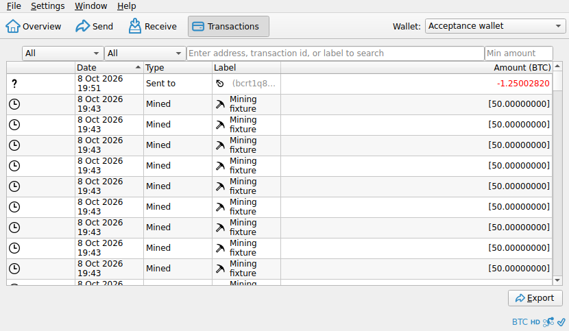
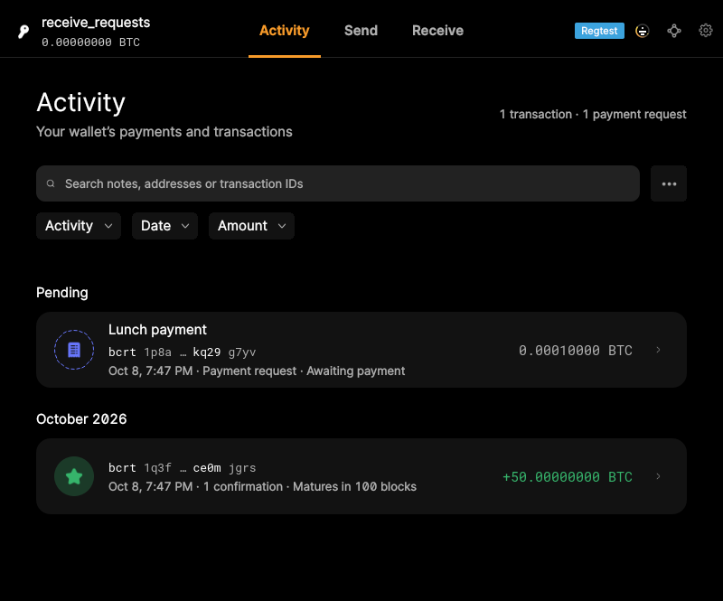
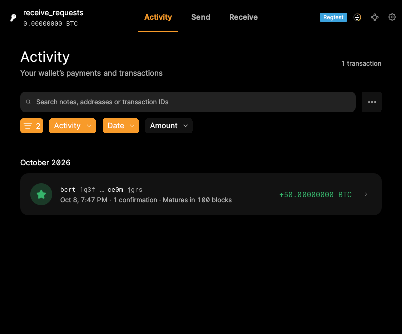

# F16 · Browse and Export Transaction History

[Evidence index](../README.md) · [Test results](../TEST-RESULTS.md) · [Capture and build provenance](../PROVENANCE.md)

9 acceptance criteria from the supported-feature inventory. **Acceptance is pending review.** A screenshot demonstrates the visible state; the stated assertions describe the behavior that was actually checked. Related passing suites do not certify every variant of a criterion.

## Implementation comparison

**Partial.** Browse transaction types and statuses; search; filter by date, type, and amount; inspect transaction details; export filtered CSV; and open external explorers. Copy addresses, transaction IDs, and raw transactions. History uses a fixed chronological order; user-selected sorting, the full set of amount/detail clipboard exports, and editing outgoing-recipient labels are missing.

[History and export](https://github.com/bitcoin-core/gui-qml/blob/a91f4b4774f25de061fe1a7c132a91ddde117fca/qml/pages/wallet/ActivityListPage.qml); [Transaction details](https://github.com/bitcoin-core/gui-qml/blob/a91f4b4774f25de061fe1a7c132a91ddde117fca/qml/pages/wallet/TransactionDetail.qml); [Detail copying](https://github.com/bitcoin-core/gui-qml/blob/a91f4b4774f25de061fe1a7c132a91ddde117fca/qml/components/TransactionDetailsSection.qml).

## Application captures

| Qt Widgets (`src/qt`) | GUI-QML (`qt6`) |
| --- | --- |
|  Transaction history   Transaction history actions |  Wallet activity   Filtered transaction history |

[All selected captures for this group](#capture-register) are listed below.

## Modules

- **Qt Widgets:** [primary implementation](https://github.com/bitcoin-core/gui/blob/f739c7876b81304bdc72e7eaa307702da269ac31/src/qt/transactionview.cpp).
  [Transaction states](https://github.com/bitcoin-core/gui/blob/f739c7876b81304bdc72e7eaa307702da269ac31/src/qt/transactionrecord.cpp).
  [Transaction details](https://github.com/bitcoin-core/gui/blob/f739c7876b81304bdc72e7eaa307702da269ac31/src/qt/transactiondesc.cpp).
- **GUI-QML:** [History and export](https://github.com/bitcoin-core/gui-qml/blob/a91f4b4774f25de061fe1a7c132a91ddde117fca/qml/pages/wallet/ActivityListPage.qml); [Transaction details](https://github.com/bitcoin-core/gui-qml/blob/a91f4b4774f25de061fe1a7c132a91ddde117fca/qml/pages/wallet/TransactionDetail.qml); [Detail copying](https://github.com/bitcoin-core/gui-qml/blob/a91f4b4774f25de061fe1a7c132a91ddde117fca/qml/components/TransactionDetailsSection.qml).

These are the implementation entry points for the criteria below. Links are pinned to the tested source revisions.

## Automated tests

| Application | Test/module | Recorded result |
| --- | --- | --- |
| GUI-QML | [qml_test_activity_filter_export](https://github.com/bitcoin-core/gui-qml/blob/a91f4b4774f25de061fe1a7c132a91ddde117fca/test/functional/qml_test_activity_filter_export.py) | [passed](../logs/qml_test_activity_filter_export.log) |
| GUI-QML | [qml_test_address_label_sync](https://github.com/bitcoin-core/gui-qml/blob/a91f4b4774f25de061fe1a7c132a91ddde117fca/test/functional/qml_test_address_label_sync.py) | [passed](../logs/qml_test_address_label_sync.log) |
| GUI-QML | [qml_test_wallet_rbf](https://github.com/bitcoin-core/gui-qml/blob/a91f4b4774f25de061fe1a7c132a91ddde117fca/test/functional/qml_test_wallet_rbf.py) | [passed](../logs/qml_test_wallet_rbf.log) |
| GUI-QML | [qml_test_send_receive](https://github.com/bitcoin-core/gui-qml/blob/a91f4b4774f25de061fe1a7c132a91ddde117fca/test/functional/qml_test_send_receive.py) | [passed](../logs/qml_test_send_receive.log) |
| GUI-QML C++ | [test/test_activityfilterproxymodel.cpp](https://github.com/bitcoin-core/gui-qml/blob/a91f4b4774f25de061fe1a7c132a91ddde117fca/test/test_activityfilterproxymodel.cpp) | [Suite passed](../logs/qml-unit-tests.log); fixture/model assertions |
| GUI-QML C++ | [test/test_transactionactivitymodel.cpp](https://github.com/bitcoin-core/gui-qml/blob/a91f4b4774f25de061fe1a7c132a91ddde117fca/test/test_transactionactivitymodel.cpp) | [Suite passed](../logs/qml-unit-tests.log); fixture/model assertions |
| GUI-QML C++ | [test/test_transactionactivity.cpp](https://github.com/bitcoin-core/gui-qml/blob/a91f4b4774f25de061fe1a7c132a91ddde117fca/test/test_transactionactivity.cpp) | [Suite passed](../logs/qml-unit-tests.log); fixture/model assertions |
| GUI-QML C++ | [test/test_transaction.cpp](https://github.com/bitcoin-core/gui-qml/blob/a91f4b4774f25de061fe1a7c132a91ddde117fca/test/test_transaction.cpp) | [Suite passed](../logs/qml-unit-tests.log); fixture/model assertions |
| GUI-QML components | [test/qml/tst_activitylist.qml](https://github.com/bitcoin-core/gui-qml/blob/a91f4b4774f25de061fe1a7c132a91ddde117fca/test/qml/tst_activitylist.qml) | [Suite passed](../logs/qml-quick-tests.log); component assertions |
| GUI-QML components | [test/qml/tst_transactiondetail.qml](https://github.com/bitcoin-core/gui-qml/blob/a91f4b4774f25de061fe1a7c132a91ddde117fca/test/qml/tst_transactiondetail.qml) | [Suite passed](../logs/qml-quick-tests.log); component assertions |
| Qt Widgets | [WalletTests](https://github.com/bitcoin-core/gui/blob/f739c7876b81304bdc72e7eaa307702da269ac31/src/qt/test/wallettests.cpp) | [Suite passed](../logs/widgets-qt-tests.log); inspect assertion scope |
| Qt Widgets additional | [Live GUI/RPC scenarios](../scripts/widgets_scenarios.py) | [Recorded assertions](../logs/widgets-checks.json); outcomes listed per criterion |

## Acceptance criteria

### F16.S01 · Review incoming, outgoing, mined, and other transactions.

| Application | Evidence status | Evidence and limits |
| --- | --- | --- |
| Qt Widgets | Visual evidence only | No targeted runtime assertion collected for this exact criterion. [Transaction history](../media/widgets/transaction-history.png) [Modules](#modules) · [Related tests](#automated-tests) |
| GUI-QML | Automated evidence collected | Payment requests, mined, outgoing and incoming activity are exercised. [Wallet activity](../media/qml/qml_test_activity_filter_export/006-06-activity-shows-payment-request-and-mined-rows.png) [Filtered transaction history](../media/qml/qml_test_activity_filter_export/010-10-today-and-mined-filters-applied.png) [Modules](#modules) · [Related tests](#automated-tests) |

- [ ] Acceptance decision recorded by reviewer.

### F16.S02 · Filter transactions by date, type, or minimum amount.

| Application | Evidence status | Evidence and limits |
| --- | --- | --- |
| Qt Widgets | Visual evidence only | No targeted runtime assertion collected for this exact criterion. [Transaction history](../media/widgets/transaction-history.png) [Modules](#modules) · [Related tests](#automated-tests) |
| GUI-QML | Automated evidence collected | Date, type and minimum-amount filters are checked. [Filtered transaction history](../media/qml/qml_test_activity_filter_export/010-10-today-and-mined-filters-applied.png) [Modules](#modules) · [Related tests](#automated-tests) |

- [ ] Acceptance decision recorded by reviewer.

### F16.S03 · Search by address, transaction ID, or label, and sort transaction history.

| Application | Evidence status | Evidence and limits |
| --- | --- | --- |
| Qt Widgets | Visual evidence only | No targeted runtime assertion collected for this exact criterion. [Transaction history](../media/widgets/transaction-history.png) [Modules](#modules) · [Related tests](#automated-tests) |
| GUI-QML | Partial / limited evidence | Search is supported; ordering is fixed rather than generally sortable. [Filtered transaction history](../media/qml/qml_test_activity_filter_export/010-10-today-and-mined-filters-applied.png) [Modules](#modules) · [Related tests](#automated-tests) |

- [ ] Acceptance decision recorded by reviewer.

### F16.S04 · View confirmation, conflict, abandonment, and mining-maturity status. Transaction states.

| Application | Evidence status | Evidence and limits |
| --- | --- | --- |
| Qt Widgets | Visual evidence only | No targeted runtime assertion collected for this exact criterion. [Transaction history](../media/widgets/transaction-history.png) [Transaction details](../media/widgets/transaction-details.png) [Modules](#modules) · [Related tests](#automated-tests) |
| GUI-QML | Automated evidence collected | Transaction status mapping has model tests. [Wallet activity](../media/qml/qml_test_activity_filter_export/006-06-activity-shows-payment-request-and-mined-rows.png) [Transaction details](../media/qml/qml_test_activity_filter_export/030-30-activity-details-amount-uses-selected-display-unit.png) [Modules](#modules) · [Related tests](#automated-tests) |

- [ ] Acceptance decision recorded by reviewer.

### F16.S05 · Inspect transaction costs, balance changes, confirmation details, and transaction data. Transaction details.

| Application | Evidence status | Evidence and limits |
| --- | --- | --- |
| Qt Widgets | Visual evidence only | No targeted runtime assertion collected for this exact criterion. [Transaction details](../media/widgets/transaction-details.png) [Modules](#modules) · [Related tests](#automated-tests) |
| GUI-QML | Automated evidence collected | Detail amounts, unit changes and transaction data are checked. [Transaction details](../media/qml/qml_test_activity_filter_export/030-30-activity-details-amount-uses-selected-display-unit.png) [Modules](#modules) · [Related tests](#automated-tests) |

- [ ] Acceptance decision recorded by reviewer.

### F16.S06 · Copy addresses, amounts, transaction IDs, transaction details, and raw transaction data to the clipboard.

| Application | Evidence status | Evidence and limits |
| --- | --- | --- |
| Qt Widgets | Assertions collected | The selected history row copies a real transaction ID. **passed**. [Transaction history actions](../media/widgets/transaction-history-actions.png) [Transaction details](../media/widgets/transaction-details.png) [Modules](#modules) · [Related tests](#automated-tests) |
| GUI-QML | Partial / limited evidence | Address, ID and raw transaction copying are supported; amount and full-detail copying are missing. No matching screenshot collected. [Modules](#modules) · [Related tests](#automated-tests) |

- [ ] Acceptance decision recorded by reviewer.

### F16.S07 · Update address labels associated with transactions.

| Application | Evidence status | Evidence and limits |
| --- | --- | --- |
| Qt Widgets | Visual evidence only | No targeted runtime assertion collected for this exact criterion. [Transaction history actions](../media/widgets/transaction-history-actions.png) [Modules](#modules) · [Related tests](#automated-tests) |
| GUI-QML | Partial / limited evidence | Receiving-address labels synchronize; outgoing address-label editing is missing. No matching screenshot collected. [Modules](#modules) · [Related tests](#automated-tests) |

- [ ] Acceptance decision recorded by reviewer.

### F16.S08 · Export filtered transaction history as CSV for record keeping or analysis.

| Application | Evidence status | Evidence and limits |
| --- | --- | --- |
| Qt Widgets | Visual evidence only | No targeted runtime assertion collected for this exact criterion. [Transaction history](../media/widgets/transaction-history.png) [Modules](#modules) · [Related tests](#automated-tests) |
| GUI-QML | Automated evidence collected | CSV exports are read back and compared with the filtered rows. [Activity after CSV export](../media/qml/qml_test_activity_filter_export/017-17-filtered-activity-exported-to-csv.png) [Modules](#modules) · [Related tests](#automated-tests) |

- [ ] Acceptance decision recorded by reviewer.

### F16.S09 · Inspect transactions in external block explorers.

| Application | Evidence status | Evidence and limits |
| --- | --- | --- |
| Qt Widgets | Related automated suite | No targeted runtime assertion collected for this exact criterion. No matching screenshot collected. [Modules](#modules) · [Related tests](#automated-tests) |
| GUI-QML | Partial / limited evidence | Explorer URI construction is tested; opening a third-party browser/service was not exercised. No matching screenshot collected. [Modules](#modules) · [Related tests](#automated-tests) |

- [ ] Acceptance decision recorded by reviewer.

## Capture register

The original PNGs are unmodified application captures. Timestamps, dimensions and SHA-256 hashes are in the [capture manifest](../selected-captures.json). Some early/raw frames are not selected for review.

| Application | Capture | Criteria |
| --- | --- | --- |
| widgets | [Transaction history](../media/widgets/transaction-history.png) | F16.S01, F16.S02, F16.S03, F16.S04, F16.S08 |
| widgets | [Transaction history actions](../media/widgets/transaction-history-actions.png) | F16.S06, F16.S07 |
| widgets | [Transaction details](../media/widgets/transaction-details.png) | F16.S04, F16.S05, F16.S06 |
| qml | [Wallet activity](../media/qml/qml_test_activity_filter_export/006-06-activity-shows-payment-request-and-mined-rows.png) | F16.S01, F16.S04 |
| qml | [Filtered transaction history](../media/qml/qml_test_activity_filter_export/010-10-today-and-mined-filters-applied.png) | F16.S01, F16.S02, F16.S03 |
| qml | [Activity after CSV export](../media/qml/qml_test_activity_filter_export/017-17-filtered-activity-exported-to-csv.png) | F16.S08 |
| qml | [Transaction details](../media/qml/qml_test_activity_filter_export/030-30-activity-details-amount-uses-selected-display-unit.png) | F16.S04, F16.S05 |
