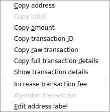
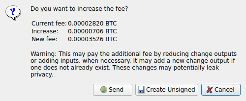
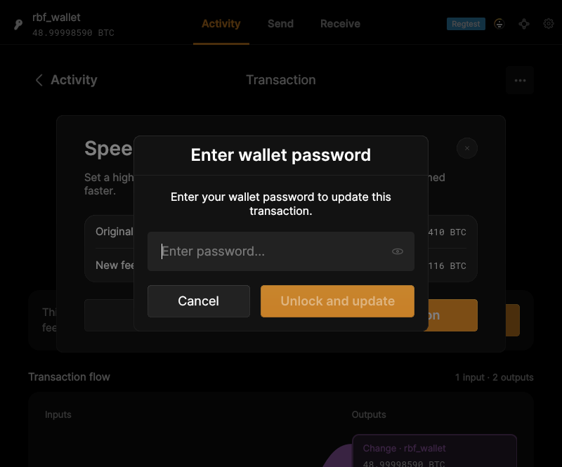

# F17 · Manage Unconfirmed Transactions

[Evidence index](../README.md) · [Test results](../TEST-RESULTS.md) · [Capture and build provenance](../PROVENANCE.md)

5 acceptance criteria from the supported-feature inventory. **Acceptance is pending review.** A screenshot demonstrates the visible state; the stated assertions describe the behavior that was actually checked. Related passing suites do not certify every variant of a criterion.

## Implementation comparison

**Partial.** Increase an eligible transaction fee, review the additional cost, unlock when needed, and sign/submit the replacement with local keys. No fee-bump PSBT export or transaction-abandonment action.

[Fee bumping](https://github.com/bitcoin-core/gui-qml/blob/a91f4b4774f25de061fe1a7c132a91ddde117fca/qml/models/bumptransactionmodel.cpp); [Fee-bump review](https://github.com/bitcoin-core/gui-qml/blob/a91f4b4774f25de061fe1a7c132a91ddde117fca/qml/pages/wallet/SpeedUpOverlay.qml).

## Application captures

| Qt Widgets (`src/qt`) | GUI-QML (`qt6`) |
| --- | --- |
|  Transaction history actions   Fee bump review |  Authorize a fee increase |

## Modules

- **Qt Widgets:** [primary implementation](https://github.com/bitcoin-core/gui/blob/f739c7876b81304bdc72e7eaa307702da269ac31/src/qt/walletmodel.cpp).
- **GUI-QML:** [Fee bumping](https://github.com/bitcoin-core/gui-qml/blob/a91f4b4774f25de061fe1a7c132a91ddde117fca/qml/models/bumptransactionmodel.cpp); [Fee-bump review](https://github.com/bitcoin-core/gui-qml/blob/a91f4b4774f25de061fe1a7c132a91ddde117fca/qml/pages/wallet/SpeedUpOverlay.qml).

These are the implementation entry points for the criteria below. Links are pinned to the tested source revisions.

## Automated tests

| Application | Test/module | Recorded result |
| --- | --- | --- |
| GUI-QML | [qml_test_wallet_rbf](https://github.com/bitcoin-core/gui-qml/blob/a91f4b4774f25de061fe1a7c132a91ddde117fca/test/functional/qml_test_wallet_rbf.py) | [passed](../logs/qml_test_wallet_rbf.log) |
| GUI-QML C++ | [test/test_bumptransactionmodel.cpp](https://github.com/bitcoin-core/gui-qml/blob/a91f4b4774f25de061fe1a7c132a91ddde117fca/test/test_bumptransactionmodel.cpp) | [Suite passed](../logs/qml-unit-tests.log); fixture/model assertions |
| GUI-QML C++ | [test/test_walletqmlmodel.cpp](https://github.com/bitcoin-core/gui-qml/blob/a91f4b4774f25de061fe1a7c132a91ddde117fca/test/test_walletqmlmodel.cpp) | [Suite passed](../logs/qml-unit-tests.log); fixture/model assertions |
| GUI-QML components | [test/qml/tst_transactiondetail.qml](https://github.com/bitcoin-core/gui-qml/blob/a91f4b4774f25de061fe1a7c132a91ddde117fca/test/qml/tst_transactiondetail.qml) | [Suite passed](../logs/qml-quick-tests.log); component assertions |
| Qt Widgets additional | [Live GUI/RPC scenarios](../scripts/widgets_scenarios.py) | [Recorded assertions](../logs/widgets-checks.json); outcomes listed per criterion |

## Acceptance criteria

### F17.S01 · Increase the fee of an eligible transaction to improve its confirmation prospects.

| Application | Evidence status | Evidence and limits |
| --- | --- | --- |
| Qt Widgets | Assertions collected | The GUI replaces the mempool transaction with a higher-fee transaction. **passed**. [Transaction history actions](../media/widgets/transaction-history-actions.png) [Fee bump review](../media/widgets/fee-bump-review.png) [Fee bump result](../media/widgets/fee-bump-result.png) [Modules](#modules) · [Related tests](#automated-tests) |
| GUI-QML | Automated evidence collected | Eligible outgoing transaction is replaced with a higher-fee transaction. [Authorize a fee increase](../media/qml/qml_test_wallet_rbf/006-click-updatetransactionbutton.png) [Modules](#modules) · [Related tests](#automated-tests) |

- [ ] Acceptance decision recorded by reviewer.

### F17.S02 · Review the additional cost before authorizing a fee increase.

| Application | Evidence status | Evidence and limits |
| --- | --- | --- |
| Qt Widgets | Assertions collected | The GUI replaces the mempool transaction with a higher-fee transaction. **passed**. [Fee bump review](../media/widgets/fee-bump-review.png) [Modules](#modules) · [Related tests](#automated-tests) |
| GUI-QML | Automated evidence collected | Additional fee is reviewed in the live flow. [Authorize a fee increase](../media/qml/qml_test_wallet_rbf/006-click-updatetransactionbutton.png) [Modules](#modules) · [Related tests](#automated-tests) |

- [ ] Acceptance decision recorded by reviewer.

### F17.S03 · Sign and submit a replacement transaction.

| Application | Evidence status | Evidence and limits |
| --- | --- | --- |
| Qt Widgets | Assertions collected | The GUI replaces the mempool transaction with a higher-fee transaction. **passed**. [Fee bump review](../media/widgets/fee-bump-review.png) [Fee bump result](../media/widgets/fee-bump-result.png) [Modules](#modules) · [Related tests](#automated-tests) |
| GUI-QML | Automated evidence collected | Encrypted-wallet replacement signing and broadcast are checked. [Authorize a fee increase](../media/qml/qml_test_wallet_rbf/006-click-updatetransactionbutton.png) [Modules](#modules) · [Related tests](#automated-tests) |

- [ ] Acceptance decision recorded by reviewer.

### F17.S04 · Create a fee-bump PSBT and copy it to the clipboard for signing elsewhere.

| Application | Evidence status | Evidence and limits |
| --- | --- | --- |
| Qt Widgets | Visual evidence only | No targeted runtime assertion collected for this exact criterion. [Fee bump review](../media/widgets/fee-bump-review.png) [Modules](#modules) · [Related tests](#automated-tests) |
| GUI-QML | Implementation gap | No graphical fee-bump PSBT export. No screenshot: this GUI workflow is absent. [Modules](#modules) · [Related tests](#automated-tests) |

- [ ] Acceptance decision recorded by reviewer.

### F17.S05 · Abandon eligible transactions so their inputs can be used for another spend.

| Application | Evidence status | Evidence and limits |
| --- | --- | --- |
| Qt Widgets | Visual evidence only | No targeted runtime assertion collected for this exact criterion. [Transaction history actions](../media/widgets/transaction-history-actions.png) [Modules](#modules) · [Related tests](#automated-tests) |
| GUI-QML | Implementation gap | No graphical abandonment action. No screenshot: this GUI workflow is absent. [Modules](#modules) · [Related tests](#automated-tests) |

- [ ] Acceptance decision recorded by reviewer.

## Capture register

The original PNGs are unmodified application captures. Timestamps, dimensions and SHA-256 hashes are in the [capture manifest](../selected-captures.json). Some early/raw frames are not selected for review.

| Application | Capture | Criteria |
| --- | --- | --- |
| widgets | [Transaction history actions](../media/widgets/transaction-history-actions.png) | F17.S01, F17.S05 |
| widgets | [Fee bump review](../media/widgets/fee-bump-review.png) | F17.S01, F17.S02, F17.S03, F17.S04 |
| widgets | [Fee bump result](../media/widgets/fee-bump-result.png) | F17.S01, F17.S03 |
| qml | [Authorize a fee increase](../media/qml/qml_test_wallet_rbf/006-click-updatetransactionbutton.png) | F17.S01, F17.S02, F17.S03 |
