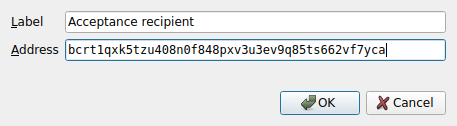
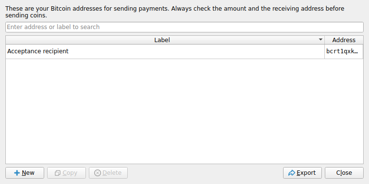
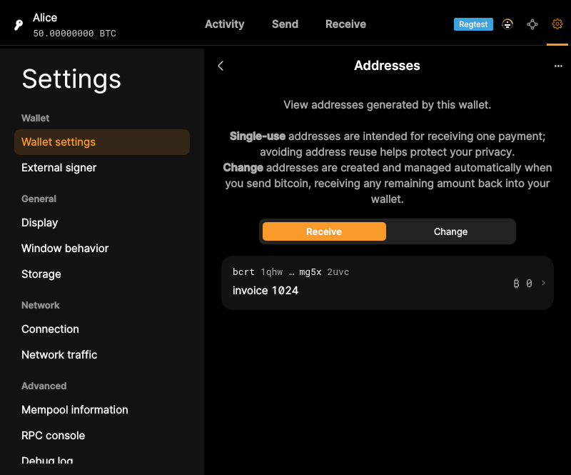

# F18 · Manage Address Book

[Evidence index](../README.md) · [Test results](../TEST-RESULTS.md) · [Capture and build provenance](../PROVENANCE.md)

6 acceptance criteria from the supported-feature inventory. **Acceptance is pending review.** A screenshot demonstrates the visible state; the stated assertions describe the behavior that was actually checked. Related passing suites do not certify every variant of a criterion.

## Implementation comparison

**Partial.** Browse receiving and change addresses, distinguish used addresses, edit address labels/notes, and copy addresses. A sending-contact address book with add/edit/remove, address search/sort controls, and CSV export is missing.

[Address browser](https://github.com/bitcoin-core/gui-qml/blob/a91f4b4774f25de061fe1a7c132a91ddde117fca/qml/pages/wallet/AddressList.qml); [Address details](https://github.com/bitcoin-core/gui-qml/blob/a91f4b4774f25de061fe1a7c132a91ddde117fca/qml/pages/wallet/AddressDetails.qml).

## Application captures

| Qt Widgets (`src/qt`) | GUI-QML (`qt6`) |
| --- | --- |
|  Add saved recipient   Saved sending addresses |  Receiving-address records |

## Modules

- **Qt Widgets:** [primary implementation](https://github.com/bitcoin-core/gui/blob/f739c7876b81304bdc72e7eaa307702da269ac31/src/qt/addressbookpage.cpp).
- **GUI-QML:** [Address browser](https://github.com/bitcoin-core/gui-qml/blob/a91f4b4774f25de061fe1a7c132a91ddde117fca/qml/pages/wallet/AddressList.qml); [Address details](https://github.com/bitcoin-core/gui-qml/blob/a91f4b4774f25de061fe1a7c132a91ddde117fca/qml/pages/wallet/AddressDetails.qml).

These are the implementation entry points for the criteria below. Links are pinned to the tested source revisions.

## Automated tests

| Application | Test/module | Recorded result |
| --- | --- | --- |
| GUI-QML | [qml_test_addresses](https://github.com/bitcoin-core/gui-qml/blob/a91f4b4774f25de061fe1a7c132a91ddde117fca/test/functional/qml_test_addresses.py) | [passed](../logs/qml_test_addresses.log) |
| GUI-QML | [qml_test_address_label_sync](https://github.com/bitcoin-core/gui-qml/blob/a91f4b4774f25de061fe1a7c132a91ddde117fca/test/functional/qml_test_address_label_sync.py) | [passed](../logs/qml_test_address_label_sync.log) |
| GUI-QML C++ | [test/test_addresslistmodel.cpp](https://github.com/bitcoin-core/gui-qml/blob/a91f4b4774f25de061fe1a7c132a91ddde117fca/test/test_addresslistmodel.cpp) | [Suite passed](../logs/qml-unit-tests.log); fixture/model assertions |
| GUI-QML C++ | [test/test_walletqmlmodel.cpp](https://github.com/bitcoin-core/gui-qml/blob/a91f4b4774f25de061fe1a7c132a91ddde117fca/test/test_walletqmlmodel.cpp) | [Suite passed](../logs/qml-unit-tests.log); fixture/model assertions |
| GUI-QML components | [test/qml/tst_address_components.qml](https://github.com/bitcoin-core/gui-qml/blob/a91f4b4774f25de061fe1a7c132a91ddde117fca/test/qml/tst_address_components.qml) | [Suite passed](../logs/qml-quick-tests.log); component assertions |
| Qt Widgets | [AddressBookTests](https://github.com/bitcoin-core/gui/blob/f739c7876b81304bdc72e7eaa307702da269ac31/src/qt/test/addressbooktests.cpp) | [Suite passed](../logs/widgets-qt-tests.log); inspect assertion scope |
| Qt Widgets additional | [Live GUI/RPC scenarios](../scripts/widgets_scenarios.py) | [Recorded assertions](../logs/widgets-checks.json); outcomes listed per criterion |

## Acceptance criteria

### F18.S01 · Keep records of sending and receiving addresses.

| Application | Evidence status | Evidence and limits |
| --- | --- | --- |
| Qt Widgets | Assertions collected | GUI-created recipient label appears in the wallet address book. **passed**. [Add saved recipient](../media/widgets/add-saved-recipient.png) [Saved sending addresses](../media/widgets/saved-sending-addresses.png) [Saved receiving addresses](../media/widgets/saved-receiving-addresses.png) [Modules](#modules) · [Related tests](#automated-tests) |
| GUI-QML | Partial / limited evidence | Receiving and change addresses are present; no managed sending-address book. [Receiving-address records](../media/qml/qml_test_addresses/012-click-walletaddressesrow.png) [Modules](#modules) · [Related tests](#automated-tests) |

- [ ] Acceptance decision recorded by reviewer.

### F18.S02 · Add, update, and remove saved recipients.

| Application | Evidence status | Evidence and limits |
| --- | --- | --- |
| Qt Widgets | Assertions collected | GUI-created recipient label appears in the wallet address book. **passed**. [Add saved recipient](../media/widgets/add-saved-recipient.png) [Saved sending addresses](../media/widgets/saved-sending-addresses.png) [Modules](#modules) · [Related tests](#automated-tests) |
| GUI-QML | Implementation gap | No saved sending-recipient CRUD. No screenshot: this GUI workflow is absent. [Modules](#modules) · [Related tests](#automated-tests) |

- [ ] Acceptance decision recorded by reviewer.

### F18.S03 · Label receiving addresses.

| Application | Evidence status | Evidence and limits |
| --- | --- | --- |
| Qt Widgets | Visual evidence only | No targeted runtime assertion collected for this exact criterion. [Saved receiving addresses](../media/widgets/saved-receiving-addresses.png) [Modules](#modules) · [Related tests](#automated-tests) |
| GUI-QML | Automated evidence collected | Address labels synchronize with payment requests and activity. [Receiving-address records](../media/qml/qml_test_addresses/012-click-walletaddressesrow.png) [Modules](#modules) · [Related tests](#automated-tests) |

- [ ] Acceptance decision recorded by reviewer.

### F18.S04 · Search and sort saved addresses by address or label.

| Application | Evidence status | Evidence and limits |
| --- | --- | --- |
| Qt Widgets | Visual evidence only | No targeted runtime assertion collected for this exact criterion. [Saved sending addresses](../media/widgets/saved-sending-addresses.png) [Saved receiving addresses](../media/widgets/saved-receiving-addresses.png) [Modules](#modules) · [Related tests](#automated-tests) |
| GUI-QML | Implementation gap | No address-book search or sorting. No screenshot: this GUI workflow is absent. [Modules](#modules) · [Related tests](#automated-tests) |

- [ ] Acceptance decision recorded by reviewer.

### F18.S05 · Copy saved addresses and labels to the clipboard.

| Application | Evidence status | Evidence and limits |
| --- | --- | --- |
| Qt Widgets | Visual evidence only | No targeted runtime assertion collected for this exact criterion. [Saved sending addresses](../media/widgets/saved-sending-addresses.png) [Saved receiving addresses](../media/widgets/saved-receiving-addresses.png) [Modules](#modules) · [Related tests](#automated-tests) |
| GUI-QML | Partial / limited evidence | Address copying is supported; separate label-copy coverage needs verification. [Receiving-address records](../media/qml/qml_test_addresses/012-click-walletaddressesrow.png) [Modules](#modules) · [Related tests](#automated-tests) |

- [ ] Acceptance decision recorded by reviewer.

### F18.S06 · Export address records as CSV.

| Application | Evidence status | Evidence and limits |
| --- | --- | --- |
| Qt Widgets | Assertions collected | GUI CSV export contains the saved address and label. **passed**. [Saved sending addresses](../media/widgets/saved-sending-addresses.png) [Modules](#modules) · [Related tests](#automated-tests) |
| GUI-QML | Implementation gap | No address-book CSV export. No screenshot: this GUI workflow is absent. [Modules](#modules) · [Related tests](#automated-tests) |

- [ ] Acceptance decision recorded by reviewer.

## Capture register

The original PNGs are unmodified application captures. Timestamps, dimensions and SHA-256 hashes are in the [capture manifest](../selected-captures.json). Some early/raw frames are not selected for review.

| Application | Capture | Criteria |
| --- | --- | --- |
| widgets | [Add saved recipient](../media/widgets/add-saved-recipient.png) | F18.S01, F18.S02 |
| widgets | [Saved sending addresses](../media/widgets/saved-sending-addresses.png) | F18.S01, F18.S02, F18.S04, F18.S05, F18.S06 |
| widgets | [Saved receiving addresses](../media/widgets/saved-receiving-addresses.png) | F18.S01, F18.S03, F18.S04, F18.S05 |
| qml | [Receiving-address records](../media/qml/qml_test_addresses/012-click-walletaddressesrow.png) | F18.S01, F18.S03, F18.S05 |
