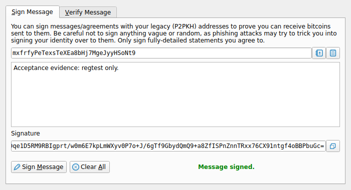
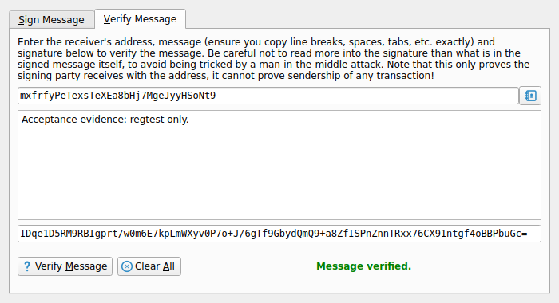
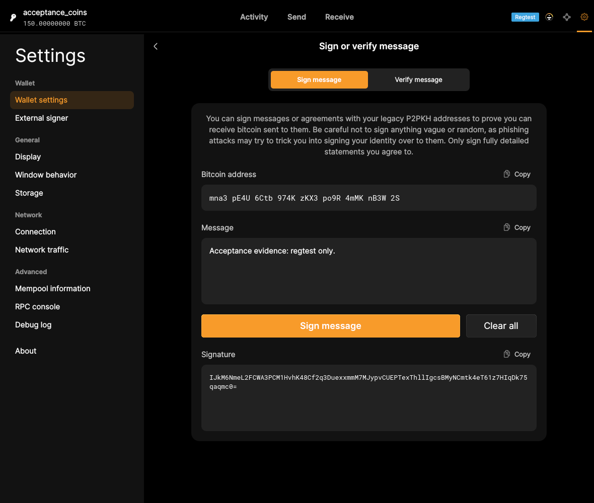
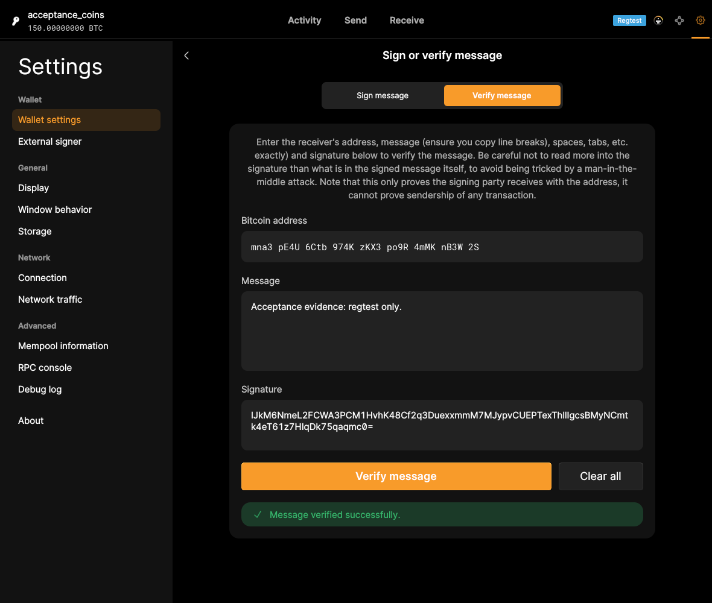

# F19 · Sign and Verify Messages

[Evidence index](../README.md) · [Test results](../TEST-RESULTS.md) · [Capture and build provenance](../PROVENANCE.md)

3 acceptance criteria from the supported-feature inventory. **Acceptance is pending review.** A screenshot demonstrates the visible state; the stated assertions describe the behavior that was actually checked. Related passing suites do not certify every variant of a criterion.

## Implementation comparison

**Implemented.** Sign and verify legacy P2PKH messages, unlock an encrypted signing wallet when needed, and copy the signature. The interface requires a selected wallet to access this flow.

[Message signing and verification](https://github.com/bitcoin-core/gui-qml/blob/a91f4b4774f25de061fe1a7c132a91ddde117fca/qml/pages/wallet/SignVerifyMessage.qml); [Address compatibility](https://github.com/bitcoin-core/gui-qml/blob/a91f4b4774f25de061fe1a7c132a91ddde117fca/qml/models/signverifymessagemodel.cpp).

## Application captures

| Qt Widgets (`src/qt`) | GUI-QML (`qt6`) |
| --- | --- |
|  Message signed   Message verified |  Signed message   Verified message |

Baseline support notes: *Support: Message signing and verification support legacy P2PKH addresses.*

[All selected captures for this group](#capture-register) are listed below.

## Modules

- **Qt Widgets:** [primary implementation](https://github.com/bitcoin-core/gui/blob/f739c7876b81304bdc72e7eaa307702da269ac31/src/qt/signverifymessagedialog.cpp).
- **GUI-QML:** [Message signing and verification](https://github.com/bitcoin-core/gui-qml/blob/a91f4b4774f25de061fe1a7c132a91ddde117fca/qml/pages/wallet/SignVerifyMessage.qml); [Address compatibility](https://github.com/bitcoin-core/gui-qml/blob/a91f4b4774f25de061fe1a7c132a91ddde117fca/qml/models/signverifymessagemodel.cpp).

These are the implementation entry points for the criteria below. Links are pinned to the tested source revisions.

## Automated tests

| Application | Test/module | Recorded result |
| --- | --- | --- |
| GUI-QML | [qml_test_wallet_settings](https://github.com/bitcoin-core/gui-qml/blob/a91f4b4774f25de061fe1a7c132a91ddde117fca/test/functional/qml_test_wallet_settings.py) | [passed](../logs/qml_test_wallet_settings.log) |
| GUI-QML C++ | [test/test_walletqmlmodel.cpp](https://github.com/bitcoin-core/gui-qml/blob/a91f4b4774f25de061fe1a7c132a91ddde117fca/test/test_walletqmlmodel.cpp) | [Suite passed](../logs/qml-unit-tests.log); fixture/model assertions |
| GUI-QML components | [test/qml/tst_signverifymessage.qml](https://github.com/bitcoin-core/gui-qml/blob/a91f4b4774f25de061fe1a7c132a91ddde117fca/test/qml/tst_signverifymessage.qml) | [Suite passed](../logs/qml-quick-tests.log); component assertions |
| GUI-QML additional | [Independent live scenarios](../scripts/qml_additional.py) | [Passed](../logs/qml-additional.log), [assertions](../logs/qml-additional-checks.json) |
| Qt Widgets additional | [Live GUI/RPC scenarios](../scripts/widgets_scenarios.py) | [Recorded assertions](../logs/widgets-checks.json); outcomes listed per criterion |

## Acceptance criteria

### F19.S01 · Sign a message to demonstrate control of a Bitcoin address.

| Application | Evidence status | Evidence and limits |
| --- | --- | --- |
| Qt Widgets | Assertions collected | GUI signature verifies through Core RPC. **passed**. [Message signed](../media/widgets/message-signed.png) [Encrypted message signed](../media/widgets/encrypted-message-signed.png) [Modules](#modules) · [Related tests](#automated-tests) |
| GUI-QML | Automated evidence collected | P2PKH signing succeeds and encrypted signing relocks. The live QML signature verifies through RPC. **passed**. [Signed message](../media/qml/qml_additional/027-message-signed-full-view.png) [Modules](#modules) · [Related tests](#automated-tests) |

- [ ] Acceptance decision recorded by reviewer.

### F19.S02 · Verify that a message was signed by the holder of the corresponding key.

| Application | Evidence status | Evidence and limits |
| --- | --- | --- |
| Qt Widgets | Assertions collected | GUI reports valid message signature. **passed**. [Message verified](../media/widgets/message-verified.png) [Modules](#modules) · [Related tests](#automated-tests) |
| GUI-QML | Automated evidence collected | Valid and modified messages give opposite verification results. The QML form reports successful signature verification. **passed**. [Verified message](../media/qml/qml_additional/030-message-verified-full-view.png) [Modules](#modules) · [Related tests](#automated-tests) |

- [ ] Acceptance decision recorded by reviewer.

### F19.S03 · Copy the resulting signature to the clipboard.

| Application | Evidence status | Evidence and limits |
| --- | --- | --- |
| Qt Widgets | Assertions collected | Signature is copied to the system clipboard. **passed**. [Message signed](../media/widgets/message-signed.png) [Modules](#modules) · [Related tests](#automated-tests) |
| GUI-QML | Automated evidence collected | Signature-copy behavior has QML component assertions. [Signed message](../media/qml/qml_additional/027-message-signed-full-view.png) [Modules](#modules) · [Related tests](#automated-tests) |

- [ ] Acceptance decision recorded by reviewer.

## Capture register

The original PNGs are unmodified application captures. Timestamps, dimensions and SHA-256 hashes are in the [capture manifest](../selected-captures.json). Some early/raw frames are not selected for review.

| Application | Capture | Criteria |
| --- | --- | --- |
| widgets | [Message signed](../media/widgets/message-signed.png) | F19.S01, F19.S03 |
| widgets | [Message verified](../media/widgets/message-verified.png) | F19.S02 |
| widgets | [Encrypted message signed](../media/widgets/encrypted-message-signed.png) | F19.S01 |
| qml | [Signed message](../media/qml/qml_additional/027-message-signed-full-view.png) | F19.S01, F19.S03 |
| qml | [Verified message](../media/qml/qml_additional/030-message-verified-full-view.png) | F19.S02 |
