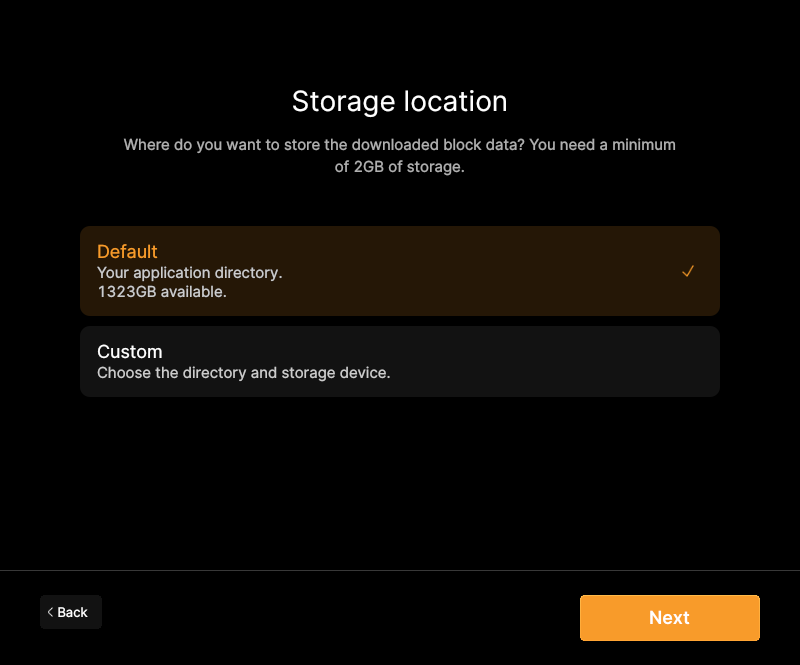
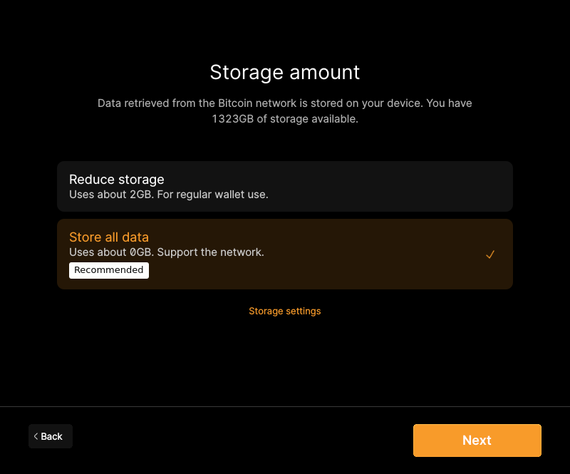

# F20 · Set Up and Synchronize Node

[Evidence index](../README.md) · [Test results](../TEST-RESULTS.md) · [Capture and build provenance](../PROVENANCE.md)

7 acceptance criteria from the supported-feature inventory. **Acceptance is pending review.** A screenshot demonstrates the visible state; the stated assertions describe the behavior that was actually checked. Related passing suites do not certify every variant of a criterion.

## Implementation comparison

**Partial.** Choose storage location and pruning, check available/required storage, validate and synchronize the chain, monitor progress and estimated time remaining, and run without an open wallet. Mainnet, testnet, testnet4, signet, and regtest are recognized. Guidance about how pruning affects wallet recovery is missing.

[Node setup](https://github.com/bitcoin-core/gui-qml/blob/a91f4b4774f25de061fe1a7c132a91ddde117fca/qml/pages/onboarding/OnboardingWizard.qml); [Storage checks](https://github.com/bitcoin-core/gui-qml/blob/a91f4b4774f25de061fe1a7c132a91ddde117fca/qml/models/onboardingoptionsmodel.h); [Networks](https://github.com/bitcoin-core/gui-qml/blob/a91f4b4774f25de061fe1a7c132a91ddde117fca/qml/networkstyle.cpp).

## Application captures

| Qt Widgets (`src/qt`) | GUI-QML (`qt6`) |
| --- | --- |
|  Startup sync status   Preferences general |  Choose data storage   Choose blockchain storage amount |

Baseline support notes: *Support: The network is selected as part of startup configuration.*

[All selected captures for this group](#capture-register) are listed below.

## Modules

- **Qt Widgets:** [primary implementation](https://github.com/bitcoin-core/gui/blob/f739c7876b81304bdc72e7eaa307702da269ac31/src/qt/intro.cpp).
  [Network support](https://github.com/bitcoin-core/gui/blob/f739c7876b81304bdc72e7eaa307702da269ac31/src/qt/networkstyle.cpp).
- **GUI-QML:** [Node setup](https://github.com/bitcoin-core/gui-qml/blob/a91f4b4774f25de061fe1a7c132a91ddde117fca/qml/pages/onboarding/OnboardingWizard.qml); [Storage checks](https://github.com/bitcoin-core/gui-qml/blob/a91f4b4774f25de061fe1a7c132a91ddde117fca/qml/models/onboardingoptionsmodel.h); [Networks](https://github.com/bitcoin-core/gui-qml/blob/a91f4b4774f25de061fe1a7c132a91ddde117fca/qml/networkstyle.cpp).

These are the implementation entry points for the criteria below. Links are pinned to the tested source revisions.

## Automated tests

| Application | Test/module | Recorded result |
| --- | --- | --- |
| GUI-QML | [qml_test_onboarding](https://github.com/bitcoin-core/gui-qml/blob/a91f4b4774f25de061fe1a7c132a91ddde117fca/test/functional/qml_test_onboarding.py) | [passed](../logs/qml_test_onboarding.log) |
| GUI-QML | [qml_test_preinit_onboarding](https://github.com/bitcoin-core/gui-qml/blob/a91f4b4774f25de061fe1a7c132a91ddde117fca/test/functional/qml_test_preinit_onboarding.py) | [passed](../logs/qml_test_preinit_onboarding.log) |
| GUI-QML | [qml_test_blockclock](https://github.com/bitcoin-core/gui-qml/blob/a91f4b4774f25de061fe1a7c132a91ddde117fca/test/functional/qml_test_blockclock.py) | [passed](../logs/qml_test_blockclock.log) |
| GUI-QML | [qml_test_disablewallet_boot](https://github.com/bitcoin-core/gui-qml/blob/a91f4b4774f25de061fe1a7c132a91ddde117fca/test/functional/qml_test_disablewallet_boot.py) | [passed](../logs/qml_test_disablewallet_boot.log) |
| GUI-QML C++ | [test/test_onboarding_storage.cpp](https://github.com/bitcoin-core/gui-qml/blob/a91f4b4774f25de061fe1a7c132a91ddde117fca/test/test_onboarding_storage.cpp) | [Suite passed](../logs/qml-unit-tests.log); fixture/model assertions |
| GUI-QML C++ | [test/test_options_model.cpp](https://github.com/bitcoin-core/gui-qml/blob/a91f4b4774f25de061fe1a7c132a91ddde117fca/test/test_options_model.cpp) | [Suite passed](../logs/qml-unit-tests.log); fixture/model assertions |
| GUI-QML C++ | [test/test_syncprogresstracker.cpp](https://github.com/bitcoin-core/gui-qml/blob/a91f4b4774f25de061fe1a7c132a91ddde117fca/test/test_syncprogresstracker.cpp) | [Suite passed](../logs/qml-unit-tests.log); fixture/model assertions |
| GUI-QML C++ | [test/test_guiargs.cpp](https://github.com/bitcoin-core/gui-qml/blob/a91f4b4774f25de061fe1a7c132a91ddde117fca/test/test_guiargs.cpp) | [Suite passed](../logs/qml-unit-tests.log); fixture/model assertions |
| GUI-QML components | [test/qml/tst_onboarding_datadir.qml](https://github.com/bitcoin-core/gui-qml/blob/a91f4b4774f25de061fe1a7c132a91ddde117fca/test/qml/tst_onboarding_datadir.qml) | [Suite passed](../logs/qml-quick-tests.log); component assertions |
| GUI-QML components | [test/qml/tst_onboardingview.qml](https://github.com/bitcoin-core/gui-qml/blob/a91f4b4774f25de061fe1a7c132a91ddde117fca/test/qml/tst_onboardingview.qml) | [Suite passed](../logs/qml-quick-tests.log); component assertions |
| GUI-QML components | [test/qml/tst_blockclock.qml](https://github.com/bitcoin-core/gui-qml/blob/a91f4b4774f25de061fe1a7c132a91ddde117fca/test/qml/tst_blockclock.qml) | [Suite passed](../logs/qml-quick-tests.log); component assertions |
| Qt Widgets | [AppTests](https://github.com/bitcoin-core/gui/blob/f739c7876b81304bdc72e7eaa307702da269ac31/src/qt/test/apptests.cpp) | [Suite passed](../logs/widgets-qt-tests.log); inspect assertion scope |
| Qt Widgets | [OptionTests](https://github.com/bitcoin-core/gui/blob/f739c7876b81304bdc72e7eaa307702da269ac31/src/qt/test/optiontests.cpp) | [Suite passed](../logs/widgets-qt-tests.log); inspect assertion scope |

## Acceptance criteria

### F20.S01 · Choose where node and wallet data are stored.

| Application | Evidence status | Evidence and limits |
| --- | --- | --- |
| Qt Widgets | Related automated suite | No targeted runtime assertion collected for this exact criterion. No matching screenshot collected. [Modules](#modules) · [Related tests](#automated-tests) |
| GUI-QML | Automated evidence collected | Pre-initialization data-directory selection and startup handoff pass. [Choose data storage](../media/qml/qml_test_preinit_onboarding/013-wait-for-page-onboardingstoragelocation.png) [Initial-download confirmation and network settings](../media/qml/qml_test_preinit_onboarding/017-wait-for-page-onboardingconnection.png) [Modules](#modules) · [Related tests](#automated-tests) |

- [ ] Acceptance decision recorded by reviewer.

### F20.S02 · Limit blockchain storage through pruning.

| Application | Evidence status | Evidence and limits |
| --- | --- | --- |
| Qt Widgets | Visual evidence only | No targeted runtime assertion collected for this exact criterion. [Preferences general](../media/widgets/preferences-general.png) [Modules](#modules) · [Related tests](#automated-tests) |
| GUI-QML | Automated evidence collected | Pruning/storage selection and persisted settings have tests. [Choose blockchain storage amount](../media/qml/qml_test_preinit_onboarding/015-wait-for-page-onboardingstorageamount.png) [Modules](#modules) · [Related tests](#automated-tests) |

- [ ] Acceptance decision recorded by reviewer.

### F20.S03 · Assess available storage, expected requirements, and the effect of pruning on wallet recovery.

| Application | Evidence status | Evidence and limits |
| --- | --- | --- |
| Qt Widgets | Visual evidence only | No targeted runtime assertion collected for this exact criterion. [Preferences general](../media/widgets/preferences-general.png) [Modules](#modules) · [Related tests](#automated-tests) |
| GUI-QML | Partial / limited evidence | Storage and pruning information is shown; wallet-recovery consequences are not explained. [Choose blockchain storage amount](../media/qml/qml_test_preinit_onboarding/015-wait-for-page-onboardingstorageamount.png) [Modules](#modules) · [Related tests](#automated-tests) |

- [ ] Acceptance decision recorded by reviewer.

### F20.S04 · Download and validate the blockchain.

| Application | Evidence status | Evidence and limits |
| --- | --- | --- |
| Qt Widgets | Related automated suite | No targeted runtime assertion collected for this exact criterion. **Limit:** Only an isolated regtest chain is used. Mainnet initial download is not exercised. No matching screenshot collected. [Modules](#modules) · [Related tests](#automated-tests) |
| GUI-QML | Partial / limited evidence | Regtest block validation is exercised; a full mainnet initial download is not. No matching screenshot collected. [Modules](#modules) · [Related tests](#automated-tests) |

- [ ] Acceptance decision recorded by reviewer.

### F20.S05 · Monitor synchronization progress and how far the node is behind.

| Application | Evidence status | Evidence and limits |
| --- | --- | --- |
| Qt Widgets | Visual evidence only | No targeted runtime assertion collected for this exact criterion. [Startup sync status](../media/widgets/startup-sync-status.png) [Modules](#modules) · [Related tests](#automated-tests) |
| GUI-QML | Automated evidence collected | Sync progress/ETA and block-clock states have component/model tests. No matching screenshot collected. [Modules](#modules) · [Related tests](#automated-tests) |

- [ ] Acceptance decision recorded by reviewer.

### F20.S06 · Operate the node without an open wallet.

| Application | Evidence status | Evidence and limits |
| --- | --- | --- |
| Qt Widgets | Related automated suite | No targeted runtime assertion collected for this exact criterion. No matching screenshot collected. [Modules](#modules) · [Related tests](#automated-tests) |
| GUI-QML | Automated evidence collected | Node tools remain available without a wallet. [Node running with wallet features disabled](../media/qml/qml_test_disablewallet_boot/002-02-node-only-main-screen-reached.png) [Modules](#modules) · [Related tests](#automated-tests) |

- [ ] Acceptance decision recorded by reviewer.

### F20.S07 · Use mainnet, testnet, testnet4, signet, or regtest. Network support.

| Application | Evidence status | Evidence and limits |
| --- | --- | --- |
| Qt Widgets | Related automated suite | No targeted runtime assertion collected for this exact criterion. **Limit:** Only regtest is run; other network variants remain unexercised. No matching screenshot collected. [Modules](#modules) · [Related tests](#automated-tests) |
| GUI-QML | Partial / limited evidence | Regtest is executed; other chains are source/configuration evidence only. No matching screenshot collected. [Modules](#modules) · [Related tests](#automated-tests) |

- [ ] Acceptance decision recorded by reviewer.

## Capture register

The original PNGs are unmodified application captures. Timestamps, dimensions and SHA-256 hashes are in the [capture manifest](../selected-captures.json). Some early/raw frames are not selected for review.

| Application | Capture | Criteria |
| --- | --- | --- |
| widgets | [Startup sync status](../media/widgets/startup-sync-status.png) | F20.S05 |
| widgets | [Preferences general](../media/widgets/preferences-general.png) | F20.S02, F20.S03 |
| qml | [Choose data storage](../media/qml/qml_test_preinit_onboarding/013-wait-for-page-onboardingstoragelocation.png) | F20.S01 |
| qml | [Choose blockchain storage amount](../media/qml/qml_test_preinit_onboarding/015-wait-for-page-onboardingstorageamount.png) | F20.S02, F20.S03 |
| qml | [Initial-download confirmation and network settings](../media/qml/qml_test_preinit_onboarding/017-wait-for-page-onboardingconnection.png) | F20.S01 |
| qml | [Node running with wallet features disabled](../media/qml/qml_test_disablewallet_boot/002-02-node-only-main-screen-reached.png) | F20.S06 |
