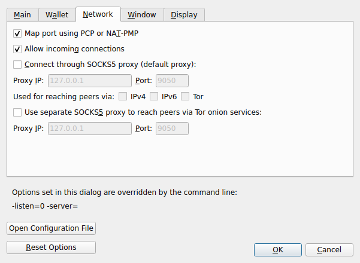
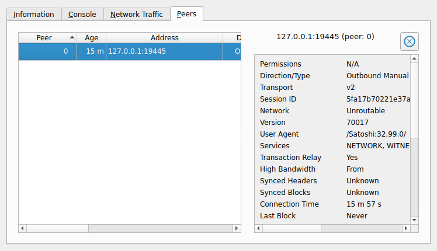
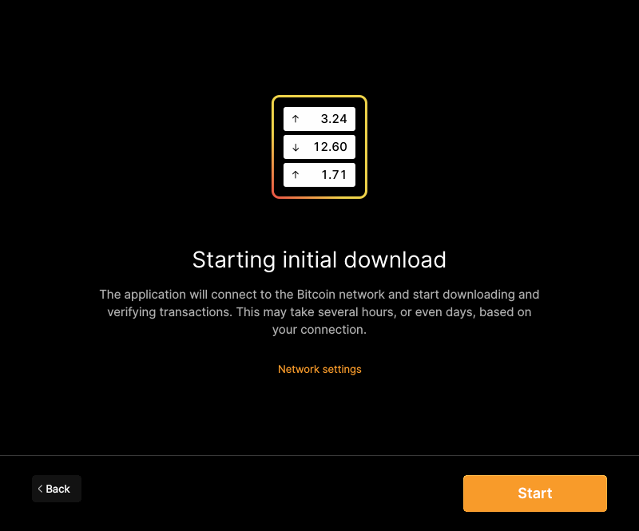
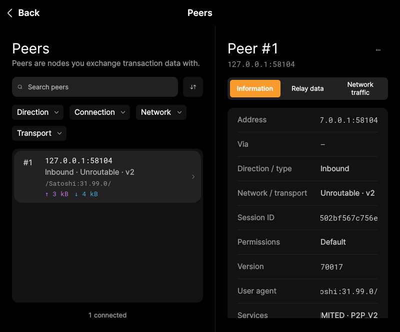

# F21 · Configure Network and Manage Peers

[Evidence index](../README.md) · [Test results](../TEST-RESULTS.md) · [Capture and build provenance](../PROVENANCE.md)

9 acceptance criteria from the supported-feature inventory. **Acceptance is pending review.** A screenshot demonstrates the visible state; the stated assertions describe the behavior that was actually checked. Related passing suites do not certify every variant of a criterion.

## Implementation comparison

**Partial.** Pause/resume networking, allow inbound connections, configure SOCKS5/Tor routing and automatic port mapping, and inspect peer details and encrypted transport. Sort/filter peers, copy peer details, disconnect, temporarily ban, review bans, and unban. Copying banned addresses/network ranges is missing.

[Network settings](https://github.com/bitcoin-core/gui-qml/blob/a91f4b4774f25de061fe1a7c132a91ddde117fca/qml/pages/settings/ConnectionSettingsPage.qml); [Peers](https://github.com/bitcoin-core/gui-qml/blob/a91f4b4774f25de061fe1a7c132a91ddde117fca/qml/pages/node/Peers.qml); [Peer details](https://github.com/bitcoin-core/gui-qml/blob/a91f4b4774f25de061fe1a7c132a91ddde117fca/qml/pages/node/PeerDetails.qml); [Bans](https://github.com/bitcoin-core/gui-qml/blob/a91f4b4774f25de061fe1a7c132a91ddde117fca/qml/components/BannedPeersPopup.qml).

## Application captures

| Qt Widgets (`src/qt`) | GUI-QML (`qt6`) |
| --- | --- |
|  Preferences network   peers |  Initial-download confirmation and network settings   Connected peer details |

[All selected captures for this group](#capture-register) are listed below.

## Modules

- **Qt Widgets:** [primary implementation](https://github.com/bitcoin-core/gui/blob/f739c7876b81304bdc72e7eaa307702da269ac31/src/qt/rpcconsole.cpp).
  [Proxy support](https://github.com/bitcoin-core/gui/blob/f739c7876b81304bdc72e7eaa307702da269ac31/src/qt/optionsdialog.cpp).
- **GUI-QML:** [Network settings](https://github.com/bitcoin-core/gui-qml/blob/a91f4b4774f25de061fe1a7c132a91ddde117fca/qml/pages/settings/ConnectionSettingsPage.qml); [Peers](https://github.com/bitcoin-core/gui-qml/blob/a91f4b4774f25de061fe1a7c132a91ddde117fca/qml/pages/node/Peers.qml); [Peer details](https://github.com/bitcoin-core/gui-qml/blob/a91f4b4774f25de061fe1a7c132a91ddde117fca/qml/pages/node/PeerDetails.qml); [Bans](https://github.com/bitcoin-core/gui-qml/blob/a91f4b4774f25de061fe1a7c132a91ddde117fca/qml/components/BannedPeersPopup.qml).

These are the implementation entry points for the criteria below. Links are pinned to the tested source revisions.

## Automated tests

| Application | Test/module | Recorded result |
| --- | --- | --- |
| GUI-QML | [qml_test_peers](https://github.com/bitcoin-core/gui-qml/blob/a91f4b4774f25de061fe1a7c132a91ddde117fca/test/functional/qml_test_peers.py) | [passed](../logs/qml_test_peers.log) |
| GUI-QML | [qml_test_proxy](https://github.com/bitcoin-core/gui-qml/blob/a91f4b4774f25de061fe1a7c132a91ddde117fca/test/functional/qml_test_proxy.py) | [passed](../logs/qml_test_proxy.log) |
| GUI-QML | [qml_test_blocksonly_settings](https://github.com/bitcoin-core/gui-qml/blob/a91f4b4774f25de061fe1a7c132a91ddde117fca/test/functional/qml_test_blocksonly_settings.py) | [passed](../logs/qml_test_blocksonly_settings.log) |
| GUI-QML C++ | [test/test_peerlistmodel.cpp](https://github.com/bitcoin-core/gui-qml/blob/a91f4b4774f25de061fe1a7c132a91ddde117fca/test/test_peerlistmodel.cpp) | [Suite passed](../logs/qml-unit-tests.log); fixture/model assertions |
| GUI-QML C++ | [test/test_peerstatsutil.cpp](https://github.com/bitcoin-core/gui-qml/blob/a91f4b4774f25de061fe1a7c132a91ddde117fca/test/test_peerstatsutil.cpp) | [Suite passed](../logs/qml-unit-tests.log); fixture/model assertions |
| GUI-QML C++ | [test/test_banlistmodel.cpp](https://github.com/bitcoin-core/gui-qml/blob/a91f4b4774f25de061fe1a7c132a91ddde117fca/test/test_banlistmodel.cpp) | [Suite passed](../logs/qml-unit-tests.log); fixture/model assertions |
| GUI-QML C++ | [test/test_networkstatusmodel.cpp](https://github.com/bitcoin-core/gui-qml/blob/a91f4b4774f25de061fe1a7c132a91ddde117fca/test/test_networkstatusmodel.cpp) | [Suite passed](../logs/qml-unit-tests.log); fixture/model assertions |
| GUI-QML C++ | [test/test_options_model.cpp](https://github.com/bitcoin-core/gui-qml/blob/a91f4b4774f25de061fe1a7c132a91ddde117fca/test/test_options_model.cpp) | [Suite passed](../logs/qml-unit-tests.log); fixture/model assertions |
| GUI-QML components | [test/qml/tst_peeractions.qml](https://github.com/bitcoin-core/gui-qml/blob/a91f4b4774f25de061fe1a7c132a91ddde117fca/test/qml/tst_peeractions.qml) | [Suite passed](../logs/qml-quick-tests.log); component assertions |
| GUI-QML components | [test/qml/tst_proxylocationinput.qml](https://github.com/bitcoin-core/gui-qml/blob/a91f4b4774f25de061fe1a7c132a91ddde117fca/test/qml/tst_proxylocationinput.qml) | [Suite passed](../logs/qml-quick-tests.log); component assertions |
| Qt Widgets | [OptionTests](https://github.com/bitcoin-core/gui/blob/f739c7876b81304bdc72e7eaa307702da269ac31/src/qt/test/optiontests.cpp) | [Suite passed](../logs/widgets-qt-tests.log); inspect assertion scope |
| Qt Widgets additional | [Live GUI/RPC scenarios](../scripts/widgets_scenarios.py) | [Recorded assertions](../logs/widgets-checks.json); outcomes listed per criterion |

## Acceptance criteria

### F21.S01 · Enable or pause peer-to-peer networking.

| Application | Evidence status | Evidence and limits |
| --- | --- | --- |
| Qt Widgets | Assertions collected | The GUI network action pauses peer networking. **passed**. The GUI network action resumes peer networking. **passed**. [Network paused](../media/widgets/network-paused.png) [Modules](#modules) · [Related tests](#automated-tests) |
| GUI-QML | Automated evidence collected | Network pause/resume model and UI wiring are checked. No matching screenshot collected. [Modules](#modules) · [Related tests](#automated-tests) |

- [ ] Acceptance decision recorded by reviewer.

### F21.S02 · Allow incoming peer connections.

| Application | Evidence status | Evidence and limits |
| --- | --- | --- |
| Qt Widgets | Visual evidence only | No targeted runtime assertion collected for this exact criterion. [Preferences network](../media/widgets/preferences-network.png) [Modules](#modules) · [Related tests](#automated-tests) |
| GUI-QML | Automated evidence collected | Incoming-connection settings are exercised. [Initial-download confirmation and network settings](../media/qml/qml_test_preinit_onboarding/017-wait-for-page-onboardingconnection.png) [Modules](#modules) · [Related tests](#automated-tests) |

- [ ] Acceptance decision recorded by reviewer.

### F21.S03 · Route connections through SOCKS5 proxies, with separate routing for Tor. Proxy support.

| Application | Evidence status | Evidence and limits |
| --- | --- | --- |
| Qt Widgets | Visual evidence only | No targeted runtime assertion collected for this exact criterion. **Limit:** Proxy configuration is pictured; no live proxy routing is verified. [Preferences network](../media/widgets/preferences-network.png) [Modules](#modules) · [Related tests](#automated-tests) |
| GUI-QML | Partial / limited evidence | Proxy settings and validation are tested; live Tor/SOCKS routing is not. [Proxy settings](../media/qml/qml_test_proxy/005-wait-for-page-proxysettingspage.png) [Modules](#modules) · [Related tests](#automated-tests) |

- [ ] Acceptance decision recorded by reviewer.

### F21.S04 · Automatically configure router access for incoming connections where supported.

| Application | Evidence status | Evidence and limits |
| --- | --- | --- |
| Qt Widgets | Visual evidence only | No targeted runtime assertion collected for this exact criterion. **Limit:** The router-mapping preference is pictured; no physical router is exercised. [Preferences network](../media/widgets/preferences-network.png) [Modules](#modules) · [Related tests](#automated-tests) |
| GUI-QML | Partial / limited evidence | Configuration exists; physical-router mapping is untested. No matching screenshot collected. [Modules](#modules) · [Related tests](#automated-tests) |

- [ ] Acceptance decision recorded by reviewer.

### F21.S05 · Inspect peer connectivity, performance, synchronization, and relay behavior.

| Application | Evidence status | Evidence and limits |
| --- | --- | --- |
| Qt Widgets | Visual evidence only | No targeted runtime assertion collected for this exact criterion. [peers](../media/widgets/peers.png) [Modules](#modules) · [Related tests](#automated-tests) |
| GUI-QML | Automated evidence collected | Live peer details are captured. [Connected peer details](../media/qml/qml_test_peers/004-wait-for-page-peerdetails.png) [Modules](#modules) · [Related tests](#automated-tests) |

- [ ] Acceptance decision recorded by reviewer.

### F21.S06 · Check whether peer connections use encrypted transport.

| Application | Evidence status | Evidence and limits |
| --- | --- | --- |
| Qt Widgets | Visual evidence only | No targeted runtime assertion collected for this exact criterion. [peers](../media/widgets/peers.png) [Modules](#modules) · [Related tests](#automated-tests) |
| GUI-QML | Automated evidence collected | Transport type has peer model assertions. [Connected peer details](../media/qml/qml_test_peers/004-wait-for-page-peerdetails.png) [Modules](#modules) · [Related tests](#automated-tests) |

- [ ] Acceptance decision recorded by reviewer.

### F21.S07 · Sort peers, copy peer addresses to the clipboard, and disconnect unwanted peers.

| Application | Evidence status | Evidence and limits |
| --- | --- | --- |
| Qt Widgets | Visual evidence only | No targeted runtime assertion collected for this exact criterion. [peers](../media/widgets/peers.png) [Modules](#modules) · [Related tests](#automated-tests) |
| GUI-QML | Automated evidence collected | Disconnect is tested against a real local peer; sorting/copying have model/UI coverage. [Connected peer details](../media/qml/qml_test_peers/004-wait-for-page-peerdetails.png) [Modules](#modules) · [Related tests](#automated-tests) |

- [ ] Acceptance decision recorded by reviewer.

### F21.S08 · Temporarily ban peers, review existing bans, and restore access.

| Application | Evidence status | Evidence and limits |
| --- | --- | --- |
| Qt Widgets | Visual evidence only | No targeted runtime assertion collected for this exact criterion. [peers](../media/widgets/peers.png) [Modules](#modules) · [Related tests](#automated-tests) |
| GUI-QML | Automated evidence collected | All offered ban periods and unban are exercised. [Banned peers](../media/qml/qml_test_peers/032-click-viewbannedpeersbutton.png) [Modules](#modules) · [Related tests](#automated-tests) |

- [ ] Acceptance decision recorded by reviewer.

### F21.S09 · Copy banned addresses and network ranges to the clipboard.

| Application | Evidence status | Evidence and limits |
| --- | --- | --- |
| Qt Widgets | Related automated suite | No targeted runtime assertion collected for this exact criterion. No matching screenshot collected. [Modules](#modules) · [Related tests](#automated-tests) |
| GUI-QML | Implementation gap | No banned-address clipboard action. No screenshot: this GUI workflow is absent. [Modules](#modules) · [Related tests](#automated-tests) |

- [ ] Acceptance decision recorded by reviewer.

## Capture register

The original PNGs are unmodified application captures. Timestamps, dimensions and SHA-256 hashes are in the [capture manifest](../selected-captures.json). Some early/raw frames are not selected for review.

| Application | Capture | Criteria |
| --- | --- | --- |
| widgets | [Preferences network](../media/widgets/preferences-network.png) | F21.S02, F21.S03, F21.S04 |
| widgets | [peers](../media/widgets/peers.png) | F21.S05, F21.S06, F21.S07, F21.S08 |
| widgets | [Network paused](../media/widgets/network-paused.png) | F21.S01 |
| qml | [Initial-download confirmation and network settings](../media/qml/qml_test_preinit_onboarding/017-wait-for-page-onboardingconnection.png) | F21.S02 |
| qml | [Connected peer details](../media/qml/qml_test_peers/004-wait-for-page-peerdetails.png) | F21.S05, F21.S06, F21.S07 |
| qml | [Banned peers](../media/qml/qml_test_peers/032-click-viewbannedpeersbutton.png) | F21.S08 |
| qml | [Proxy settings](../media/qml/qml_test_proxy/005-wait-for-page-proxysettingspage.png) | F21.S03 |
