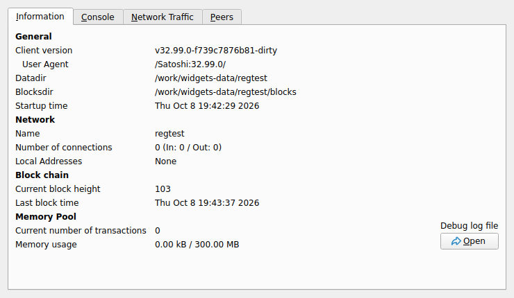
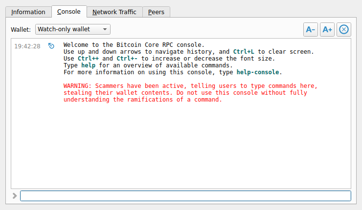
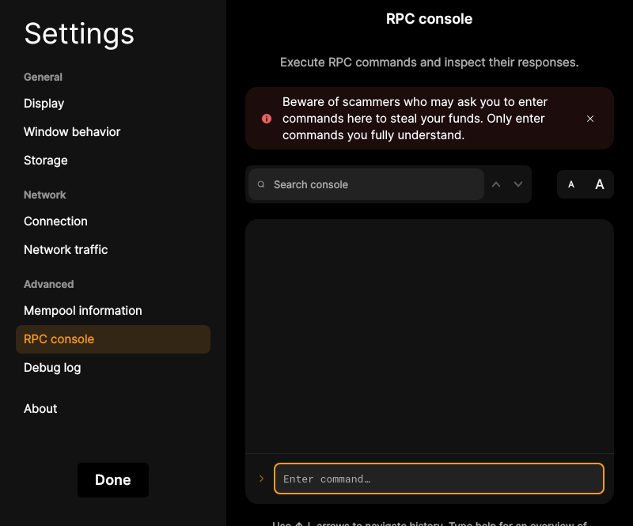
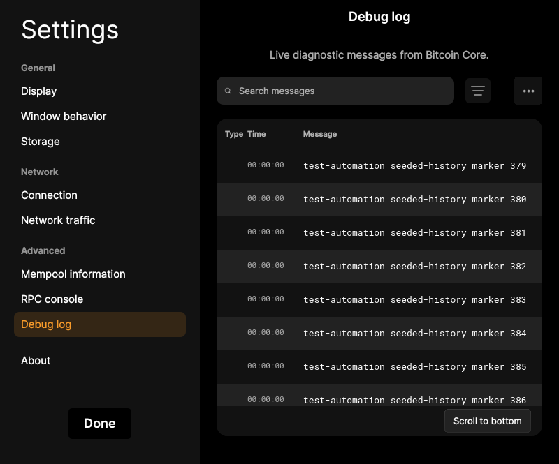

# F22 · Inspect Node and Use RPC Console

[Evidence index](../README.md) · [Test results](../TEST-RESULTS.md) · [Capture and build provenance](../PROVENANCE.md)

9 acceptance criteria from the supported-feature inventory. **Acceptance is pending review.** A screenshot demonstrates the visible state; the stated assertions describe the behavior that was actually checked. Related passing suites do not certify every variant of a criterion.

## Implementation comparison

**Partial.** Inspect node/mempool information, traffic totals/history with selectable time ranges, and logs. Run node and selected-wallet RPC commands with history, completion, help, adjustable text, and output clearing. No action to reset traffic history and start a fresh observation.

[Node information](https://github.com/bitcoin-core/gui-qml/blob/a91f4b4774f25de061fe1a7c132a91ddde117fca/qml/models/nodemodel.cpp#L654); [Console](https://github.com/bitcoin-core/gui-qml/blob/a91f4b4774f25de061fe1a7c132a91ddde117fca/qml/pages/node/CommandConsole.qml); [Wallet context](https://github.com/bitcoin-core/gui-qml/blob/a91f4b4774f25de061fe1a7c132a91ddde117fca/qml/components/SettingsView.qml#L372); [Traffic](https://github.com/bitcoin-core/gui-qml/blob/a91f4b4774f25de061fe1a7c132a91ddde117fca/qml/pages/node/NetworkTraffic.qml).

## Application captures

| Qt Widgets (`src/qt`) | GUI-QML (`qt6`) |
| --- | --- |
|  Node information   RPC console |  RPC console   Debug log viewer |

[All selected captures for this group](#capture-register) are listed below.

## Modules

- **Qt Widgets:** [primary implementation](https://github.com/bitcoin-core/gui/blob/f739c7876b81304bdc72e7eaa307702da269ac31/src/qt/rpcconsole.cpp).
- **GUI-QML:** [Node information](https://github.com/bitcoin-core/gui-qml/blob/a91f4b4774f25de061fe1a7c132a91ddde117fca/qml/models/nodemodel.cpp#L654); [Console](https://github.com/bitcoin-core/gui-qml/blob/a91f4b4774f25de061fe1a7c132a91ddde117fca/qml/pages/node/CommandConsole.qml); [Wallet context](https://github.com/bitcoin-core/gui-qml/blob/a91f4b4774f25de061fe1a7c132a91ddde117fca/qml/components/SettingsView.qml#L372); [Traffic](https://github.com/bitcoin-core/gui-qml/blob/a91f4b4774f25de061fe1a7c132a91ddde117fca/qml/pages/node/NetworkTraffic.qml).

These are the implementation entry points for the criteria below. Links are pinned to the tested source revisions.

## Automated tests

| Application | Test/module | Recorded result |
| --- | --- | --- |
| GUI-QML | [qml_test_console](https://github.com/bitcoin-core/gui-qml/blob/a91f4b4774f25de061fe1a7c132a91ddde117fca/test/functional/qml_test_console.py) | [passed](../logs/qml_test_console.log) |
| GUI-QML | [qml_test_debug_log](https://github.com/bitcoin-core/gui-qml/blob/a91f4b4774f25de061fe1a7c132a91ddde117fca/test/functional/qml_test_debug_log.py) | [passed](../logs/qml_test_debug_log.log) |
| GUI-QML | [qml_test_disablewallet_boot](https://github.com/bitcoin-core/gui-qml/blob/a91f4b4774f25de061fe1a7c132a91ddde117fca/test/functional/qml_test_disablewallet_boot.py) | [passed](../logs/qml_test_disablewallet_boot.log) |
| GUI-QML C++ | [test/test_nodemodel.cpp](https://github.com/bitcoin-core/gui-qml/blob/a91f4b4774f25de061fe1a7c132a91ddde117fca/test/test_nodemodel.cpp) | [Suite passed](../logs/qml-unit-tests.log); fixture/model assertions |
| GUI-QML C++ | [test/test_rpcconsolemodel.cpp](https://github.com/bitcoin-core/gui-qml/blob/a91f4b4774f25de061fe1a7c132a91ddde117fca/test/test_rpcconsolemodel.cpp) | [Suite passed](../logs/qml-unit-tests.log); fixture/model assertions |
| GUI-QML C++ | [test/test_rpccommandexecutor.cpp](https://github.com/bitcoin-core/gui-qml/blob/a91f4b4774f25de061fe1a7c132a91ddde117fca/test/test_rpccommandexecutor.cpp) | [Suite passed](../logs/qml-unit-tests.log); fixture/model assertions |
| GUI-QML C++ | [test/test_debuglogmodel.cpp](https://github.com/bitcoin-core/gui-qml/blob/a91f4b4774f25de061fe1a7c132a91ddde117fca/test/test_debuglogmodel.cpp) | [Suite passed](../logs/qml-unit-tests.log); fixture/model assertions |
| GUI-QML C++ | [test/test_networktraffictower.cpp](https://github.com/bitcoin-core/gui-qml/blob/a91f4b4774f25de061fe1a7c132a91ddde117fca/test/test_networktraffictower.cpp) | [Suite passed](../logs/qml-unit-tests.log); fixture/model assertions |
| GUI-QML components | [test/qml/tst_debuglogview.qml](https://github.com/bitcoin-core/gui-qml/blob/a91f4b4774f25de061fe1a7c132a91ddde117fca/test/qml/tst_debuglogview.qml) | [Suite passed](../logs/qml-quick-tests.log); component assertions |
| GUI-QML components | [test/qml/tst_mempoolinformationrows.qml](https://github.com/bitcoin-core/gui-qml/blob/a91f4b4774f25de061fe1a7c132a91ddde117fca/test/qml/tst_mempoolinformationrows.qml) | [Suite passed](../logs/qml-quick-tests.log); component assertions |
| Qt Widgets | [RPCNestedTests](https://github.com/bitcoin-core/gui/blob/f739c7876b81304bdc72e7eaa307702da269ac31/src/qt/test/rpcnestedtests.cpp) | [Suite passed](../logs/widgets-qt-tests.log); inspect assertion scope |

## Acceptance criteria

### F22.S01 · Inspect node identity, network, synchronization, and mempool information.

| Application | Evidence status | Evidence and limits |
| --- | --- | --- |
| Qt Widgets | Visual evidence only | No targeted runtime assertion collected for this exact criterion. [Node information](../media/widgets/node-information.png) [Node only diagnostics](../media/widgets/node-only-diagnostics.png) [Modules](#modules) · [Related tests](#automated-tests) |
| GUI-QML | Automated evidence collected | Node/mempool properties are tested and node pages captured. [Node settings without a wallet](../media/qml/qml_test_disablewallet_boot/005-05-node-settings-opened-without-wallet-ui.png) [Modules](#modules) · [Related tests](#automated-tests) |

- [ ] Acceptance decision recorded by reviewer.

### F22.S02 · Monitor network traffic and data usage over time.

| Application | Evidence status | Evidence and limits |
| --- | --- | --- |
| Qt Widgets | Visual evidence only | No targeted runtime assertion collected for this exact criterion. [Network traffic](../media/widgets/network-traffic.png) [Modules](#modules) · [Related tests](#automated-tests) |
| GUI-QML | Automated evidence collected | Traffic data model and node-only traffic page are exercised. [Network traffic](../media/qml/qml_test_disablewallet_boot/017-17-network-traffic-settings-opened.png) [Modules](#modules) · [Related tests](#automated-tests) |

- [ ] Acceptance decision recorded by reviewer.

### F22.S03 · Focus traffic monitoring on a chosen time period or begin a fresh observation.

| Application | Evidence status | Evidence and limits |
| --- | --- | --- |
| Qt Widgets | Visual evidence only | No targeted runtime assertion collected for this exact criterion. [Network traffic](../media/widgets/network-traffic.png) [Modules](#modules) · [Related tests](#automated-tests) |
| GUI-QML | Partial / limited evidence | Traffic periods are selectable; resetting traffic history is missing. [Network traffic](../media/qml/qml_test_disablewallet_boot/017-17-network-traffic-settings-opened.png) [Modules](#modules) · [Related tests](#automated-tests) |

- [ ] Acceptance decision recorded by reviewer.

### F22.S04 · Inspect logs for troubleshooting.

| Application | Evidence status | Evidence and limits |
| --- | --- | --- |
| Qt Widgets | Related automated suite | No targeted runtime assertion collected for this exact criterion. No matching screenshot collected. [Modules](#modules) · [Related tests](#automated-tests) |
| GUI-QML | Automated evidence collected | Debug-log search, pause, copy and error handling are tested. [Debug log viewer](../media/qml/qml_test_debug_log/005-wait-for-page-debuglogview.png) [Modules](#modules) · [Related tests](#automated-tests) |

- [ ] Acceptance decision recorded by reviewer.

### F22.S05 · Run advanced node and wallet commands.

| Application | Evidence status | Evidence and limits |
| --- | --- | --- |
| Qt Widgets | Visual evidence only | No targeted runtime assertion collected for this exact criterion. [RPC console](../media/widgets/rpc-console.png) [Modules](#modules) · [Related tests](#automated-tests) |
| GUI-QML | Automated evidence collected | Console executes live node commands. [RPC console](../media/qml/qml_test_console/004-wait-for-page-rpcconsolesettingspage.png) [Modules](#modules) · [Related tests](#automated-tests) |

- [ ] Acceptance decision recorded by reviewer.

### F22.S06 · Choose which wallet an advanced operation applies to.

| Application | Evidence status | Evidence and limits |
| --- | --- | --- |
| Qt Widgets | Visual evidence only | No targeted runtime assertion collected for this exact criterion. [RPC console](../media/widgets/rpc-console.png) [Modules](#modules) · [Related tests](#automated-tests) |
| GUI-QML | Automated evidence collected | Wallet RPC context has model tests. [RPC console](../media/qml/qml_test_console/004-wait-for-page-rpcconsolesettingspage.png) [Modules](#modules) · [Related tests](#automated-tests) |

- [ ] Acceptance decision recorded by reviewer.

### F22.S07 · Use command history, completion, and help.

| Application | Evidence status | Evidence and limits |
| --- | --- | --- |
| Qt Widgets | Visual evidence only | No targeted runtime assertion collected for this exact criterion. [RPC console](../media/widgets/rpc-console.png) [Modules](#modules) · [Related tests](#automated-tests) |
| GUI-QML | Automated evidence collected | History, completion and command behavior have model/UI assertions. [RPC console](../media/qml/qml_test_console/004-wait-for-page-rpcconsolesettingspage.png) [Modules](#modules) · [Related tests](#automated-tests) |

- [ ] Acceptance decision recorded by reviewer.

### F22.S08 · Adjust console readability and clear previous output.

| Application | Evidence status | Evidence and limits |
| --- | --- | --- |
| Qt Widgets | Visual evidence only | No targeted runtime assertion collected for this exact criterion. [RPC console](../media/widgets/rpc-console.png) [Modules](#modules) · [Related tests](#automated-tests) |
| GUI-QML | Automated evidence collected | Font size/output clearing have console-model/UI coverage. [RPC console](../media/qml/qml_test_console/004-wait-for-page-rpcconsolesettingspage.png) [Modules](#modules) · [Related tests](#automated-tests) |

- [ ] Acceptance decision recorded by reviewer.

### F22.S09 · Use RPC for descriptor import, multisig setup, wallet rescans, and combining PSBTs.

| Application | Evidence status | Evidence and limits |
| --- | --- | --- |
| Qt Widgets | Related automated suite | No targeted runtime assertion collected for this exact criterion. No matching screenshot collected. [Modules](#modules) · [Related tests](#automated-tests) |
| GUI-QML | Partial / limited evidence | RPC is available; this collection does not execute every advanced command listed. [RPC console](../media/qml/qml_test_console/004-wait-for-page-rpcconsolesettingspage.png) [Modules](#modules) · [Related tests](#automated-tests) |

- [ ] Acceptance decision recorded by reviewer.

## Capture register

The original PNGs are unmodified application captures. Timestamps, dimensions and SHA-256 hashes are in the [capture manifest](../selected-captures.json). Some early/raw frames are not selected for review.

| Application | Capture | Criteria |
| --- | --- | --- |
| widgets | [Node information](../media/widgets/node-information.png) | F22.S01 |
| widgets | [RPC console](../media/widgets/rpc-console.png) | F22.S05, F22.S06, F22.S07, F22.S08 |
| widgets | [Network traffic](../media/widgets/network-traffic.png) | F22.S02, F22.S03 |
| widgets | [Node only diagnostics](../media/widgets/node-only-diagnostics.png) | F22.S01 |
| qml | [RPC console](../media/qml/qml_test_console/004-wait-for-page-rpcconsolesettingspage.png) | F22.S05, F22.S06, F22.S07, F22.S08, F22.S09 |
| qml | [Debug log viewer](../media/qml/qml_test_debug_log/005-wait-for-page-debuglogview.png) | F22.S04 |
| qml | [Network traffic](../media/qml/qml_test_disablewallet_boot/017-17-network-traffic-settings-opened.png) | F22.S02, F22.S03 |
| qml | [Node settings without a wallet](../media/qml/qml_test_disablewallet_boot/005-05-node-settings-opened-without-wallet-ui.png) | F22.S01 |
