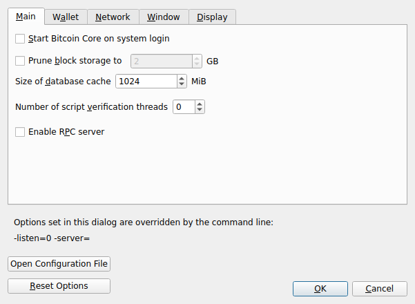
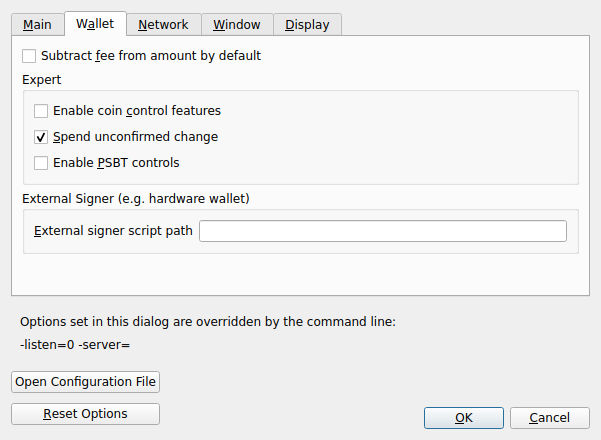
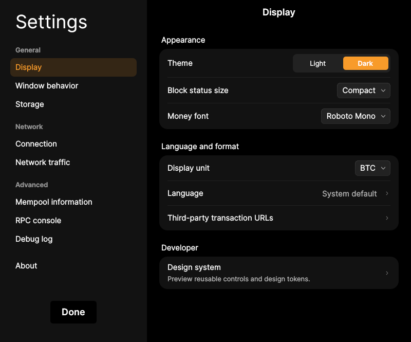
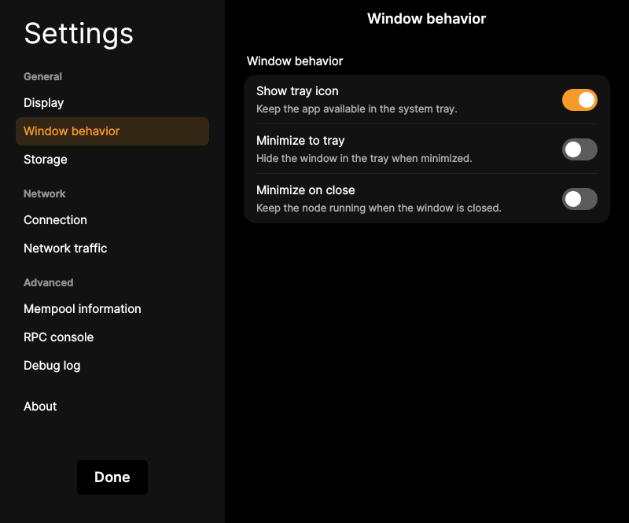

# F23 · Configure Application Preferences

[Evidence index](../README.md) · [Test results](../TEST-RESULTS.md) · [Capture and build provenance](../PROVENANCE.md)

12 acceptance criteria from the supported-feature inventory. **Acceptance is pending review.** A screenshot demonstrates the visible state; the stated assertions describe the behavior that was actually checked. Related passing suites do not certify every variant of a criterion.

## Implementation comparison

**Partial.** Configure validation resources, RPC server access, networking/storage, language, all four amount units, money fonts, explorers, and window behavior; view setting precedence and restart requirements. No preferences for unconfirmed-change spending, default fee subtraction, or enabling/disabling advanced transaction controls; no configuration-file opening action. Resetting settings with a backup is available through the startup option, without an in-app reset flow. Automatic login startup is missing.

[Preferences](https://github.com/bitcoin-core/gui-qml/blob/a91f4b4774f25de061fe1a7c132a91ddde117fca/qml/models/options_model.h); [Display settings](https://github.com/bitcoin-core/gui-qml/blob/a91f4b4774f25de061fe1a7c132a91ddde117fca/qml/pages/settings/DisplaySettingsPage.qml); [Settings reset](https://github.com/bitcoin-core/gui-qml/blob/a91f4b4774f25de061fe1a7c132a91ddde117fca/qml/datadir.cpp#L229).

## Application captures

| Qt Widgets (`src/qt`) | GUI-QML (`qt6`) |
| --- | --- |
|  Preferences general   Preferences wallet |  Display preferences   Window and tray preferences |

[All selected captures for this group](#capture-register) are listed below.

## Modules

- **Qt Widgets:** [primary implementation](https://github.com/bitcoin-core/gui/blob/f739c7876b81304bdc72e7eaa307702da269ac31/src/qt/forms/optionsdialog.ui).
  [Amount units](https://github.com/bitcoin-core/gui/blob/f739c7876b81304bdc72e7eaa307702da269ac31/src/qt/bitcoinunits.cpp).
  [Settings behavior](https://github.com/bitcoin-core/gui/blob/f739c7876b81304bdc72e7eaa307702da269ac31/src/qt/optionsdialog.cpp).
  [Settings recovery](https://github.com/bitcoin-core/gui/blob/f739c7876b81304bdc72e7eaa307702da269ac31/src/qt/optionsmodel.cpp).
- **GUI-QML:** [Preferences](https://github.com/bitcoin-core/gui-qml/blob/a91f4b4774f25de061fe1a7c132a91ddde117fca/qml/models/options_model.h); [Display settings](https://github.com/bitcoin-core/gui-qml/blob/a91f4b4774f25de061fe1a7c132a91ddde117fca/qml/pages/settings/DisplaySettingsPage.qml); [Settings reset](https://github.com/bitcoin-core/gui-qml/blob/a91f4b4774f25de061fe1a7c132a91ddde117fca/qml/datadir.cpp#L229).

These are the implementation entry points for the criteria below. Links are pinned to the tested source revisions.

## Automated tests

| Application | Test/module | Recorded result |
| --- | --- | --- |
| GUI-QML | [qml_test_settings_display](https://github.com/bitcoin-core/gui-qml/blob/a91f4b4774f25de061fe1a7c132a91ddde117fca/test/functional/qml_test_settings_display.py) | [passed](../logs/qml_test_settings_display.log) |
| GUI-QML | [qml_test_proxy](https://github.com/bitcoin-core/gui-qml/blob/a91f4b4774f25de061fe1a7c132a91ddde117fca/test/functional/qml_test_proxy.py) | [passed](../logs/qml_test_proxy.log) |
| GUI-QML | [qml_test_resetguisettings](https://github.com/bitcoin-core/gui-qml/blob/a91f4b4774f25de061fe1a7c132a91ddde117fca/test/functional/qml_test_resetguisettings.py) | [passed](../logs/qml_test_resetguisettings.log) |
| GUI-QML | [qml_test_blocksonly_settings](https://github.com/bitcoin-core/gui-qml/blob/a91f4b4774f25de061fe1a7c132a91ddde117fca/test/functional/qml_test_blocksonly_settings.py) | [passed](../logs/qml_test_blocksonly_settings.log) |
| GUI-QML C++ | [test/test_options_model.cpp](https://github.com/bitcoin-core/gui-qml/blob/a91f4b4774f25de061fe1a7c132a91ddde117fca/test/test_options_model.cpp) | [Suite passed](../logs/qml-unit-tests.log); fixture/model assertions |
| GUI-QML C++ | [test/test_display_settings.cpp](https://github.com/bitcoin-core/gui-qml/blob/a91f4b4774f25de061fe1a7c132a91ddde117fca/test/test_display_settings.cpp) | [Suite passed](../logs/qml-unit-tests.log); fixture/model assertions |
| GUI-QML C++ | [test/test_qmlbitcoinunits.cpp](https://github.com/bitcoin-core/gui-qml/blob/a91f4b4774f25de061fe1a7c132a91ddde117fca/test/test_qmlbitcoinunits.cpp) | [Suite passed](../logs/qml-unit-tests.log); fixture/model assertions |
| GUI-QML components | [test/qml/tst_settingsstatus.qml](https://github.com/bitcoin-core/gui-qml/blob/a91f4b4774f25de061fe1a7c132a91ddde117fca/test/qml/tst_settingsstatus.qml) | [Suite passed](../logs/qml-quick-tests.log); component assertions |
| GUI-QML components | [test/qml/tst_setting.qml](https://github.com/bitcoin-core/gui-qml/blob/a91f4b4774f25de061fe1a7c132a91ddde117fca/test/qml/tst_setting.qml) | [Suite passed](../logs/qml-quick-tests.log); component assertions |
| Qt Widgets | [OptionTests](https://github.com/bitcoin-core/gui/blob/f739c7876b81304bdc72e7eaa307702da269ac31/src/qt/test/optiontests.cpp) | [Suite passed](../logs/widgets-qt-tests.log); inspect assertion scope |
| Qt Widgets additional | [Live GUI/RPC scenarios](../scripts/widgets_scenarios.py) | [Recorded assertions](../logs/widgets-checks.json); outcomes listed per criterion |

## Acceptance criteria

### F23.S01 · Allocate memory and processing resources for block validation.

| Application | Evidence status | Evidence and limits |
| --- | --- | --- |
| Qt Widgets | Visual evidence only | No targeted runtime assertion collected for this exact criterion. [Preferences general](../media/widgets/preferences-general.png) [Modules](#modules) · [Related tests](#automated-tests) |
| GUI-QML | Automated evidence collected | Options-model resource settings are tested. No matching screenshot collected. [Modules](#modules) · [Related tests](#automated-tests) |

- [ ] Acceptance decision recorded by reviewer.

### F23.S02 · Allow external tools to communicate with the node through RPC.

| Application | Evidence status | Evidence and limits |
| --- | --- | --- |
| Qt Widgets | Visual evidence only | No targeted runtime assertion collected for this exact criterion. [Preferences general](../media/widgets/preferences-general.png) [Modules](#modules) · [Related tests](#automated-tests) |
| GUI-QML | Automated evidence collected | Server settings and override precedence are tested. No matching screenshot collected. [Modules](#modules) · [Related tests](#automated-tests) |

- [ ] Acceptance decision recorded by reviewer.

### F23.S03 · Choose whether unconfirmed change is available for spending.

| Application | Evidence status | Evidence and limits |
| --- | --- | --- |
| Qt Widgets | Visual evidence only | No targeted runtime assertion collected for this exact criterion. [Preferences wallet](../media/widgets/preferences-wallet.png) [Modules](#modules) · [Related tests](#automated-tests) |
| GUI-QML | Implementation gap | No preference for spending unconfirmed change. No screenshot: this GUI workflow is absent. [Modules](#modules) · [Related tests](#automated-tests) |

- [ ] Acceptance decision recorded by reviewer.

### F23.S04 · Set the default treatment of fees in recipient amounts.

| Application | Evidence status | Evidence and limits |
| --- | --- | --- |
| Qt Widgets | Visual evidence only | No targeted runtime assertion collected for this exact criterion. [Preferences wallet](../media/widgets/preferences-wallet.png) [Modules](#modules) · [Related tests](#automated-tests) |
| GUI-QML | Implementation gap | No default fee-subtraction preference. No screenshot: this GUI workflow is absent. [Modules](#modules) · [Related tests](#automated-tests) |

- [ ] Acceptance decision recorded by reviewer.

### F23.S05 · Choose whether advanced transaction controls are available.

| Application | Evidence status | Evidence and limits |
| --- | --- | --- |
| Qt Widgets | Assertions collected | Enabling advanced controls exposes input selection. **passed**. [Preferences wallet](../media/widgets/preferences-wallet.png) [Modules](#modules) · [Related tests](#automated-tests) |
| GUI-QML | Implementation gap | Advanced controls are always available; no enable/disable preference. No screenshot: this GUI workflow is absent. [Modules](#modules) · [Related tests](#automated-tests) |

- [ ] Acceptance decision recorded by reviewer.

### F23.S06 · Choose the interface language and amount units: BTC, mBTC, bits, or satoshis.

| Application | Evidence status | Evidence and limits |
| --- | --- | --- |
| Qt Widgets | Visual evidence only | No targeted runtime assertion collected for this exact criterion. [Preferences display](../media/widgets/preferences-display.png) [Modules](#modules) · [Related tests](#automated-tests) |
| GUI-QML | Automated evidence collected | Language and amount units survive restart in the functional test. [Display preferences](../media/qml/qml_test_settings_display/004-wait-for-page-displaysettingspage.png) [Modules](#modules) · [Related tests](#automated-tests) |

- [ ] Acceptance decision recorded by reviewer.

### F23.S07 · Customize the font used to display wallet balances.

| Application | Evidence status | Evidence and limits |
| --- | --- | --- |
| Qt Widgets | Visual evidence only | No targeted runtime assertion collected for this exact criterion. [Preferences display](../media/widgets/preferences-display.png) [Modules](#modules) · [Related tests](#automated-tests) |
| GUI-QML | Automated evidence collected | Money-font properties have display-model tests. [Display preferences](../media/qml/qml_test_settings_display/004-wait-for-page-displaysettingspage.png) [Modules](#modules) · [Related tests](#automated-tests) |

- [ ] Acceptance decision recorded by reviewer.

### F23.S08 · Choose external services for inspecting transactions.

| Application | Evidence status | Evidence and limits |
| --- | --- | --- |
| Qt Widgets | Visual evidence only | No targeted runtime assertion collected for this exact criterion. [Preferences display](../media/widgets/preferences-display.png) [Modules](#modules) · [Related tests](#automated-tests) |
| GUI-QML | Automated evidence collected | Explorer URL configuration and URI generation have model tests. [Display preferences](../media/qml/qml_test_settings_display/004-wait-for-page-displaysettingspage.png) [Modules](#modules) · [Related tests](#automated-tests) |

- [ ] Acceptance decision recorded by reviewer.

### F23.S09 · Configure startup and window behavior.

| Application | Evidence status | Evidence and limits |
| --- | --- | --- |
| Qt Widgets | Visual evidence only | No targeted runtime assertion collected for this exact criterion. [Preferences window](../media/widgets/preferences-window.png) [Modules](#modules) · [Related tests](#automated-tests) |
| GUI-QML | Partial / limited evidence | Window preferences work; automatic-login startup is missing. [Window and tray preferences](../media/qml/qml_test_tray/005-wait-for-page-windowbehaviorsettingspage.png) [Modules](#modules) · [Related tests](#automated-tests) |

- [ ] Acceptance decision recorded by reviewer.

### F23.S10 · Manage advanced application configuration.

| Application | Evidence status | Evidence and limits |
| --- | --- | --- |
| Qt Widgets | Related automated suite | No targeted runtime assertion collected for this exact criterion. No matching screenshot collected. [Modules](#modules) · [Related tests](#automated-tests) |
| GUI-QML | Partial / limited evidence | Configuration precedence is exposed, but there is no open-configuration-file action. No matching screenshot collected. [Modules](#modules) · [Related tests](#automated-tests) |

- [ ] Acceptance decision recorded by reviewer.

### F23.S11 · Understand which settings take precedence and which changes require a restart.

| Application | Evidence status | Evidence and limits |
| --- | --- | --- |
| Qt Widgets | Visual evidence only | No targeted runtime assertion collected for this exact criterion. [Preferences general](../media/widgets/preferences-general.png) [Modules](#modules) · [Related tests](#automated-tests) |
| GUI-QML | Automated evidence collected | Restart-required and overridden settings have tests. No matching screenshot collected. [Modules](#modules) · [Related tests](#automated-tests) |

- [ ] Acceptance decision recorded by reviewer.

### F23.S12 · Restore default preferences while retaining a backup of previous settings.

| Application | Evidence status | Evidence and limits |
| --- | --- | --- |
| Qt Widgets | Related automated suite | No targeted runtime assertion collected for this exact criterion. No matching screenshot collected. [Modules](#modules) · [Related tests](#automated-tests) |
| GUI-QML | Partial / limited evidence | Startup reset with backup is tested; no in-app reset workflow. No matching screenshot collected. [Modules](#modules) · [Related tests](#automated-tests) |

- [ ] Acceptance decision recorded by reviewer.

## Capture register

The original PNGs are unmodified application captures. Timestamps, dimensions and SHA-256 hashes are in the [capture manifest](../selected-captures.json). Some early/raw frames are not selected for review.

| Application | Capture | Criteria |
| --- | --- | --- |
| widgets | [Preferences general](../media/widgets/preferences-general.png) | F23.S01, F23.S02, F23.S11 |
| widgets | [Preferences wallet](../media/widgets/preferences-wallet.png) | F23.S03, F23.S04, F23.S05 |
| widgets | [Preferences window](../media/widgets/preferences-window.png) | F23.S09 |
| widgets | [Preferences display](../media/widgets/preferences-display.png) | F23.S06, F23.S07, F23.S08 |
| qml | [Display preferences](../media/qml/qml_test_settings_display/004-wait-for-page-displaysettingspage.png) | F23.S06, F23.S07, F23.S08 |
| qml | [Window and tray preferences](../media/qml/qml_test_tray/005-wait-for-page-windowbehaviorsettingspage.png) | F23.S09 |
