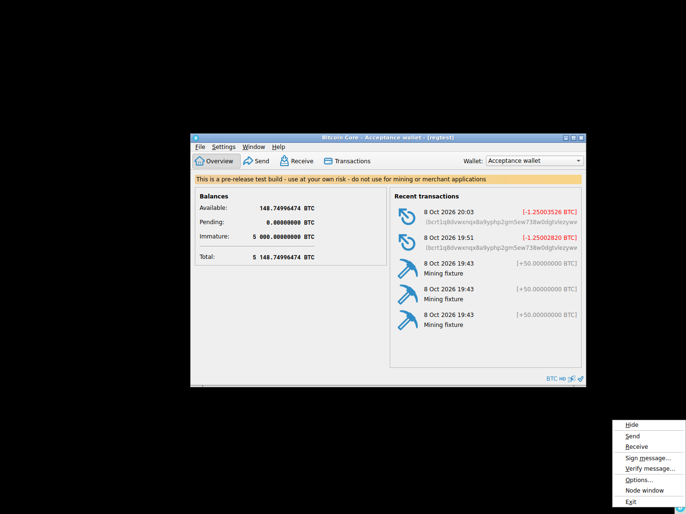
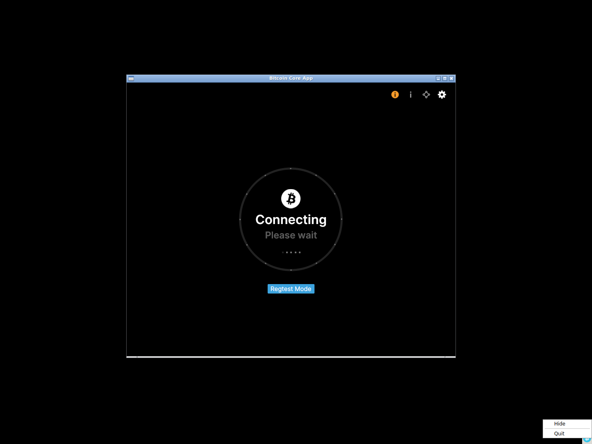

# F24 · System Tray / macOS Dock

[Evidence index](../README.md) · [Test results](../TEST-RESULTS.md) · [Capture and build provenance](../PROVENANCE.md)

5 acceptance criteria from the supported-feature inventory. **Acceptance is pending review.** A screenshot demonstrates the visible state; the stated assertions describe the behavior that was actually checked. Related passing suites do not certify every variant of a criterion.

## Implementation comparison

**Partial.** Show/hide the main window, keep the node running in the background, quit through the tray, and configure tray visibility. Reopen the application through the macOS Dock. Tray/Dock shortcuts to payments, message signing, settings, and diagnostics are missing.

[Tray](https://github.com/bitcoin-core/gui-qml/blob/a91f4b4774f25de061fe1a7c132a91ddde117fca/qml/models/desktoptrayiconcontroller.cpp); [Dock](https://github.com/bitcoin-core/gui-qml/blob/a91f4b4774f25de061fe1a7c132a91ddde117fca/qml/models/macdockiconhandler.mm).

## Application captures

| Qt Widgets (`src/qt`) | GUI-QML (`qt6`) |
| --- | --- |
|  Preferences window   Native Linux tray menu |  Native Linux tray menu   QML window hidden while the node keeps running |

Baseline support notes: *Support: Uses the system tray on supported Windows/Linux desktops and the Dock on macOS.*

[All selected captures for this group](#capture-register) are listed below.

## Modules

- **Qt Widgets:** [primary implementation](https://github.com/bitcoin-core/gui/blob/f739c7876b81304bdc72e7eaa307702da269ac31/src/qt/bitcoingui.cpp#L894).
- **GUI-QML:** [Tray](https://github.com/bitcoin-core/gui-qml/blob/a91f4b4774f25de061fe1a7c132a91ddde117fca/qml/models/desktoptrayiconcontroller.cpp); [Dock](https://github.com/bitcoin-core/gui-qml/blob/a91f4b4774f25de061fe1a7c132a91ddde117fca/qml/models/macdockiconhandler.mm).

These are the implementation entry points for the criteria below. Links are pinned to the tested source revisions.

## Automated tests

| Application | Test/module | Recorded result |
| --- | --- | --- |
| GUI-QML | [qml_test_tray](https://github.com/bitcoin-core/gui-qml/blob/a91f4b4774f25de061fe1a7c132a91ddde117fca/test/functional/qml_test_tray.py) | [passed](../logs/qml_test_tray.log) |
| GUI-QML C++ | [test/test_desktoptrayiconcontroller.cpp](https://github.com/bitcoin-core/gui-qml/blob/a91f4b4774f25de061fe1a7c132a91ddde117fca/test/test_desktoptrayiconcontroller.cpp) | [Suite passed](../logs/qml-unit-tests.log); fixture/model assertions |
| GUI-QML C++ | [test/test_desktopwindowbehaviormodel.cpp](https://github.com/bitcoin-core/gui-qml/blob/a91f4b4774f25de061fe1a7c132a91ddde117fca/test/test_desktopwindowbehaviormodel.cpp) | [Suite passed](../logs/qml-unit-tests.log); fixture/model assertions |
| GUI-QML components | [test/qml/tst_desktopmenuactions.qml](https://github.com/bitcoin-core/gui-qml/blob/a91f4b4774f25de061fe1a7c132a91ddde117fca/test/qml/tst_desktopmenuactions.qml) | [Suite passed](../logs/qml-quick-tests.log); component assertions |
| GUI-QML native shell | [Linux tray scenario](../scripts/qml_native_shell.py) | [Passed](../logs/qml-native-shell.log), [assertions](../logs/qml-native-shell-checks.json) |
| Qt Widgets | [AppTests](https://github.com/bitcoin-core/gui/blob/f739c7876b81304bdc72e7eaa307702da269ac31/src/qt/test/apptests.cpp) | [Suite passed](../logs/widgets-qt-tests.log); inspect assertion scope |
| Qt Widgets additional | [Live GUI/RPC scenarios](../scripts/widgets_scenarios.py) | [Recorded assertions](../logs/widgets-checks.json); outcomes listed per criterion |

## Acceptance criteria

### F24.S01 · Keep the application accessible while its main window is hidden.

| Application | Evidence status | Evidence and limits |
| --- | --- | --- |
| Qt Widgets | Assertions collected | Native tray Hide makes the main window invisible while node RPC still responds. **passed**. Native tray Show restores the main window. **passed**. **Limit:** Native Linux tray verified; macOS and Windows remain untested. [Native Linux tray menu](../media/widgets/linux-tray-menu.png) [Node remains accessible with its window hidden](../media/widgets/linux-tray-hidden.png) [Modules](#modules) · [Related tests](#automated-tests) |
| GUI-QML | Partial / limited evidence | Native Linux tray Hide/Show passed; macOS Dock and Windows remain untested. Linux tray hides the QML window while RPC still responds. **passed**. Linux tray restores the QML window. **passed**. [Native Linux tray menu](../media/qml/linux-tray-menu.png) [QML window hidden while the node keeps running](../media/qml/linux-tray-hidden.png) [Modules](#modules) · [Related tests](#automated-tests) |

- [ ] Acceptance decision recorded by reviewer.

### F24.S02 · Control application visibility without interrupting the node.

| Application | Evidence status | Evidence and limits |
| --- | --- | --- |
| Qt Widgets | Assertions collected | Native tray Hide makes the main window invisible while node RPC still responds. **passed**. Native tray Show restores the main window. **passed**. **Limit:** Native Linux tray verified; macOS and Windows remain untested. [Node remains accessible with its window hidden](../media/widgets/linux-tray-hidden.png) [Modules](#modules) · [Related tests](#automated-tests) |
| GUI-QML | Partial / limited evidence | Native Linux Hide/Show preserves a responding node; other desktop implementations remain untested. Linux tray hides the QML window while RPC still responds. **passed**. Linux tray restores the QML window. **passed**. [QML window hidden while the node keeps running](../media/qml/linux-tray-hidden.png) [Modules](#modules) · [Related tests](#automated-tests) |

- [ ] Acceptance decision recorded by reviewer.

### F24.S03 · Quickly access payments, message signing and verification, settings, and diagnostics.

| Application | Evidence status | Evidence and limits |
| --- | --- | --- |
| Qt Widgets | Visual evidence only | No targeted runtime assertion collected for this exact criterion. [Native Linux tray menu](../media/widgets/linux-tray-menu.png) [Modules](#modules) · [Related tests](#automated-tests) |
| GUI-QML | Implementation gap | Tray contains visibility and quit actions, without the listed wallet/settings shortcuts. No screenshot: this GUI workflow is absent. [Modules](#modules) · [Related tests](#automated-tests) |

- [ ] Acceptance decision recorded by reviewer.

### F24.S04 · Quit the application.

| Application | Evidence status | Evidence and limits |
| --- | --- | --- |
| Qt Widgets | Assertions collected | Native Linux tray Exit terminates the Widgets process successfully. **passed**. [Native Linux tray menu](../media/widgets/linux-tray-menu.png) [Modules](#modules) · [Related tests](#automated-tests) |
| GUI-QML | Automated evidence collected | Native Linux tray Quit exits successfully. The native Linux tray Quit action exits the application successfully. **passed**. [Native Linux tray menu](../media/qml/linux-tray-menu.png) [Modules](#modules) · [Related tests](#automated-tests) |

- [ ] Acceptance decision recorded by reviewer.

### F24.S05 · Choose whether to display a tray icon on supported desktops.

| Application | Evidence status | Evidence and limits |
| --- | --- | --- |
| Qt Widgets | Visual evidence only | No targeted runtime assertion collected for this exact criterion. [Preferences window](../media/widgets/preferences-window.png) [Modules](#modules) · [Related tests](#automated-tests) |
| GUI-QML | Automated evidence collected | Tray visibility preferences and controller behavior are tested. [Window and tray preferences](../media/qml/qml_test_tray/005-wait-for-page-windowbehaviorsettingspage.png) [Modules](#modules) · [Related tests](#automated-tests) |

- [ ] Acceptance decision recorded by reviewer.

## Capture register

The original PNGs are unmodified application captures. Timestamps, dimensions and SHA-256 hashes are in the [capture manifest](../selected-captures.json). Some early/raw frames are not selected for review.

| Application | Capture | Criteria |
| --- | --- | --- |
| widgets | [Preferences window](../media/widgets/preferences-window.png) | F24.S05 |
| widgets | [Native Linux tray menu](../media/widgets/linux-tray-menu.png) | F24.S01, F24.S03, F24.S04 |
| widgets | [Node remains accessible with its window hidden](../media/widgets/linux-tray-hidden.png) | F24.S01, F24.S02 |
| qml | [Native Linux tray menu](../media/qml/linux-tray-menu.png) | F24.S01, F24.S04 |
| qml | [QML window hidden while the node keeps running](../media/qml/linux-tray-hidden.png) | F24.S01, F24.S02 |
| qml | [Window and tray preferences](../media/qml/qml_test_tray/005-wait-for-page-windowbehaviorsettingspage.png) | F24.S05 |
