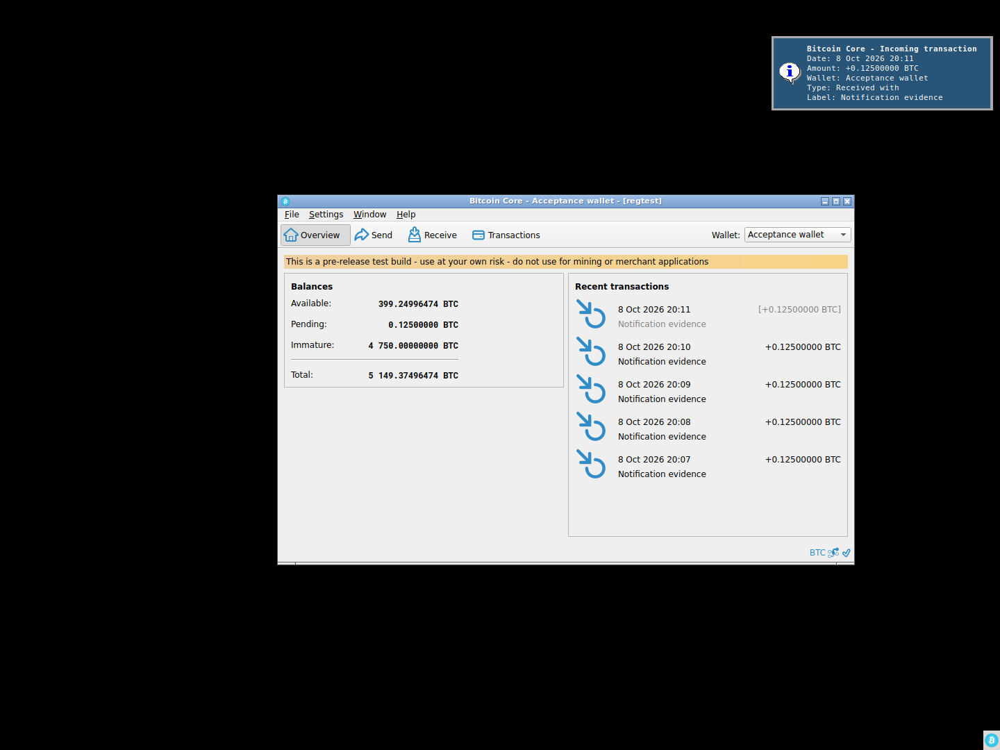

# F25 · Desktop Notifications

[Evidence index](../README.md) · [Test results](../TEST-RESULTS.md) · [Capture and build provenance](../PROVENANCE.md)

5 acceptance criteria from the supported-feature inventory. **Acceptance is pending review.** A screenshot demonstrates the visible state; the stated assertions describe the behavior that was actually checked. Related passing suites do not certify every variant of a criterion.

## Implementation comparison

**Not available in GUI.** No desktop payment-notification or desktop information/warning/error delivery is connected. In-app messages and critical-error dialogs are available under progress, errors, and confirmations.

[Desktop integration](https://github.com/bitcoin-core/gui-qml/blob/a91f4b4774f25de061fe1a7c132a91ddde117fca/qml/models/desktoptrayiconcontroller.cpp); [In-app messages](https://github.com/bitcoin-core/gui-qml/blob/a91f4b4774f25de061fe1a7c132a91ddde117fca/qml/models/nodemodel.cpp#L590).

## Application captures

| Qt Widgets (`src/qt`) | GUI-QML (`qt6`) |
| --- | --- |
|  Incoming payment delivered to the desktop | No matching application capture collected. See the criterion-level gaps below. |

Baseline support notes: *Support: Delivery depends on the application build and the desktop notification support available.*

## Modules

- **Qt Widgets:** [primary implementation](https://github.com/bitcoin-core/gui/blob/f739c7876b81304bdc72e7eaa307702da269ac31/src/qt/notificator.cpp).
  [Transaction notifications](https://github.com/bitcoin-core/gui/blob/f739c7876b81304bdc72e7eaa307702da269ac31/src/qt/walletview.cpp#L125).
- **GUI-QML:** [Desktop integration](https://github.com/bitcoin-core/gui-qml/blob/a91f4b4774f25de061fe1a7c132a91ddde117fca/qml/models/desktoptrayiconcontroller.cpp); [In-app messages](https://github.com/bitcoin-core/gui-qml/blob/a91f4b4774f25de061fe1a7c132a91ddde117fca/qml/models/nodemodel.cpp#L590).

These are the implementation entry points for the criteria below. Links are pinned to the tested source revisions.

## Automated tests

| Application | Test/module | Recorded result |
| --- | --- | --- |
| Qt Widgets additional | [Live GUI/RPC scenarios](../scripts/widgets_scenarios.py) | [Recorded assertions](../logs/widgets-checks.json); outcomes listed per criterion |

## Acceptance criteria

### F25.S01 · Receive updates about incoming and outgoing payments.

| Application | Evidence status | Evidence and limits |
| --- | --- | --- |
| Qt Widgets | Assertions collected | Notification fixture transaction reaches the GUI wallet. **passed**. The desktop service receives the application notification with amount, wallet and label. **passed**. **Limit:** Incoming payment delivery is captured; outgoing notification delivery is not separately captured. [Incoming payment delivered to the desktop](../media/widgets/linux-payment-notification.png) [Modules](#modules) · [Related tests](#automated-tests) |
| GUI-QML | Implementation gap | No desktop notification delivery is connected. No screenshot: this GUI workflow is absent. [Modules](#modules) · [Related tests](#automated-tests) |

- [ ] Acceptance decision recorded by reviewer.

### F25.S02 · Identify the affected transaction and wallet, including amounts and recipient information.

| Application | Evidence status | Evidence and limits |
| --- | --- | --- |
| Qt Widgets | Assertions collected | Notification fixture transaction reaches the GUI wallet. **passed**. The desktop service receives the application notification with amount, wallet and label. **passed**. [Incoming payment delivered to the desktop](../media/widgets/linux-payment-notification.png) [Modules](#modules) · [Related tests](#automated-tests) |
| GUI-QML | Implementation gap | No desktop notification delivery is connected. No screenshot: this GUI workflow is absent. [Modules](#modules) · [Related tests](#automated-tests) |

- [ ] Acceptance decision recorded by reviewer.

### F25.S03 · Receive informational, warning, and critical messages through desktop notifications.

| Application | Evidence status | Evidence and limits |
| --- | --- | --- |
| Qt Widgets | Source only | No targeted runtime assertion collected for this exact criterion. **Limit:** The incoming-payment information notification is captured; synthetic warning/critical desktop notifications were not injected. No matching screenshot collected. [Modules](#modules) · [Related tests](#automated-tests) |
| GUI-QML | Implementation gap | No desktop notification delivery is connected. No screenshot: this GUI workflow is absent. [Modules](#modules) · [Related tests](#automated-tests) |

- [ ] Acceptance decision recorded by reviewer.

### F25.S04 · Receive critical error messages when desktop notifications are unavailable.

| Application | Evidence status | Evidence and limits |
| --- | --- | --- |
| Qt Widgets | Source only | No targeted runtime assertion collected for this exact criterion. No matching screenshot collected. [Modules](#modules) · [Related tests](#automated-tests) |
| GUI-QML | Implementation gap | No desktop notification delivery is connected. No screenshot: this GUI workflow is absent. [Modules](#modules) · [Related tests](#automated-tests) |

- [ ] Acceptance decision recorded by reviewer.

### F25.S05 · Avoid a flood of notifications while historical wallet activity is being loaded.

| Application | Evidence status | Evidence and limits |
| --- | --- | --- |
| Qt Widgets | Source only | No targeted runtime assertion collected for this exact criterion. No matching screenshot collected. [Modules](#modules) · [Related tests](#automated-tests) |
| GUI-QML | Implementation gap | No desktop notification delivery is connected. No screenshot: this GUI workflow is absent. [Modules](#modules) · [Related tests](#automated-tests) |

- [ ] Acceptance decision recorded by reviewer.

## Capture register

The original PNGs are unmodified application captures. Timestamps, dimensions and SHA-256 hashes are in the [capture manifest](../selected-captures.json). Some early/raw frames are not selected for review.

| Application | Capture | Criteria |
| --- | --- | --- |
| widgets | [Incoming payment delivered to the desktop](../media/widgets/linux-payment-notification.png) | F25.S01, F25.S02 |
