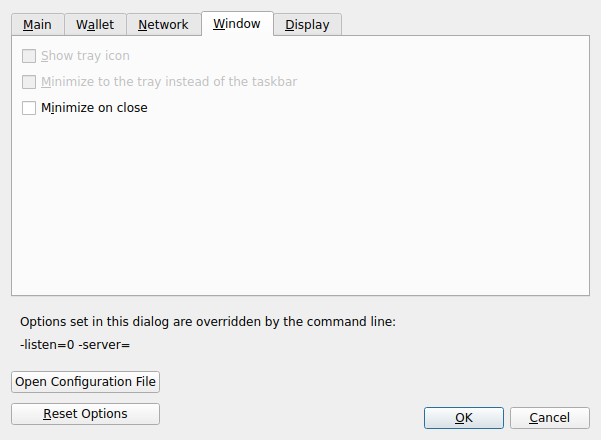
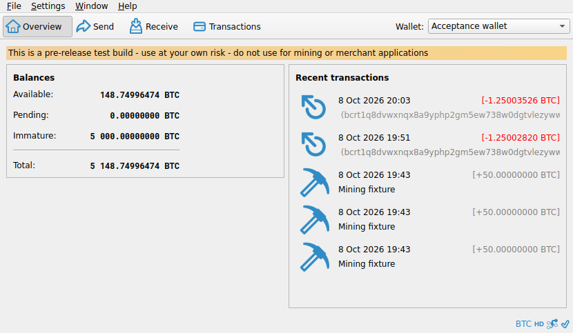

# F26 · Manage Application Windows

[Evidence index](../README.md) · [Test results](../TEST-RESULTS.md) · [Capture and build provenance](../PROVENANCE.md)

5 acceptance criteria from the supported-feature inventory. **Acceptance is pending review.** A screenshot demonstrates the visible state; the stated assertions describe the behavior that was actually checked. Related passing suites do not certify every variant of a criterion.

## Implementation comparison

**Partial.** Resize, minimize, hide, restore, and remember main-window placement; keep running on minimize/close where supported; identify the active wallet and network. A separate diagnostics window for use alongside wallet activity is missing.

[Window behavior](https://github.com/bitcoin-core/gui-qml/blob/a91f4b4774f25de061fe1a7c132a91ddde117fca/qml/pages/MainWindow.qml); [Window preferences](https://github.com/bitcoin-core/gui-qml/blob/a91f4b4774f25de061fe1a7c132a91ddde117fca/qml/pages/settings/WindowBehaviorSettingsPage.qml).

## Application captures

| Qt Widgets (`src/qt`) | GUI-QML (`qt6`) |
| --- | --- |
|  Preferences window   Overview balances |  QML window hidden while the node keeps running   Window and tray preferences |

[All selected captures for this group](#capture-register) are listed below.

## Modules

- **Qt Widgets:** [primary implementation](https://github.com/bitcoin-core/gui/blob/f739c7876b81304bdc72e7eaa307702da269ac31/src/qt/bitcoingui.cpp).
- **GUI-QML:** [Window behavior](https://github.com/bitcoin-core/gui-qml/blob/a91f4b4774f25de061fe1a7c132a91ddde117fca/qml/pages/MainWindow.qml); [Window preferences](https://github.com/bitcoin-core/gui-qml/blob/a91f4b4774f25de061fe1a7c132a91ddde117fca/qml/pages/settings/WindowBehaviorSettingsPage.qml).

These are the implementation entry points for the criteria below. Links are pinned to the tested source revisions.

## Automated tests

| Application | Test/module | Recorded result |
| --- | --- | --- |
| GUI-QML | [qml_test_window_geometry](https://github.com/bitcoin-core/gui-qml/blob/a91f4b4774f25de061fe1a7c132a91ddde117fca/test/functional/qml_test_window_geometry.py) | [passed](../logs/qml_test_window_geometry.log) |
| GUI-QML | [qml_test_tray](https://github.com/bitcoin-core/gui-qml/blob/a91f4b4774f25de061fe1a7c132a91ddde117fca/test/functional/qml_test_tray.py) | [passed](../logs/qml_test_tray.log) |
| GUI-QML C++ | [test/test_desktopwindowbehaviormodel.cpp](https://github.com/bitcoin-core/gui-qml/blob/a91f4b4774f25de061fe1a7c132a91ddde117fca/test/test_desktopwindowbehaviormodel.cpp) | [Suite passed](../logs/qml-unit-tests.log); fixture/model assertions |
| GUI-QML components | [test/qml/tst_mainrouting.qml](https://github.com/bitcoin-core/gui-qml/blob/a91f4b4774f25de061fe1a7c132a91ddde117fca/test/qml/tst_mainrouting.qml) | [Suite passed](../logs/qml-quick-tests.log); component assertions |
| GUI-QML native shell | [Linux tray scenario](../scripts/qml_native_shell.py) | [Passed](../logs/qml-native-shell.log), [assertions](../logs/qml-native-shell-checks.json) |
| Qt Widgets | [AppTests](https://github.com/bitcoin-core/gui/blob/f739c7876b81304bdc72e7eaa307702da269ac31/src/qt/test/apptests.cpp) | [Suite passed](../logs/widgets-qt-tests.log); inspect assertion scope |
| Qt Widgets additional | [Live GUI/RPC scenarios](../scripts/widgets_scenarios.py) | [Recorded assertions](../logs/widgets-checks.json); outcomes listed per criterion |

## Acceptance criteria

### F26.S01 · Arrange, hide, and restore application windows.

| Application | Evidence status | Evidence and limits |
| --- | --- | --- |
| Qt Widgets | Related automated suite | No targeted runtime assertion collected for this exact criterion. No matching screenshot collected. [Modules](#modules) · [Related tests](#automated-tests) |
| GUI-QML | Automated evidence collected | Window-state model and headed geometry behavior are tested. No matching screenshot collected. [Modules](#modules) · [Related tests](#automated-tests) |

- [ ] Acceptance decision recorded by reviewer.

### F26.S02 · Remember the main window placement between sessions.

| Application | Evidence status | Evidence and limits |
| --- | --- | --- |
| Qt Widgets | Related automated suite | No targeted runtime assertion collected for this exact criterion. No matching screenshot collected. [Modules](#modules) · [Related tests](#automated-tests) |
| GUI-QML | Automated evidence collected | Window geometry is restored across launches. No matching screenshot collected. [Modules](#modules) · [Related tests](#automated-tests) |

- [ ] Acceptance decision recorded by reviewer.

### F26.S03 · Keep the node running while the main window is minimized or closed, where supported.

| Application | Evidence status | Evidence and limits |
| --- | --- | --- |
| Qt Widgets | Assertions collected | Native tray Hide makes the main window invisible while node RPC still responds. **passed**. [Preferences window](../media/widgets/preferences-window.png) [Node remains accessible with its window hidden](../media/widgets/linux-tray-hidden.png) [Modules](#modules) · [Related tests](#automated-tests) |
| GUI-QML | Automated evidence collected | Minimize/close behavior is covered by the window model and tray test. Linux tray hides the QML window while RPC still responds. **passed**. [QML window hidden while the node keeps running](../media/qml/linux-tray-hidden.png) [Window and tray preferences](../media/qml/qml_test_tray/005-wait-for-page-windowbehaviorsettingspage.png) [Modules](#modules) · [Related tests](#automated-tests) |

- [ ] Acceptance decision recorded by reviewer.

### F26.S04 · Use diagnostics alongside wallet activity.

| Application | Evidence status | Evidence and limits |
| --- | --- | --- |
| Qt Widgets | Related automated suite | No targeted runtime assertion collected for this exact criterion. No matching screenshot collected. [Modules](#modules) · [Related tests](#automated-tests) |
| GUI-QML | Implementation gap | Diagnostics share the application window; there is no separate node window. No screenshot: this GUI workflow is absent. [Modules](#modules) · [Related tests](#automated-tests) |

- [ ] Acceptance decision recorded by reviewer.

### F26.S05 · Identify the active wallet and network.

| Application | Evidence status | Evidence and limits |
| --- | --- | --- |
| Qt Widgets | Visual evidence only | No targeted runtime assertion collected for this exact criterion. [Overview balances](../media/widgets/overview-balances.png) [Modules](#modules) · [Related tests](#automated-tests) |
| GUI-QML | Automated evidence collected | Wallet name and regtest network are visible in captures. [Node running with wallet features disabled](../media/qml/qml_test_disablewallet_boot/002-02-node-only-main-screen-reached.png) [Modules](#modules) · [Related tests](#automated-tests) |

- [ ] Acceptance decision recorded by reviewer.

## Capture register

The original PNGs are unmodified application captures. Timestamps, dimensions and SHA-256 hashes are in the [capture manifest](../selected-captures.json). Some early/raw frames are not selected for review.

| Application | Capture | Criteria |
| --- | --- | --- |
| widgets | [Preferences window](../media/widgets/preferences-window.png) | F26.S03 |
| widgets | [Overview balances](../media/widgets/overview-balances.png) | F26.S05 |
| widgets | [Node remains accessible with its window hidden](../media/widgets/linux-tray-hidden.png) | F26.S03 |
| qml | [QML window hidden while the node keeps running](../media/qml/linux-tray-hidden.png) | F26.S03 |
| qml | [Window and tray preferences](../media/qml/qml_test_tray/005-wait-for-page-windowbehaviorsettingspage.png) | F26.S03 |
| qml | [Node running with wallet features disabled](../media/qml/qml_test_disablewallet_boot/002-02-node-only-main-screen-reached.png) | F26.S05 |
