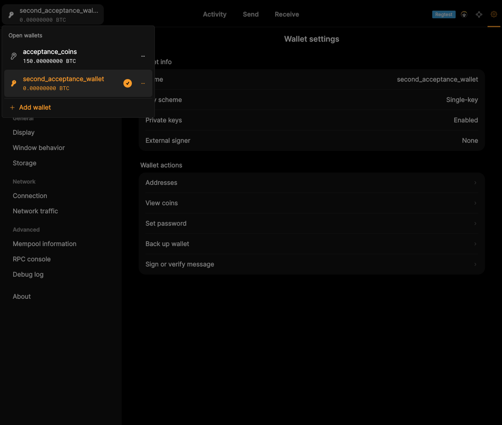

# F28 · Navigate the Application

[Evidence index](../README.md) · [Test results](../TEST-RESULTS.md) · [Capture and build provenance](../PROVENANCE.md)

5 acceptance criteria from the supported-feature inventory. **Acceptance is pending review.** A screenshot demonstrates the visible state; the stated assertions describe the behavior that was actually checked. Related passing suites do not certify every variant of a criterion.

## Implementation comparison

**Implemented.** Navigate wallets, balances/activity, sending, receiving, addresses, settings, and node tools. Switch wallets and use application menus and keyboard shortcuts for common actions.

[Application navigation](https://github.com/bitcoin-core/gui-qml/blob/a91f4b4774f25de061fe1a7c132a91ddde117fca/qml/pages/MainWindow.qml); [Menu actions and shortcuts](https://github.com/bitcoin-core/gui-qml/blob/a91f4b4774f25de061fe1a7c132a91ddde117fca/qml/components/DesktopMenuActions.qml).

## Application captures

| Qt Widgets (`src/qt`) | GUI-QML (`qt6`) |
| --- | --- |
|  Node information   Saved sending addresses |  Multiple wallets available   Wallet activity |

[All selected captures for this group](#capture-register) are listed below.

## Modules

- **Qt Widgets:** [primary implementation](https://github.com/bitcoin-core/gui/blob/f739c7876b81304bdc72e7eaa307702da269ac31/src/qt/bitcoingui.cpp#L253).
- **GUI-QML:** [Application navigation](https://github.com/bitcoin-core/gui-qml/blob/a91f4b4774f25de061fe1a7c132a91ddde117fca/qml/pages/MainWindow.qml); [Menu actions and shortcuts](https://github.com/bitcoin-core/gui-qml/blob/a91f4b4774f25de061fe1a7c132a91ddde117fca/qml/components/DesktopMenuActions.qml).

These are the implementation entry points for the criteria below. Links are pinned to the tested source revisions.

## Automated tests

| Application | Test/module | Recorded result |
| --- | --- | --- |
| GUI-QML | [qml_test_disablewallet_boot](https://github.com/bitcoin-core/gui-qml/blob/a91f4b4774f25de061fe1a7c132a91ddde117fca/test/functional/qml_test_disablewallet_boot.py) | [passed](../logs/qml_test_disablewallet_boot.log) |
| GUI-QML | [qml_test_wallet_selector_load](https://github.com/bitcoin-core/gui-qml/blob/a91f4b4774f25de061fe1a7c132a91ddde117fca/test/functional/qml_test_wallet_selector_load.py) | [passed](../logs/qml_test_wallet_selector_load.log) |
| GUI-QML C++ | [test/test_walletqmlcontroller.cpp](https://github.com/bitcoin-core/gui-qml/blob/a91f4b4774f25de061fe1a7c132a91ddde117fca/test/test_walletqmlcontroller.cpp) | [Suite passed](../logs/qml-unit-tests.log); fixture/model assertions |
| GUI-QML components | [test/qml/tst_desktopmenuactions.qml](https://github.com/bitcoin-core/gui-qml/blob/a91f4b4774f25de061fe1a7c132a91ddde117fca/test/qml/tst_desktopmenuactions.qml) | [Suite passed](../logs/qml-quick-tests.log); component assertions |
| GUI-QML components | [test/qml/tst_mainrouting.qml](https://github.com/bitcoin-core/gui-qml/blob/a91f4b4774f25de061fe1a7c132a91ddde117fca/test/qml/tst_mainrouting.qml) | [Suite passed](../logs/qml-quick-tests.log); component assertions |
| GUI-QML components | [test/qml/tst_settingsnavigation.qml](https://github.com/bitcoin-core/gui-qml/blob/a91f4b4774f25de061fe1a7c132a91ddde117fca/test/qml/tst_settingsnavigation.qml) | [Suite passed](../logs/qml-quick-tests.log); component assertions |
| Qt Widgets | [AppTests](https://github.com/bitcoin-core/gui/blob/f739c7876b81304bdc72e7eaa307702da269ac31/src/qt/test/apptests.cpp) | [Suite passed](../logs/widgets-qt-tests.log); inspect assertion scope |
| Qt Widgets additional | [Live GUI/RPC scenarios](../scripts/widgets_scenarios.py) | [Recorded assertions](../logs/widgets-checks.json); outcomes listed per criterion |

## Acceptance criteria

### F28.S01 · Move between wallet balances, payments, and transaction history.

| Application | Evidence status | Evidence and limits |
| --- | --- | --- |
| Qt Widgets | Visual evidence only | No targeted runtime assertion collected for this exact criterion. [Overview balances](../media/widgets/overview-balances.png) [Modules](#modules) · [Related tests](#automated-tests) |
| GUI-QML | Automated evidence collected | Functional payment and activity tests navigate the live application. [Wallet activity](../media/qml/qml_test_activity_filter_export/006-06-activity-shows-payment-request-and-mined-rows.png) [Modules](#modules) · [Related tests](#automated-tests) |

- [ ] Acceptance decision recorded by reviewer.

### F28.S02 · Switch between available wallets.

| Application | Evidence status | Evidence and limits |
| --- | --- | --- |
| Qt Widgets | Assertions collected | Selecting another wallet changes the application title. **passed**. [Restored wallet overview](../media/widgets/restored-wallet-overview.png) [Modules](#modules) · [Related tests](#automated-tests) |
| GUI-QML | Automated evidence collected | Wallet-selector scenarios switch between loaded wallets. [Multiple wallets available](../media/qml/qml_additional/032-multiple-loaded-wallets.png) [Modules](#modules) · [Related tests](#automated-tests) |

- [ ] Acceptance decision recorded by reviewer.

### F28.S03 · Access address records and node diagnostics.

| Application | Evidence status | Evidence and limits |
| --- | --- | --- |
| Qt Widgets | Visual evidence only | No targeted runtime assertion collected for this exact criterion. [Node information](../media/widgets/node-information.png) [Saved sending addresses](../media/widgets/saved-sending-addresses.png) [Modules](#modules) · [Related tests](#automated-tests) |
| GUI-QML | Automated evidence collected | Address, peer and diagnostic pages are opened by functional tests. No matching screenshot collected. [Modules](#modules) · [Related tests](#automated-tests) |

- [ ] Acceptance decision recorded by reviewer.

### F28.S04 · Reach common wallet and application tasks quickly.

| Application | Evidence status | Evidence and limits |
| --- | --- | --- |
| Qt Widgets | Visual evidence only | No targeted runtime assertion collected for this exact criterion. [Overview balances](../media/widgets/overview-balances.png) [Modules](#modules) · [Related tests](#automated-tests) |
| GUI-QML | Automated evidence collected | Menu actions have component tests. No matching screenshot collected. [Modules](#modules) · [Related tests](#automated-tests) |

- [ ] Acceptance decision recorded by reviewer.

### F28.S05 · Use keyboard shortcuts for navigation and common actions.

| Application | Evidence status | Evidence and limits |
| --- | --- | --- |
| Qt Widgets | Related automated suite | No targeted runtime assertion collected for this exact criterion. No matching screenshot collected. [Modules](#modules) · [Related tests](#automated-tests) |
| GUI-QML | Automated evidence collected | Keyboard shortcuts have desktop-menu component tests. No matching screenshot collected. [Modules](#modules) · [Related tests](#automated-tests) |

- [ ] Acceptance decision recorded by reviewer.

## Capture register

The original PNGs are unmodified application captures. Timestamps, dimensions and SHA-256 hashes are in the [capture manifest](../selected-captures.json). Some early/raw frames are not selected for review.

| Application | Capture | Criteria |
| --- | --- | --- |
| widgets | [Node information](../media/widgets/node-information.png) | F28.S03 |
| widgets | [Saved sending addresses](../media/widgets/saved-sending-addresses.png) | F28.S03 |
| widgets | [Overview balances](../media/widgets/overview-balances.png) | F28.S01, F28.S04 |
| widgets | [Restored wallet overview](../media/widgets/restored-wallet-overview.png) | F28.S02 |
| qml | [Multiple wallets available](../media/qml/qml_additional/032-multiple-loaded-wallets.png) | F28.S02 |
| qml | [Wallet activity](../media/qml/qml_test_activity_filter_export/006-06-activity-shows-payment-request-and-mined-rows.png) | F28.S01 |
