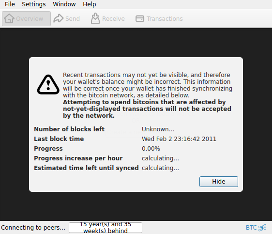
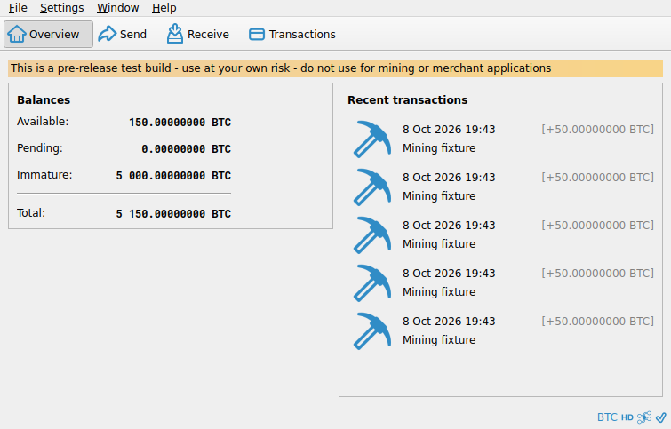
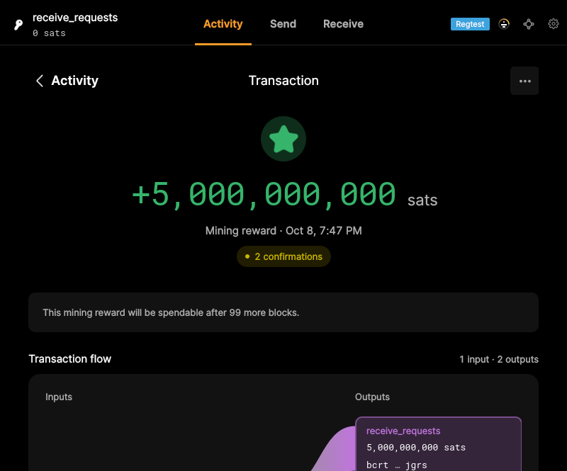
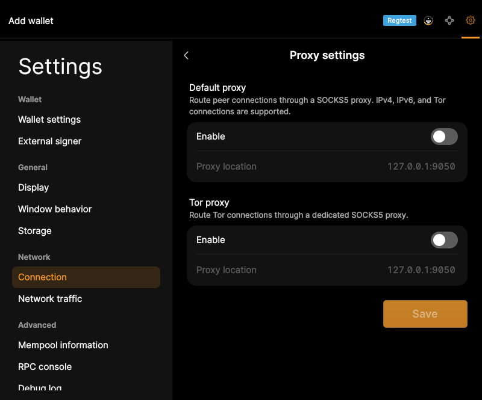

# F29 · View Application Status

[Evidence index](../README.md) · [Test results](../TEST-RESULTS.md) · [Capture and build provenance](../PROVENANCE.md)

6 acceptance criteria from the supported-feature inventory. **Acceptance is pending review.** A screenshot demonstrates the visible state; the stated assertions describe the behavior that was actually checked. Related passing suites do not certify every variant of a criterion.

## Implementation comparison

**Partial.** Show peer/network state, synchronization state, amount units, wallet type, and contextual guidance. Proxy configuration and encryption information are available in settings. Visible wallet locked/unlocked and key-generation status are missing.

[Wallet and node status](https://github.com/bitcoin-core/gui-qml/blob/a91f4b4774f25de061fe1a7c132a91ddde117fca/qml/pages/wallet/DesktopWallets.qml); [Wallet information](https://github.com/bitcoin-core/gui-qml/blob/a91f4b4774f25de061fe1a7c132a91ddde117fca/qml/pages/settings/WalletSectionPage.qml); [Proxy information](https://github.com/bitcoin-core/gui-qml/blob/a91f4b4774f25de061fe1a7c132a91ddde117fca/qml/pages/settings/ProxySettingsPage.qml).

## Application captures

| Qt Widgets (`src/qt`) | GUI-QML (`qt6`) |
| --- | --- |
|  Startup sync status   Wallet overview funded |  Transaction details   Proxy settings |

[All selected captures for this group](#capture-register) are listed below.

## Modules

- **Qt Widgets:** [primary implementation](https://github.com/bitcoin-core/gui/blob/f739c7876b81304bdc72e7eaa307702da269ac31/src/qt/bitcoingui.cpp).
- **GUI-QML:** [Wallet and node status](https://github.com/bitcoin-core/gui-qml/blob/a91f4b4774f25de061fe1a7c132a91ddde117fca/qml/pages/wallet/DesktopWallets.qml); [Wallet information](https://github.com/bitcoin-core/gui-qml/blob/a91f4b4774f25de061fe1a7c132a91ddde117fca/qml/pages/settings/WalletSectionPage.qml); [Proxy information](https://github.com/bitcoin-core/gui-qml/blob/a91f4b4774f25de061fe1a7c132a91ddde117fca/qml/pages/settings/ProxySettingsPage.qml).

These are the implementation entry points for the criteria below. Links are pinned to the tested source revisions.

## Automated tests

| Application | Test/module | Recorded result |
| --- | --- | --- |
| GUI-QML | [qml_test_blockclock](https://github.com/bitcoin-core/gui-qml/blob/a91f4b4774f25de061fe1a7c132a91ddde117fca/test/functional/qml_test_blockclock.py) | [passed](../logs/qml_test_blockclock.log) |
| GUI-QML | [qml_test_proxy](https://github.com/bitcoin-core/gui-qml/blob/a91f4b4774f25de061fe1a7c132a91ddde117fca/test/functional/qml_test_proxy.py) | [passed](../logs/qml_test_proxy.log) |
| GUI-QML | [qml_test_settings_display](https://github.com/bitcoin-core/gui-qml/blob/a91f4b4774f25de061fe1a7c132a91ddde117fca/test/functional/qml_test_settings_display.py) | [passed](../logs/qml_test_settings_display.log) |
| GUI-QML | [qml_test_password_wallet](https://github.com/bitcoin-core/gui-qml/blob/a91f4b4774f25de061fe1a7c132a91ddde117fca/test/functional/qml_test_password_wallet.py) | [passed](../logs/qml_test_password_wallet.log) |
| GUI-QML C++ | [test/test_networkstatusmodel.cpp](https://github.com/bitcoin-core/gui-qml/blob/a91f4b4774f25de061fe1a7c132a91ddde117fca/test/test_networkstatusmodel.cpp) | [Suite passed](../logs/qml-unit-tests.log); fixture/model assertions |
| GUI-QML C++ | [test/test_blockclockmodel.cpp](https://github.com/bitcoin-core/gui-qml/blob/a91f4b4774f25de061fe1a7c132a91ddde117fca/test/test_blockclockmodel.cpp) | [Suite passed](../logs/qml-unit-tests.log); fixture/model assertions |
| GUI-QML C++ | [test/test_qmlbitcoinunits.cpp](https://github.com/bitcoin-core/gui-qml/blob/a91f4b4774f25de061fe1a7c132a91ddde117fca/test/test_qmlbitcoinunits.cpp) | [Suite passed](../logs/qml-unit-tests.log); fixture/model assertions |
| GUI-QML components | [test/qml/tst_blockclock.qml](https://github.com/bitcoin-core/gui-qml/blob/a91f4b4774f25de061fe1a7c132a91ddde117fca/test/qml/tst_blockclock.qml) | [Suite passed](../logs/qml-quick-tests.log); component assertions |
| GUI-QML components | [test/qml/tst_settingsstatus.qml](https://github.com/bitcoin-core/gui-qml/blob/a91f4b4774f25de061fe1a7c132a91ddde117fca/test/qml/tst_settingsstatus.qml) | [Suite passed](../logs/qml-quick-tests.log); component assertions |
| Qt Widgets additional | [Live GUI/RPC scenarios](../scripts/widgets_scenarios.py) | [Recorded assertions](../logs/widgets-checks.json); outcomes listed per criterion |

## Acceptance criteria

### F29.S01 · Check connection count and whether networking is active.

| Application | Evidence status | Evidence and limits |
| --- | --- | --- |
| Qt Widgets | Assertions collected | The GUI network action pauses peer networking. **passed**. [Wallet overview funded](../media/widgets/wallet-overview-funded.png) [Overview balances](../media/widgets/overview-balances.png) [Network paused](../media/widgets/network-paused.png) [Modules](#modules) · [Related tests](#automated-tests) |
| GUI-QML | Automated evidence collected | Peer count and enabled/disabled network state have assertions. [Paused network status](../media/qml/qml_test_blockclock/002-click-blockclocktogglearea.png) [Modules](#modules) · [Related tests](#automated-tests) |

- [ ] Acceptance decision recorded by reviewer.

### F29.S02 · Understand synchronization progress and whether wallet information is current.

| Application | Evidence status | Evidence and limits |
| --- | --- | --- |
| Qt Widgets | Visual evidence only | No targeted runtime assertion collected for this exact criterion. [Startup sync status](../media/widgets/startup-sync-status.png) [Wallet overview funded](../media/widgets/wallet-overview-funded.png) [Overview balances](../media/widgets/overview-balances.png) [Modules](#modules) · [Related tests](#automated-tests) |
| GUI-QML | Automated evidence collected | Synchronization states have model/component tests. No matching screenshot collected. [Modules](#modules) · [Related tests](#automated-tests) |

- [ ] Acceptance decision recorded by reviewer.

### F29.S03 · Check whether a proxy is in use.

| Application | Evidence status | Evidence and limits |
| --- | --- | --- |
| Qt Widgets | Visual evidence only | No targeted runtime assertion collected for this exact criterion. [Preferences network](../media/widgets/preferences-network.png) [Modules](#modules) · [Related tests](#automated-tests) |
| GUI-QML | Automated evidence collected | Proxy settings and feedback are captured. [Proxy settings](../media/qml/qml_test_proxy/005-wait-for-page-proxysettingspage.png) [Modules](#modules) · [Related tests](#automated-tests) |

- [ ] Acceptance decision recorded by reviewer.

### F29.S04 · Check wallet encryption, lock, and key-generation status.

| Application | Evidence status | Evidence and limits |
| --- | --- | --- |
| Qt Widgets | Visual evidence only | No targeted runtime assertion collected for this exact criterion. [Encrypted wallet status](../media/widgets/encrypted-wallet-status.png) [Modules](#modules) · [Related tests](#automated-tests) |
| GUI-QML | Partial / limited evidence | Encryption and wallet type are visible; live lock and key-generation status are missing. No matching screenshot collected. [Modules](#modules) · [Related tests](#automated-tests) |

- [ ] Acceptance decision recorded by reviewer.

### F29.S05 · Choose the denomination used to display amounts.

| Application | Evidence status | Evidence and limits |
| --- | --- | --- |
| Qt Widgets | Visual evidence only | No targeted runtime assertion collected for this exact criterion. [Wallet overview funded](../media/widgets/wallet-overview-funded.png) [Modules](#modules) · [Related tests](#automated-tests) |
| GUI-QML | Automated evidence collected | BTC/satoshi display changes are exercised and persisted. [Transaction details](../media/qml/qml_test_activity_filter_export/030-30-activity-details-amount-uses-selected-display-unit.png) [Modules](#modules) · [Related tests](#automated-tests) |

- [ ] Acceptance decision recorded by reviewer.

### F29.S06 · Understand available actions through contextual guidance.

| Application | Evidence status | Evidence and limits |
| --- | --- | --- |
| Qt Widgets | Source only | No targeted runtime assertion collected for this exact criterion. No matching screenshot collected. [Modules](#modules) · [Related tests](#automated-tests) |
| GUI-QML | Automated evidence collected | Guidance components have QML tests; comprehensive usability is not asserted. No matching screenshot collected. [Modules](#modules) · [Related tests](#automated-tests) |

- [ ] Acceptance decision recorded by reviewer.

## Capture register

The original PNGs are unmodified application captures. Timestamps, dimensions and SHA-256 hashes are in the [capture manifest](../selected-captures.json). Some early/raw frames are not selected for review.

| Application | Capture | Criteria |
| --- | --- | --- |
| widgets | [Startup sync status](../media/widgets/startup-sync-status.png) | F29.S02 |
| widgets | [Wallet overview funded](../media/widgets/wallet-overview-funded.png) | F29.S01, F29.S02, F29.S05 |
| widgets | [Preferences network](../media/widgets/preferences-network.png) | F29.S03 |
| widgets | [Encrypted wallet status](../media/widgets/encrypted-wallet-status.png) | F29.S04 |
| widgets | [Overview balances](../media/widgets/overview-balances.png) | F29.S01, F29.S02 |
| widgets | [Network paused](../media/widgets/network-paused.png) | F29.S01 |
| qml | [Transaction details](../media/qml/qml_test_activity_filter_export/030-30-activity-details-amount-uses-selected-display-unit.png) | F29.S05 |
| qml | [Proxy settings](../media/qml/qml_test_proxy/005-wait-for-page-proxysettingspage.png) | F29.S03 |
| qml | [Paused network status](../media/qml/qml_test_blockclock/002-click-blockclocktogglearea.png) | F29.S01 |
