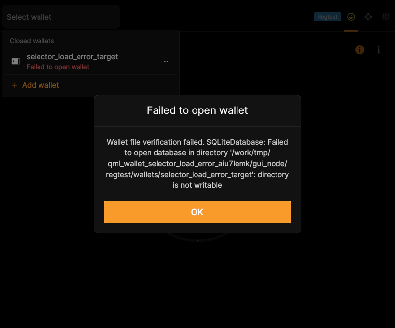
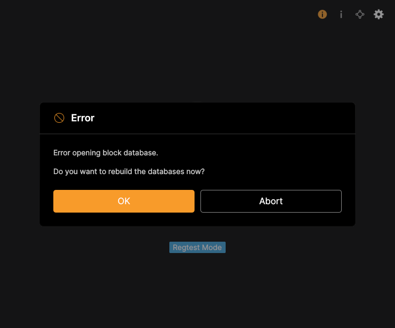

# F30 · Show Progress, Errors, and Confirmations

[Evidence index](../README.md) · [Test results](../TEST-RESULTS.md) · [Capture and build provenance](../PROVENANCE.md)

7 acceptance criteria from the supported-feature inventory. **Acceptance is pending review.** A screenshot demonstrates the visible state; the stated assertions describe the behavior that was actually checked. Related passing suites do not certify every variant of a criterion.

## Implementation comparison

**Partial.** Show node warnings/errors/questions, wallet-operation feedback, confirmations, busy states, and background synchronization with progress and estimated remaining time. General wallet-operation/rescan progress reporting and an explicit synchronization processing-rate display are missing.

[Runtime messages](https://github.com/bitcoin-core/gui-qml/blob/a91f4b4774f25de061fe1a7c132a91ddde117fca/qml/models/nodemodel.cpp#L590); [Synchronization feedback](https://github.com/bitcoin-core/gui-qml/blob/a91f4b4774f25de061fe1a7c132a91ddde117fca/qml/components/BlockClock.qml); [Application dialogs](https://github.com/bitcoin-core/gui-qml/blob/a91f4b4774f25de061fe1a7c132a91ddde117fca/qml/pages/MainWindow.qml).

## Application captures

| Qt Widgets (`src/qt`) | GUI-QML (`qt6`) |
| --- | --- |
|  Startup sync status   Encryption confirmation |  Wallet-load error   Runtime confirmation dialog |

## Modules

- **Qt Widgets:** [primary implementation](https://github.com/bitcoin-core/gui/blob/f739c7876b81304bdc72e7eaa307702da269ac31/src/qt/bitcoingui.cpp#L1286).
  [Synchronization feedback](https://github.com/bitcoin-core/gui/blob/f739c7876b81304bdc72e7eaa307702da269ac31/src/qt/modaloverlay.cpp).
- **GUI-QML:** [Runtime messages](https://github.com/bitcoin-core/gui-qml/blob/a91f4b4774f25de061fe1a7c132a91ddde117fca/qml/models/nodemodel.cpp#L590); [Synchronization feedback](https://github.com/bitcoin-core/gui-qml/blob/a91f4b4774f25de061fe1a7c132a91ddde117fca/qml/components/BlockClock.qml); [Application dialogs](https://github.com/bitcoin-core/gui-qml/blob/a91f4b4774f25de061fe1a7c132a91ddde117fca/qml/pages/MainWindow.qml).

These are the implementation entry points for the criteria below. Links are pinned to the tested source revisions.

## Automated tests

| Application | Test/module | Recorded result |
| --- | --- | --- |
| GUI-QML | [qml_test_node_runtime_dialogs](https://github.com/bitcoin-core/gui-qml/blob/a91f4b4774f25de061fe1a7c132a91ddde117fca/test/functional/qml_test_node_runtime_dialogs.py) | [passed](../logs/qml_test_node_runtime_dialogs.log) |
| GUI-QML | [qml_test_blockclock](https://github.com/bitcoin-core/gui-qml/blob/a91f4b4774f25de061fe1a7c132a91ddde117fca/test/functional/qml_test_blockclock.py) | [passed](../logs/qml_test_blockclock.log) |
| GUI-QML | [qml_test_wallet_restore](https://github.com/bitcoin-core/gui-qml/blob/a91f4b4774f25de061fe1a7c132a91ddde117fca/test/functional/qml_test_wallet_restore.py) | [passed](../logs/qml_test_wallet_restore.log) |
| GUI-QML C++ | [test/test_nodemodel.cpp](https://github.com/bitcoin-core/gui-qml/blob/a91f4b4774f25de061fe1a7c132a91ddde117fca/test/test_nodemodel.cpp) | [Suite passed](../logs/qml-unit-tests.log); fixture/model assertions |
| GUI-QML C++ | [test/test_syncprogresstracker.cpp](https://github.com/bitcoin-core/gui-qml/blob/a91f4b4774f25de061fe1a7c132a91ddde117fca/test/test_syncprogresstracker.cpp) | [Suite passed](../logs/qml-unit-tests.log); fixture/model assertions |
| GUI-QML components | [test/qml/tst_nodefeedback.qml](https://github.com/bitcoin-core/gui-qml/blob/a91f4b4774f25de061fe1a7c132a91ddde117fca/test/qml/tst_nodefeedback.qml) | [Suite passed](../logs/qml-quick-tests.log); component assertions |
| GUI-QML components | [test/qml/tst_blockclock.qml](https://github.com/bitcoin-core/gui-qml/blob/a91f4b4774f25de061fe1a7c132a91ddde117fca/test/qml/tst_blockclock.qml) | [Suite passed](../logs/qml-quick-tests.log); component assertions |
| Qt Widgets | [AppTests](https://github.com/bitcoin-core/gui/blob/f739c7876b81304bdc72e7eaa307702da269ac31/src/qt/test/apptests.cpp) | [Suite passed](../logs/widgets-qt-tests.log); inspect assertion scope |

## Acceptance criteria

### F30.S01 · Understand operation results, warnings, and errors.

| Application | Evidence status | Evidence and limits |
| --- | --- | --- |
| Qt Widgets | Related automated suite | No targeted runtime assertion collected for this exact criterion. No matching screenshot collected. [Modules](#modules) · [Related tests](#automated-tests) |
| GUI-QML | Automated evidence collected | Live test-bridge messages exercise information, warning and error dialogs. [Wallet-load error](../media/qml/qml_test_wallet_selector_load/008-03-load-error-alert-popup-displayed.png) [Runtime confirmation dialog](../media/qml/qml_test_node_runtime_dialogs/003-reindex-question-ok-abort.png) [Modules](#modules) · [Related tests](#automated-tests) |

- [ ] Acceptance decision recorded by reviewer.

### F30.S02 · Review important decisions before committing to an action.

| Application | Evidence status | Evidence and limits |
| --- | --- | --- |
| Qt Widgets | Visual evidence only | No targeted runtime assertion collected for this exact criterion. [Encryption confirmation](../media/widgets/encryption-confirmation.png) [Modules](#modules) · [Related tests](#automated-tests) |
| GUI-QML | Automated evidence collected | Confirmation responses are returned to the caller. [Runtime confirmation dialog](../media/qml/qml_test_node_runtime_dialogs/003-reindex-question-ok-abort.png) [Modules](#modules) · [Related tests](#automated-tests) |

- [ ] Acceptance decision recorded by reviewer.

### F30.S03 · Inspect additional diagnostic information when available.

| Application | Evidence status | Evidence and limits |
| --- | --- | --- |
| Qt Widgets | Related automated suite | No targeted runtime assertion collected for this exact criterion. No matching screenshot collected. [Modules](#modules) · [Related tests](#automated-tests) |
| GUI-QML | Automated evidence collected | Dialog details and wallet restore diagnostic text are tested. [Wallet-load error](../media/qml/qml_test_wallet_selector_load/008-03-load-error-alert-popup-displayed.png) [Runtime confirmation dialog](../media/qml/qml_test_node_runtime_dialogs/003-reindex-question-ok-abort.png) [Modules](#modules) · [Related tests](#automated-tests) |

- [ ] Acceptance decision recorded by reviewer.

### F30.S04 · Receive a prompt when an operation requires attention.

| Application | Evidence status | Evidence and limits |
| --- | --- | --- |
| Qt Widgets | Related automated suite | No targeted runtime assertion collected for this exact criterion. No matching screenshot collected. [Modules](#modules) · [Related tests](#automated-tests) |
| GUI-QML | Automated evidence collected | Blocking questions receive the selected user answer. [Wallet-load error](../media/qml/qml_test_wallet_selector_load/008-03-load-error-alert-popup-displayed.png) [Runtime confirmation dialog](../media/qml/qml_test_node_runtime_dialogs/003-reindex-question-ok-abort.png) [Modules](#modules) · [Related tests](#automated-tests) |

- [ ] Acceptance decision recorded by reviewer.

### F30.S05 · Track long-running operations.

| Application | Evidence status | Evidence and limits |
| --- | --- | --- |
| Qt Widgets | Related automated suite | No targeted runtime assertion collected for this exact criterion. No matching screenshot collected. [Modules](#modules) · [Related tests](#automated-tests) |
| GUI-QML | Partial / limited evidence | Busy states and node synchronization are supported; general wallet/rescan progress is missing. No matching screenshot collected. [Modules](#modules) · [Related tests](#automated-tests) |

- [ ] Acceptance decision recorded by reviewer.

### F30.S06 · Assess synchronization progress, processing rate, and estimated remaining work.

| Application | Evidence status | Evidence and limits |
| --- | --- | --- |
| Qt Widgets | Visual evidence only | No targeted runtime assertion collected for this exact criterion. [Startup sync status](../media/widgets/startup-sync-status.png) [Modules](#modules) · [Related tests](#automated-tests) |
| GUI-QML | Partial / limited evidence | Synchronization progress/ETA is available; an explicit processing-rate display is missing. No matching screenshot collected. [Modules](#modules) · [Related tests](#automated-tests) |

- [ ] Acceptance decision recorded by reviewer.

### F30.S07 · Monitor background synchronization while retaining access to the application.

| Application | Evidence status | Evidence and limits |
| --- | --- | --- |
| Qt Widgets | Related automated suite | No targeted runtime assertion collected for this exact criterion. No matching screenshot collected. [Modules](#modules) · [Related tests](#automated-tests) |
| GUI-QML | Automated evidence collected | Block-clock and shell remain available during synchronization. No matching screenshot collected. [Modules](#modules) · [Related tests](#automated-tests) |

- [ ] Acceptance decision recorded by reviewer.

## Capture register

The original PNGs are unmodified application captures. Timestamps, dimensions and SHA-256 hashes are in the [capture manifest](../selected-captures.json). Some early/raw frames are not selected for review.

| Application | Capture | Criteria |
| --- | --- | --- |
| widgets | [Startup sync status](../media/widgets/startup-sync-status.png) | F30.S06 |
| widgets | [Encryption confirmation](../media/widgets/encryption-confirmation.png) | F30.S02 |
| qml | [Wallet-load error](../media/qml/qml_test_wallet_selector_load/008-03-load-error-alert-popup-displayed.png) | F30.S01, F30.S03, F30.S04 |
| qml | [Runtime confirmation dialog](../media/qml/qml_test_node_runtime_dialogs/003-reindex-question-ok-abort.png) | F30.S01, F30.S02, F30.S03, F30.S04 |
