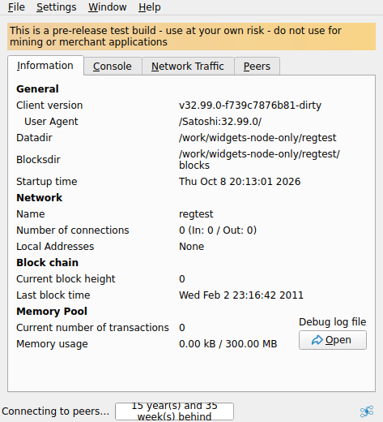
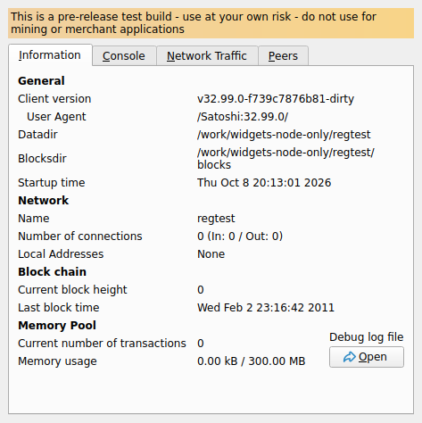
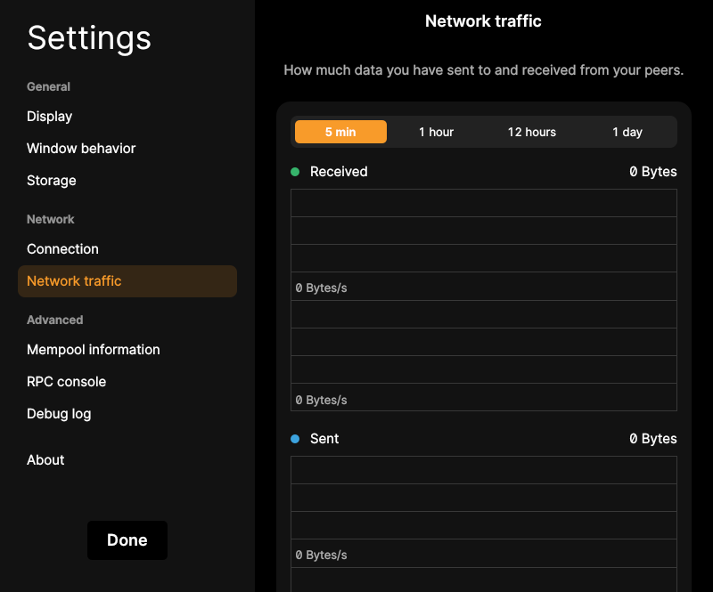
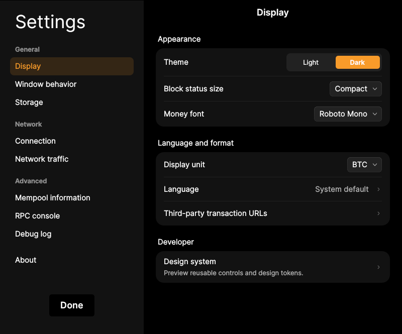

# F33 · Run with Wallet Functionality Disabled

[Evidence index](../README.md) · [Test results](../TEST-RESULTS.md) · [Capture and build provenance](../PROVENANCE.md)

3 acceptance criteria from the supported-feature inventory. **Acceptance is pending review.** A screenshot demonstrates the visible state; the stated assertions describe the behavior that was actually checked. Related passing suites do not certify every variant of a criterion.

## Implementation comparison

**Implemented.** Runtime wallet-disabled mode retains node operation, networking, traffic, diagnostics, settings, and the application shell while hiding wallet workflows.

[Wallet-disabled startup](https://github.com/bitcoin-core/gui-qml/blob/a91f4b4774f25de061fe1a7c132a91ddde117fca/qml/bitcoin.cpp); [Wallet-disabled test cases](https://github.com/bitcoin-core/gui-qml/blob/a91f4b4774f25de061fe1a7c132a91ddde117fca/test/functional/qml_test_disablewallet_boot.py).

## Application captures

| Qt Widgets (`src/qt`) | GUI-QML (`qt6`) |
| --- | --- |
|  Node only shell   Node only diagnostics |  Network traffic   Node settings without a wallet |

Baseline support notes: *Support: Wallet screens and graphical PSBT workflows require wallet functionality to be enabled. Leaving wallets closed is a separate supported mode.*

[All selected captures for this group](#capture-register) are listed below.

## Modules

- **Qt Widgets:** [primary implementation](https://github.com/bitcoin-core/gui/blob/f739c7876b81304bdc72e7eaa307702da269ac31/src/qt/bitcoingui.cpp).
- **GUI-QML:** [Wallet-disabled startup](https://github.com/bitcoin-core/gui-qml/blob/a91f4b4774f25de061fe1a7c132a91ddde117fca/qml/bitcoin.cpp); [Wallet-disabled test cases](https://github.com/bitcoin-core/gui-qml/blob/a91f4b4774f25de061fe1a7c132a91ddde117fca/test/functional/qml_test_disablewallet_boot.py).

These are the implementation entry points for the criteria below. Links are pinned to the tested source revisions.

## Automated tests

| Application | Test/module | Recorded result |
| --- | --- | --- |
| GUI-QML | [qml_test_disablewallet_boot](https://github.com/bitcoin-core/gui-qml/blob/a91f4b4774f25de061fe1a7c132a91ddde117fca/test/functional/qml_test_disablewallet_boot.py) | [passed](../logs/qml_test_disablewallet_boot.log) |
| GUI-QML C++ | [test/test_guiargs.cpp](https://github.com/bitcoin-core/gui-qml/blob/a91f4b4774f25de061fe1a7c132a91ddde117fca/test/test_guiargs.cpp) | [Suite passed](../logs/qml-unit-tests.log); fixture/model assertions |
| GUI-QML C++ | [test/test_options_model.cpp](https://github.com/bitcoin-core/gui-qml/blob/a91f4b4774f25de061fe1a7c132a91ddde117fca/test/test_options_model.cpp) | [Suite passed](../logs/qml-unit-tests.log); fixture/model assertions |
| GUI-QML components | [test/qml/tst_mainrouting.qml](https://github.com/bitcoin-core/gui-qml/blob/a91f4b4774f25de061fe1a7c132a91ddde117fca/test/qml/tst_mainrouting.qml) | [Suite passed](../logs/qml-quick-tests.log); component assertions |
| Qt Widgets | [AppTests](https://github.com/bitcoin-core/gui/blob/f739c7876b81304bdc72e7eaa307702da269ac31/src/qt/test/apptests.cpp) | [Suite passed](../logs/widgets-qt-tests.log); inspect assertion scope |
| Qt Widgets additional | [Live GUI/RPC scenarios](../scripts/widgets_scenarios.py) | [Recorded assertions](../logs/widgets-checks.json); outcomes listed per criterion |

## Acceptance criteria

### F33.S01 · Operate a node independently of wallet functionality.

| Application | Evidence status | Evidence and limits |
| --- | --- | --- |
| Qt Widgets | Assertions collected | Node RPC remains available with wallet functionality disabled. **passed**. [Node only shell](../media/widgets/node-only-shell.png) [Modules](#modules) · [Related tests](#automated-tests) |
| GUI-QML | Automated evidence collected | Runtime wallet-disabled startup reaches the node UI. [Node running with wallet features disabled](../media/qml/qml_test_disablewallet_boot/002-02-node-only-main-screen-reached.png) [Modules](#modules) · [Related tests](#automated-tests) |

- [ ] Acceptance decision recorded by reviewer.

### F33.S02 · Manage node information, networking, traffic, and diagnostics.

| Application | Evidence status | Evidence and limits |
| --- | --- | --- |
| Qt Widgets | Assertions collected | Node diagnostics open in wallet-disabled mode. **passed**. [Node only diagnostics](../media/widgets/node-only-diagnostics.png) [Modules](#modules) · [Related tests](#automated-tests) |
| GUI-QML | Automated evidence collected | Peer, traffic, log and diagnostic pages remain reachable. [Network traffic](../media/qml/qml_test_disablewallet_boot/017-17-network-traffic-settings-opened.png) [Node settings without a wallet](../media/qml/qml_test_disablewallet_boot/005-05-node-settings-opened-without-wallet-ui.png) [Modules](#modules) · [Related tests](#automated-tests) |

- [ ] Acceptance decision recorded by reviewer.

### F33.S03 · Retain application preferences and desktop integration without wallet features.

| Application | Evidence status | Evidence and limits |
| --- | --- | --- |
| Qt Widgets | Assertions collected | The wallet-disabled Widgets process shuts down successfully. **passed**. [Node only shell](../media/widgets/node-only-shell.png) [Node only preferences](../media/widgets/node-only-preferences.png) [Modules](#modules) · [Related tests](#automated-tests) |
| GUI-QML | Automated evidence collected | Preferences and application shell remain usable without wallet controls. [Node settings without a wallet](../media/qml/qml_test_disablewallet_boot/005-05-node-settings-opened-without-wallet-ui.png) [Modules](#modules) · [Related tests](#automated-tests) |

- [ ] Acceptance decision recorded by reviewer.

## Capture register

The original PNGs are unmodified application captures. Timestamps, dimensions and SHA-256 hashes are in the [capture manifest](../selected-captures.json). Some early/raw frames are not selected for review.

| Application | Capture | Criteria |
| --- | --- | --- |
| widgets | [Node only shell](../media/widgets/node-only-shell.png) | F33.S01, F33.S03 |
| widgets | [Node only diagnostics](../media/widgets/node-only-diagnostics.png) | F33.S02 |
| widgets | [Node only preferences](../media/widgets/node-only-preferences.png) | F33.S03 |
| qml | [Network traffic](../media/qml/qml_test_disablewallet_boot/017-17-network-traffic-settings-opened.png) | F33.S02 |
| qml | [Node settings without a wallet](../media/qml/qml_test_disablewallet_boot/005-05-node-settings-opened-without-wallet-ui.png) | F33.S02, F33.S03 |
| qml | [Node running with wallet features disabled](../media/qml/qml_test_disablewallet_boot/002-02-node-only-main-screen-reached.png) | F33.S01 |
